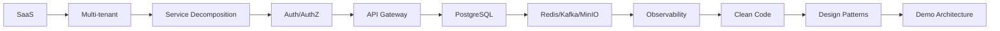
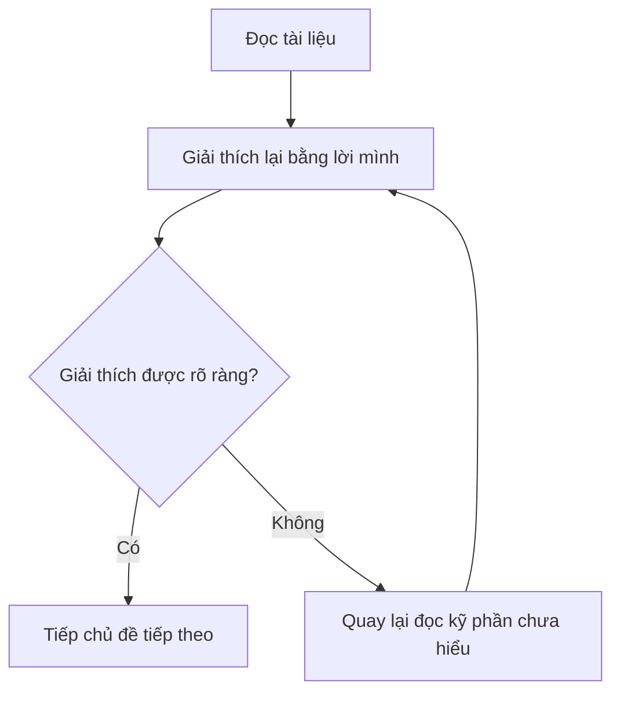

# 📖 Hướng dẫn đọc tài liệu

## Mục đích

Tài liệu này giúp bạn biết cách đọc, sử dụng, và duy trì bộ tài liệu học tập Phase 1 một cách hiệu quả nhất.

---

## Nguyên tắc đọc

### 1. Đọc theo thứ tự, không nhảy cóc

Các thư mục được đánh số từ `00` đến `21` theo thứ tự khuyến nghị. Mỗi chủ đề sau xây dựng trên nền tảng của chủ đề trước.



### 2. Mỗi thư mục = một chủ đề hoàn chỉnh

Trong mỗi thư mục, các file thường được tổ chức theo pattern:

| Thứ tự | Nội dung | Mục đích |
|--------|----------|----------|
| `01-*` | Khái niệm cơ bản | Hiểu "cái gì" |
| `02-*` | So sánh / alternatives | Hiểu "tại sao cái này, không phải cái khác" |
| `03-*` | Trade-off & phân tích | Hiểu "đánh đổi gì" |
| `04-*` | Áp dụng vào demo | Biết "làm cụ thể thế nào" |

### 3. Luôn kết hợp đọc với tự đặt câu hỏi

Sau khi đọc xong một chủ đề:
1. Mở file câu hỏi tương ứng ở `18-ngan-hang-cau-hoi/`
2. Tự trả lời **trước khi** xem đáp án
3. So sánh với đáp án ở `19-dap-an/`

### 4. Ghi chép lại những gì học được

Sử dụng template ở `21-mau-ghi-chu/` để ghi lại:
- Điều mới học được
- Điều bất ngờ / khác dự đoán
- Câu hỏi chưa giải đáp được → ghi vào `20-ghi-chu-xac-nhan-mentor/`

---

## Cách đọc hiệu quả nhất

### Phương pháp Feynman áp dụng



### Checklist sau mỗi chủ đề

- [ ] Tôi có thể giải thích khái niệm này cho người khác không?
- [ ] Tôi biết tại sao chọn phương án này thay vì phương án khác không?
- [ ] Tôi hiểu trade-off không?
- [ ] Tôi biết áp dụng vào demo Phase 1 như thế nào không?
- [ ] Tôi đã tự trả lời câu hỏi tự học chưa?

---

## Lộ trình đọc theo tuần

### Tuần 1: Nền tảng tư duy
- Ngày 1–2: `01-tong-quan-phase-1/` + `02-saas/`
- Ngày 3–5: `03-multi-tenant/` (đọc kỹ, đây là chủ đề cốt lõi)

### Tuần 2: Kiến trúc hệ thống
- Ngày 1–2: `04-phan-tach-service/`
- Ngày 3–4: `05-auth-authz-rbac/`
- Ngày 5: `06-api-gateway-kong/`

### Tuần 3: Công nghệ nền tảng
- Ngày 1–2: `07-postgresql-data-modeling/`
- Ngày 3: `08-redis-cache/`
- Ngày 4: `09-kafka-async/`
- Ngày 5: `10-minio-file-storage/`

### Tuần 4: Vận hành & chất lượng
- Ngày 1–2: `11-observability/`
- Ngày 3–4: `12-clean-code-conventions/`
- Ngày 5: `13-design-patterns/`

### Tuần 5–6: Thiết kế & xây demo
- `14-react-cho-demo/` + `15-kien-truc-demo-phase-1/` + `16-lo-trinh-thuc-hien/`
- Song song: bắt đầu code demo

### Xuyên suốt
- `17-tu-duy-kien-truc/` — đọc lại mỗi khi cần suy luận
- `18-ngan-hang-cau-hoi/` + `19-dap-an/` — sau mỗi chủ đề
- `21-mau-ghi-chu/` — ghi chép hàng ngày

---

## Quy ước khi cập nhật tài liệu

1. **Không sửa nội dung gốc** — thêm ghi chú bằng blockquote:
   ```markdown
   > 📝 **Ghi chú cá nhân (ngày XX/XX):** ...
   ```

2. **Đánh dấu tiến độ** bằng emoji:
   - ✅ Đã đọc và hiểu
   - 🔄 Đang đọc
   - ❓ Chưa hiểu, cần hỏi mentor
   - 🔗 Cần liên kết thêm tài liệu

3. **Commit thường xuyên** vào Git với message rõ ràng:
   ```
   docs: hoàn thành đọc multi-tenant isolation models
   docs: thêm ghi chú cá nhân về tenant_id strategy
   ```
