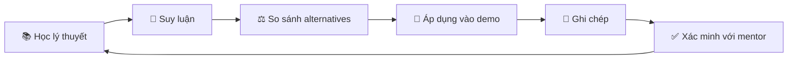
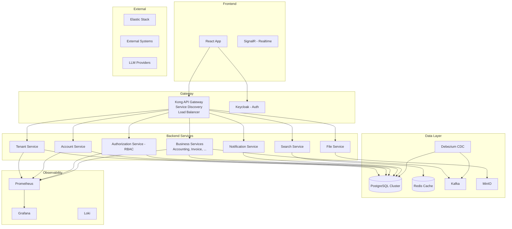

# 🎯 Tổng quan Phase 1

## Mục đích Phase 1

Phase 1 là giai đoạn **xây dựng nền tảng kỹ thuật** trước khi đi vào nghiệp vụ kế toán chuyên sâu.

Sau Phase 1, bạn cần đạt được:
- Hiểu sâu các khái niệm nền tảng: SaaS, multi-tenant, microservices
- Biết lựa chọn công nghệ và giải thích **tại sao**
- Xây được một demo backend + frontend đơn giản nhưng có kiến trúc rõ ràng
- Hình thành tư duy kiến trúc: biết so sánh, đánh đổi, lập luận

---

## Kỳ vọng từ mentor

Mentor muốn bạn:

### 1. Không chỉ "biết dùng" mà phải "hiểu tại sao"
- Với mỗi quyết định kỹ thuật, phải trả lời được:
  - Tại sao chọn cái này?
  - Có lựa chọn nào khác?
  - Trong điều kiện nào thì lựa chọn này hợp lý?
  - Lý thuyết nào hỗ trợ quyết định này?

### 2. Tự học, tự suy luận, rồi mới xác nhận
- Đọc lý thuyết → tự trả lời câu hỏi → kiểm chứng đáp án → hỏi mentor
- Không hỏi trước khi suy nghĩ

### 3. Multi-tenant phải hiểu sâu theo nhiều tầng
- Ban đầu: tenant chỉ là một bản ghi (`tenant_id` trong bảng)
- Sau: tenant có thể là một schema riêng
- Sau nữa: tenant có thể là một database riêng
- Mỗi lựa chọn có trade-off riêng

### 4. Ghi chép liên tục
- Mọi thứ học được phải được document
- Repo tài liệu phải được duy trì xuyên suốt

### 5. Demo xây dần, theo từng chủ đề
- Không cố xây hết cùng lúc
- Mỗi tuần thêm một layer mới

---

## Phạm vi Phase 1

### ✅ Trong scope

| Chủ đề | Mức độ |
|--------|--------|
| SaaS concepts | Hiểu sâu |
| Multi-tenant design | Hiểu rất sâu |
| Service decomposition | Hiểu + so sánh |
| Auth / AuthZ / RBAC | Hiểu + implement đơn giản |
| API Gateway (Kong) | Hiểu concept + có thể implement cơ bản |
| PostgreSQL + data modeling | Hiểu + implement |
| Redis | Hiểu concept + demo cơ bản |
| Kafka | Hiểu concept |
| MinIO | Hiểu concept |
| Prometheus + Grafana | Hiểu concept + setup cơ bản |
| Clean code / conventions | Áp dụng trong demo |
| Design patterns | Hiểu + áp dụng phù hợp |
| React (cơ bản) | Đủ dùng cho demo |
| Backend demo | Spring Boot + PostgreSQL |

### ❌ Ngoài scope Phase 1

- Nghiệp vụ kế toán chuyên sâu (hạch toán, bút toán, sổ cái...)
- Production deployment
- Performance optimization nâng cao
- CI/CD pipeline phức tạp
- Debezium / CDC thực tế
- AI Agents integration
- Elastic search nâng cao

---

## Triết lý học tập

### Tại sao triết lý này quan trọng?

1. **Học lý thuyết** → Tạo nền tảng kiến thức
2. **Suy luận** → Biến kiến thức thành hiểu biết
3. **So sánh** → Phát triển khả năng phân biệt tốt/xấu trong context
4. **Áp dụng** → Kiểm chứng hiểu biết qua thực hành
5. **Ghi chép** → Cố định kiến thức, dễ tra cứu lại
6. **Xác minh** → Đảm bảo không hiểu sai hướng

---

## Thành công cuối Phase 1 trông như thế nào?

### Về kiến thức
- [ ] Giải thích được SaaS, multi-tenant cho người khác
- [ ] Phân biệt được 3 mô hình tenant isolation, biết khi nào dùng cái nào
- [ ] Lập luận được khi nào tách service, khi nào không
- [ ] Hiểu flow: request → gateway → auth → service → DB → response

### Về demo
- [ ] Backend Spring Boot chạy được
- [ ] PostgreSQL với data model multi-tenant (tenant_id)
- [ ] Login + JWT authentication
- [ ] RBAC đơn giản
- [ ] 1 module CRUD master-data với search
- [ ] Frontend React kết nối backend
- [ ] Mock data ~10 tenants

### Về tư duy
- [ ] Với mỗi quyết định, trả lời được "tại sao?"
- [ ] Với mỗi công nghệ, biết alternatives và trade-offs
- [ ] Có thói quen ghi chép và so sánh
- [ ] Sẵn sàng trình bày và thảo luận với mentor

---

## Kiến trúc hệ thống thực tế (để tham khảo)

Kiến trúc target (production) bao gồm:

> ⚠️ **Lưu ý:** Kiến trúc trên là **kiến trúc đích**. Demo Phase 1 sẽ đơn giản hơn rất nhiều. Xem chi tiết ở [`15-kien-truc-demo-phase-1/`](../15-kien-truc-demo-phase-1/).
