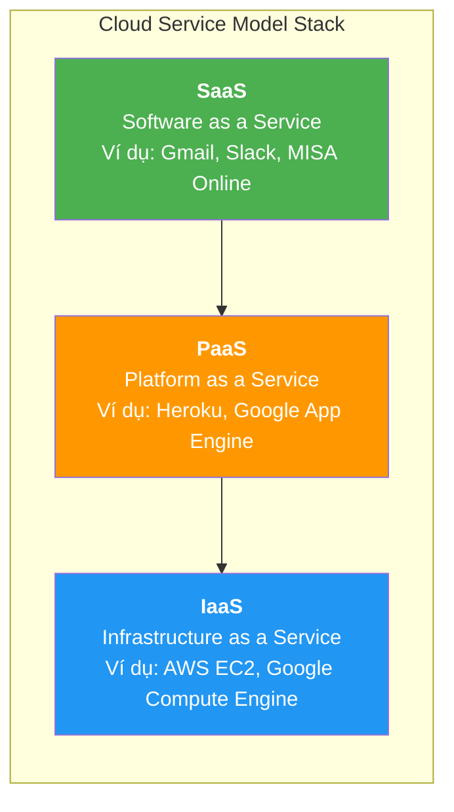
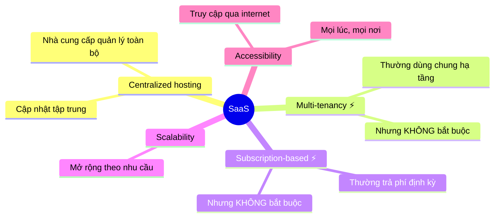
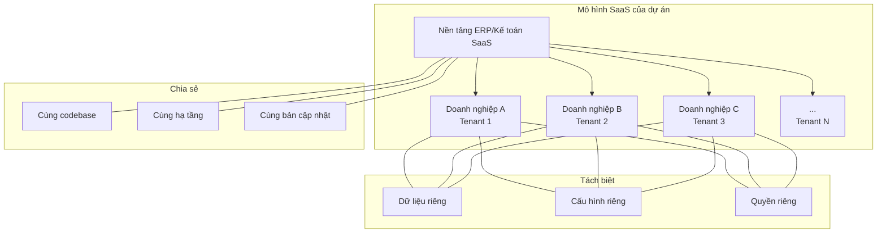

# ☁️ SaaS — Khái niệm cơ bản

## SaaS là gì?

**SaaS (Software as a Service)** là mô hình **phân phối phần mềm** (delivery model) trong đó:
- **Nhà cung cấp** chịu trách nhiệm vận hành, bảo trì, cập nhật phần mềm
- Phần mềm được **host bởi nhà cung cấp** (trên cloud hoặc data center riêng của họ)
- Khách hàng **truy cập qua internet** (thường qua trình duyệt)
- Khách hàng **không cài đặt** phần mềm trên máy tính / server của mình

> 🔑 **Điểm cốt lõi:** Khách hàng **dùng phần mềm như dịch vụ** — không sở hữu, không vận hành, không triển khai. Nhà cung cấp lo toàn bộ phần "chạy" phần mềm.

### Ví dụ thực tế quen thuộc
- **Google Workspace** (Docs, Sheets, Gmail)
- **Slack** — chat nhóm
- **Notion** — quản lý tài liệu
- **MISA Online** — phần mềm kế toán SaaS tại Việt Nam
- **Salesforce** — CRM

---

## SaaS trong cloud service model stack

SaaS **không phải là "cloud" nói chung**. Nó là 1 tầng cụ thể trong cloud service model:

| Tầng | Nhà cung cấp lo | Khách hàng lo |
|------|-----------------|---------------|
| **IaaS** | Hardware, network, virtualization | OS, runtime, app, data |
| **PaaS** | + OS, runtime, middleware | App, data |
| **SaaS** | **Tất cả** (cả ứng dụng) | Chỉ sử dụng + cấu hình |

> 📌 Dự án kế toán Viettel: mình đang **xây sản phẩm SaaS** (tầng trên cùng). Mình chọn IaaS/PaaS nào để host là chuyện riêng — sản phẩm mình phân phối cho khách hàng vẫn là SaaS.

---

## Các đặc tính thường gặp của SaaS

> ⚠️ **Lưu ý quan trọng:** Không phải tất cả đặc tính dưới đây đều **bắt buộc** cho mọi sản phẩm SaaS. Đây là các đặc tính **phổ biến**, không phải định nghĩa.

| Đặc tính | Bắt buộc? | Giải thích | Ảnh hưởng tới kiến trúc |
|-----------|-----------|-----------|------------------------|
| **Centralized hosting** | ✅ Có | Nhà cung cấp quản lý và vận hành phần mềm | Cần CI/CD, monitoring, zero-downtime deploy |
| **Accessibility** | ✅ Có | Khách hàng truy cập qua internet | Cần API + Frontend tách biệt |
| **Multi-tenancy** | ❌ Phổ biến nhưng không bắt buộc | Nhiều khách hàng có thể dùng chung deployment | Nếu dùng: cần tenant isolation ở DB, logic, cache |
| **Subscription pricing** | ❌ Phổ biến nhưng không bắt buộc | Thường trả phí định kỳ | Nếu dùng: cần quản lý gói dịch vụ, billing |
| **Scalability** | Tùy quy mô | Phải scale khi khách hàng tăng | Cần kiến trúc stateless, horizontal scaling |

---

## SaaS KHÔNG phải là gì — Những hiểu lầm phổ biến

Để hiểu đúng SaaS, cần phân biệt rõ với các khái niệm hay bị lẫn:

### ❌ SaaS ≠ Cloud nói chung
- "Dùng cloud" (AWS, GCP) = dùng hạ tầng cloud (IaaS/PaaS). Đó không tự động là SaaS.
- SaaS là tầng trên cùng — sản phẩm phần mềm mà **end-user truy cập và sử dụng qua internet**.
- Ví dụ: Team dev dùng AWS EC2 để chạy server → đó là IaaS. Nhưng sản phẩm kế toán mà khách hàng dùng qua browser → đó là SaaS.

### ❌ SaaS ≠ Multi-tenancy
- Multi-tenancy là **chiến lược kiến trúc** (architecture pattern): nhiều khách hàng dùng chung deployment.
- SaaS là **mô hình phân phối** (delivery model): nhà cung cấp host và vận hành phần mềm.
- Hai thứ **thường đi cùng** nhưng **không bắt buộc**:
  - SaaS **multi-tenant**: Gmail — tất cả user dùng chung hệ thống.
  - SaaS **single-tenant**: Một số enterprise SaaS cung cấp instance riêng cho từng khách hàng lớn, nhưng nhà cung cấp vẫn quản lý.
  - **Multi-tenant mà không SaaS**: Một công ty tự deploy phần mềm multi-tenant trên server nội bộ cho nhiều phòng ban.

### ❌ SaaS ≠ Subscription pricing
- Subscription (trả phí theo tháng/năm) là **mô hình tính tiền** (pricing model).
- SaaS là **mô hình phân phối** (delivery model).
- Hai thứ **hay đi cùng nhưng độc lập**:
  - **SaaS + Subscription**: Slack trả phí hàng tháng, chạy trên cloud của Slack.
  - **On-premise + Subscription**: JetBrains IntelliJ — trả subscription nhưng download về chạy trên máy mình.
  - **SaaS + Freemium**: Notion có bản miễn phí vĩnh viễn, vẫn là SaaS.

### Tóm tắt 3 trục độc lập

| Trục | Câu hỏi | Ví dụ giá trị |
|------|---------|---------------|
| **Delivery model** | Ai host và vận hành phần mềm? | SaaS / On-premise / Hybrid |
| **Pricing model** | Cách tính tiền? | Subscription / License / Freemium / Pay-per-use |
| **Architecture** | Chiến lược phục vụ nhiều khách hàng? | Multi-tenant / Single-tenant |

> 🔑 Ba trục này **độc lập** với nhau. Khi nói "SaaS" là chỉ nói trục delivery model, không tự động xác định pricing hay architecture.

---

## SaaS giải quyết vấn đề gì?

### Đối với khách hàng (doanh nghiệp sử dụng)
- Không cần mua server, cài đặt, bảo trì
- Luôn dùng phiên bản mới nhất
- Chi phí ban đầu thấp (thường trả theo tháng thay vì mua đứt)
- Truy cập mọi nơi có internet
- Không cần team IT vận hành

### Đối với nhà cung cấp (team phát triển — tức là mình)
- Deploy một bản → phục vụ hàng trăm/nghìn khách hàng (nếu multi-tenant)
- Cập nhật/sửa lỗi tập trung → tất cả khách hàng được hưởng ngay
- Kiểm soát được version → dễ debug, dễ support
- Doanh thu thường ổn định hơn (nếu dùng subscription)

### Trade-off — Cái giá phải trả

| Được | Mất |
|------|-----|
| Deploy tập trung, fix 1 lần cho tất cả | Blast radius lớn — 1 bug có thể ảnh hưởng TẤT CẢ khách hàng |
| Nhiều khách hàng dùng chung hạ tầng → rẻ hơn | Kiến trúc phức tạp hơn nhiều (tenant isolation, security, scaling) |
| Kiểm soát được version | Khó customize sâu cho từng khách hàng |
| Khách hàng không cần lo hạ tầng | Khách hàng phải tin tưởng nhà cung cấp về bảo mật dữ liệu |
| Scale dễ hơn | Phải giải quyết noisy neighbor problem |

---

## Tại sao SaaS quan trọng trong dự án này?

Dự án kế toán/ERP Viettel được xây theo hướng SaaS vì:

1. **Phục vụ nhiều doanh nghiệp** — mỗi doanh nghiệp là một tenant
2. **Dữ liệu kế toán cực kỳ nhạy cảm** — cần isolation rất tốt
3. **Quy trình nghiệp vụ tương tự** giữa các doanh nghiệp (luật kế toán VN giống nhau) → tái sử dụng hạ tầng và logic core
4. **Cần cập nhật tập trung** — luật kế toán, thuế thay đổi → phải update tất cả tenant cùng lúc
5. **Tiếp cận nhiều doanh nghiệp SME** — chi phí thấp, không cần mỗi doanh nghiệp tự có server

---

## Hàm ý của SaaS lên kiến trúc — Tổng quan nhanh

Khi sản phẩm là SaaS, kiến trúc backend phải giải quyết thêm nhiều vấn đề. Bảng dưới là tổng quan — chi tiết ở file [03-ham-y-saas-len-kien-truc.md](./03-ham-y-saas-len-kien-truc.md).

| Khía cạnh | Yêu cầu SaaS | Ảnh hưởng cụ thể |
|-----------|--------------|------------------|
| **Dữ liệu** | Cách ly giữa các tenant | Cần tenant-aware DB design |
| **Authentication** | Mỗi tenant có user riêng | Cần Identity Provider (Keycloak) |
| **Authorization** | Role/Permission khác nhau theo tenant | Cần RBAC multi-tenant |
| **API** | Phải route đúng tenant | Cần tenant context ở gateway/middleware |
| **Deployment** | Một bản cho tất cả | Cần CI/CD, feature flags, migration an toàn |
| **Monitoring** | Theo dõi per-tenant | Cần metrics/logs có tenant label |
| **Scaling** | Tenant lớn không ảnh hưởng tenant nhỏ | Cần rate limiting, resource isolation |
| **Billing** | Tính phí theo tenant | Cần usage tracking |
| **Configuration** | Tenant có thể customize | Cần config management per-tenant |

---

## Kết nối tới các chủ đề tiếp theo

- **So sánh SaaS vs On-Premise** → [02-so-sanh-saas-vs-on-premise.md](./02-so-sanh-saas-vs-on-premise.md)
- **Hàm ý SaaS lên kiến trúc** → [03-ham-y-saas-len-kien-truc.md](./03-ham-y-saas-len-kien-truc.md)
- **Multi-tenant** → [03-multi-tenant/](../03-multi-tenant/) — Đi sâu vào cách cách ly dữ liệu
- **Auth** → [05-auth-authz-rbac/](../05-auth-authz-rbac/) — Xác thực trong ngữ cảnh SaaS
- **API Gateway** → [06-api-gateway-kong/](../06-api-gateway-kong/) — Routing tenant ở gateway
- **Observability** → [11-observability/](../11-observability/) — Monitoring per-tenant

---

*Đọc tiếp: [02-so-sanh-saas-vs-on-premise.md](./02-so-sanh-saas-vs-on-premise.md)*
