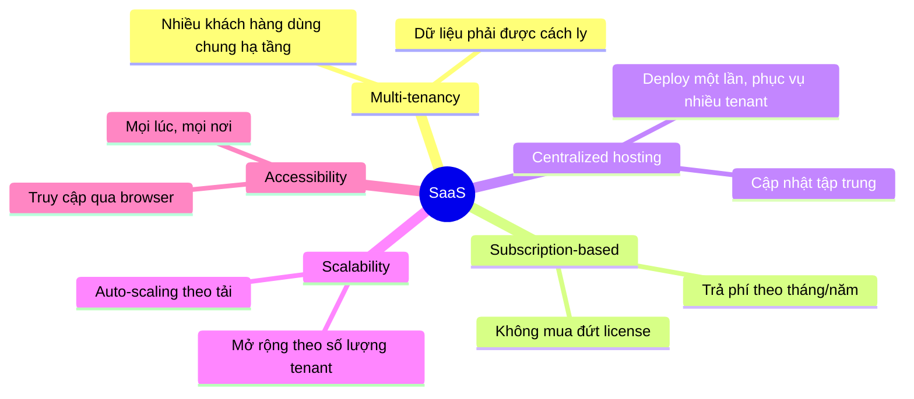
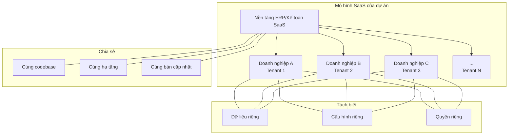

# ☁️ SaaS — Khái niệm cơ bản

## SaaS là gì?

**SaaS (Software as a Service)** là mô hình phân phối phần mềm trong đó:
- Phần mềm được **host trên cloud** bởi nhà cung cấp
- Khách hàng **truy cập qua internet** (thường qua trình duyệt)
- Khách hàng **không cài đặt** phần mềm trên máy tính của mình
- Nhà cung cấp **chịu trách nhiệm** vận hành, bảo trì, cập nhật

### Ví dụ thực tế quen thuộc
- **Google Workspace** (Docs, Sheets, Gmail)
- **Slack** — chat nhóm
- **Notion** — quản lý tài liệu
- **MISA** — phần mềm kế toán SaaS tại Việt Nam
- **Salesforce** — CRM

---

## 5 đặc tính cốt lõi của SaaS

| Đặc tính | Giải thích | Ảnh hưởng tới kiến trúc |
|-----------|-----------|------------------------|
| **Multi-tenancy** | Nhiều khách hàng dùng chung 1 deployment | Cần tenant isolation ở DB, logic, cache |
| **Subscription** | Trả phí định kỳ | Cần quản lý gói dịch vụ, billing |
| **Centralized hosting** | Nhà cung cấp quản lý server | Cần CI/CD, monitoring, zero-downtime deploy |
| **Scalability** | Phải scale khi khách hàng tăng | Cần kiến trúc stateless, horizontal scaling |
| **Accessibility** | Truy cập qua web | Cần API + Frontend tách biệt |

---

## SaaS giải quyết vấn đề gì?

### Đối với khách hàng (doanh nghiệp sử dụng)
- Không cần mua server, cài đặt, bảo trì
- Luôn dùng phiên bản mới nhất
- Chi phí ban đầu thấp (trả theo tháng thay vì mua đứt)
- Truy cập mọi nơi

### Đối với nhà cung cấp (team phát triển — tức là mình)
- Deploy một bản → phục vụ hàng trăm/nghìn khách hàng
- Cập nhật/sửa lỗi tập trung → tất cả tenant được hưởng
- Thu phí recurring → doanh thu ổn định
- **Nhưng:** phải thiết kế kiến trúc phức tạp hơn nhiều

---

## Tại sao SaaS quan trọng trong dự án này?

Dự án kế toán/ERP Viettel được xây theo hướng SaaS vì:

1. **Phục vụ nhiều doanh nghiệp** — mỗi doanh nghiệp là một tenant
2. **Dữ liệu kế toán cực kỳ nhạy cảm** — cần isolation rất tốt
3. **Quy trình nghiệp vụ tương tự** giữa các doanh nghiệp → tái sử dụng hạ tầng
4. **Cần cập nhật tập trung** — luật kế toán, thuế thay đổi → phải update tất cả tenant cùng lúc

---

## Hàm ý của SaaS lên kiến trúc

Khi sản phẩm là SaaS, kiến trúc backend phải giải quyết thêm rất nhiều vấn đề:

| Khía cạnh | Yêu cầu SaaS | Ảnh hưởng cụ thể |
|-----------|--------------|------------------|
| **Dữ liệu** | Cách ly giữa các tenant | Cần tenant-aware DB design |
| **Authentication** | Mỗi tenant có user riêng | Cần Identity Provider (Keycloak) |
| **Authorization** | Role/Permission khác nhau theo tenant | Cần RBAC multi-tenant |
| **API** | Phải route đúng tenant | Cần tenant context ở gateway/middleware |
| **Deployment** | Một bản cho tất cả | Cần CI/CD, feature flags, migration an toàn |
| **Monitoring** | Theo dõi per-tenant | Cần metrics/logs có tenant label |
| **Scaling** | Tenant lớn không ảnh hưởng tenant nhỏ | Cần rate limiting, resource isolation |
| **Billing** | Tính phí theo tenant | Cần usage tracking |
| **Configuration** | Tenant có thể customize | Cần config management per-tenant |

---

## Kết nối tới các chủ đề tiếp theo

- **Multi-tenant** → [03-multi-tenant/](../03-multi-tenant/) — Đi sâu vào cách cách ly dữ liệu
- **Auth** → [05-auth-authz-rbac/](../05-auth-authz-rbac/) — Xác thực trong ngữ cảnh SaaS
- **API Gateway** → [06-api-gateway-kong/](../06-api-gateway-kong/) — Routing tenant ở gateway
- **Observability** → [11-observability/](../11-observability/) — Monitoring per-tenant

---

*Đọc tiếp: [02-so-sanh-saas-vs-on-premise.md](./02-so-sanh-saas-vs-on-premise.md)*
