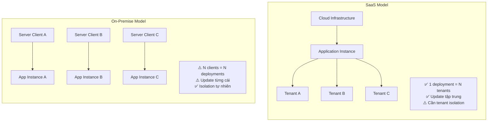

# ⚖️ So sánh SaaS vs On-Premise

## Bảng so sánh tổng quan

| Tiêu chí | SaaS | On-Premise |
|----------|------|-----------|
| **Hosting** | Nhà cung cấp quản lý server | Khách hàng tự quản lý server |
| **Cài đặt** | Không cần, truy cập qua browser | Cài đặt trên máy chủ nội bộ |
| **Chi phí ban đầu** | Thấp (subscription) | Cao (license + hardware + cài đặt) |
| **Chi phí dài hạn** | Tích lũy theo tháng/năm | Một lần + chi phí vận hành |
| **Cập nhật** | Tự động, tập trung | Khách hàng phải update thủ công |
| **Bảo trì** | Nhà cung cấp lo | Khách hàng tự lo (hoặc thuê) |
| **Customization** | Giới hạn (config-based) | Tùy ý sửa code |
| **Dữ liệu** | Lưu trên cloud | Lưu nội bộ |
| **Bảo mật dữ liệu** | Phụ thuộc nhà cung cấp | Khách hàng kiểm soát hoàn toàn |
| **Scalability** | Dễ scale | Phải mua thêm hardware |
| **Truy cập** | Mọi nơi có internet | Thường chỉ trong mạng nội bộ |
| **Multi-tenant** | Có (chia sẻ hạ tầng) | Không (mỗi client = 1 instance) |
| **Deployment complexity** | Một lần cho tất cả | Mỗi client deploy riêng |

---

## Sơ đồ so sánh kiến trúc

---

## Phân tích sâu hơn

### Khi nào SaaS tốt hơn?

1. **Sản phẩm phục vụ nhiều khách hàng** với quy trình tương tự
2. **Team vận hành muốn kiểm soát tập trung** — sửa 1 lần, apply cho tất cả
3. **Khách hàng không muốn lo server** — chỉ muốn trả phí và dùng
4. **Cần scale nhanh** — thêm tenant mới chỉ cần tạo account

### Khi nào On-Premise tốt hơn?

1. **Dữ liệu cực kỳ nhạy cảm** — khách hàng không cho phép data ra ngoài
2. **Yêu cầu custom rất sâu** — mỗi client cần logic riêng
3. **Quy mô nhỏ** — chỉ phục vụ 1-2 khách hàng lớn
4. **Quy định pháp lý** — một số ngành bắt buộc on-premise

### Khi nào dùng Hybrid?

Có những trường hợp kết hợp cả hai:
- SaaS cho SME (doanh nghiệp nhỏ)
- On-premise/private cloud cho enterprise (doanh nghiệp lớn, nhà nước)
- Cùng codebase nhưng deployment model khác

---

## Áp dụng vào dự án

Dự án kế toán/ERP Viettel chọn **SaaS** vì:

| Lý do | Giải thích |
|-------|-----------|
| Phục vụ nhiều doanh nghiệp | Mỗi doanh nghiệp = 1 tenant |
| Nghiệp vụ kế toán tương tự | Luật kế toán VN giống nhau → cùng logic core |
| Cập nhật tập trung | Khi luật thuế thay đổi → sửa 1 lần cho tất cả |
| Chi phí hạ tầng chia sẻ | N tenant dùng chung server → rẻ hơn |
| Scale dễ | Thêm tenant = thêm bản ghi/schema, không cần thêm server riêng |

### Câu hỏi suy ngẫm
- Nếu một doanh nghiệp lớn yêu cầu dữ liệu kế toán KHÔNG được lưu chung với doanh nghiệp khác, kiến trúc SaaS phải thay đổi như thế nào?
- Khi luật thuế mới chỉ áp dụng cho một số loại doanh nghiệp, SaaS platform xử lý ra sao?

---

*Đọc tiếp: [03-ham-y-saas-len-kien-truc.md](./03-ham-y-saas-len-kien-truc.md)*
