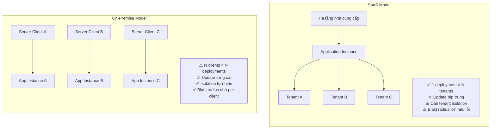
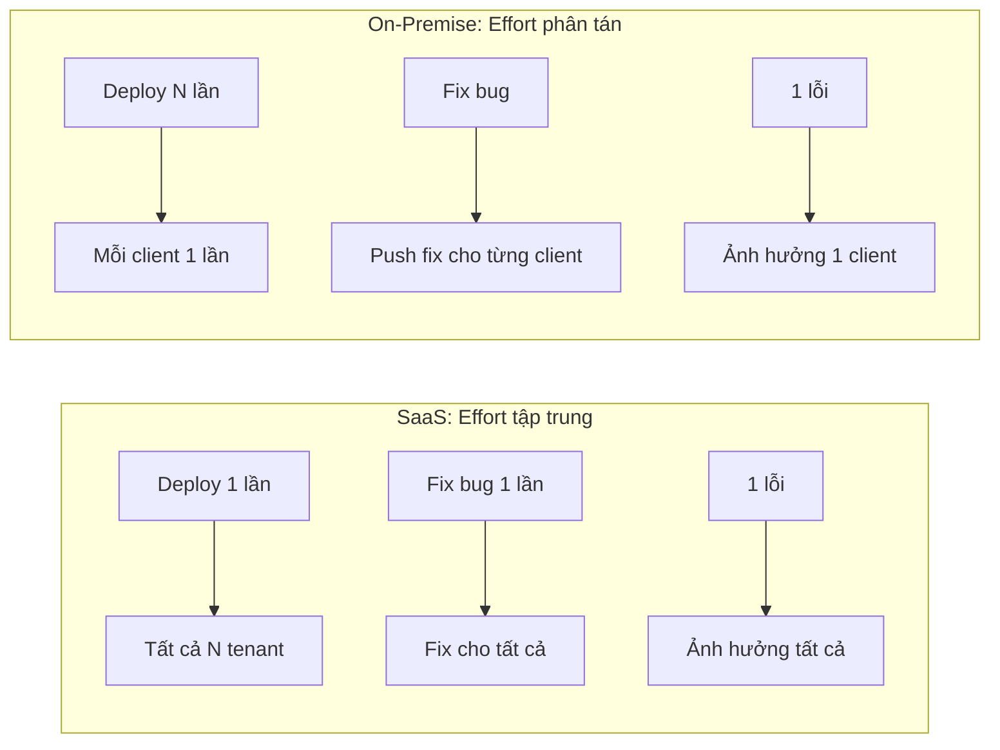

# ⚖️ So sánh SaaS vs On-Premise

## Bảng so sánh tổng quan

| Tiêu chí | SaaS | On-Premise |
|----------|------|-----------|
| **Hosting** | Nhà cung cấp quản lý và vận hành | Khách hàng tự quản lý server |
| **Cài đặt** | Không cần, truy cập qua browser | Cài đặt trên máy chủ nội bộ |
| **Chi phí ban đầu** | Thấp (thường trả subscription) | Cao (license + hardware + cài đặt + nhân sự) |
| **Chi phí dài hạn** | Tích lũy theo tháng/năm | License một lần + chi phí vận hành thường xuyên (nhân sự, hardware, bảo trì, nâng cấp) |
| **Cập nhật** | Nhà cung cấp cập nhật tập trung | Khách hàng phải update thủ công (hoặc thuê) |
| **Bảo trì** | Nhà cung cấp lo | Khách hàng tự lo |
| **Customization** | Giới hạn (config-based, API) | Tùy ý sửa code, thêm module |
| **Dữ liệu** | Lưu trên hạ tầng của nhà cung cấp | Lưu nội bộ, khách hàng kiểm soát hoàn toàn |
| **Bảo mật dữ liệu** | Phụ thuộc nhà cung cấp (phải trust) | Khách hàng tự kiểm soát |
| **Scalability** | Nhà cung cấp lo, dễ scale | Phải tự mua thêm hardware |
| **Truy cập** | Mọi nơi có internet | Thường chỉ trong mạng nội bộ (hoặc qua VPN) |
| **Multi-tenant** | **Thường** dùng multi-tenant (nhưng không bắt buộc) | **Thường** single-instance per client (nhưng không bắt buộc) |
| **Deployment complexity (cho nhà cung cấp)** | Một bản cho tất cả → rủi ro blast radius lớn | Mỗi client deploy riêng → rủi ro phân tán, effort nhân N |

> ⚠️ **Lưu ý:** Bảng trên mô tả trường hợp **điển hình**. Ranh giới SaaS vs On-premise không phải lúc nào cũng đen-trắng — có nhiều mô hình hybrid ở giữa.

---

## Sơ đồ so sánh kiến trúc

---

## So sánh từ góc nhìn nhà phát triển phần mềm

Đây là góc nhìn quan trọng nhất cho mình (developer):

### SaaS — phức tạp ở đâu?

| Vấn đề | Tại sao phức tạp |
|--------|-----------------|
| **Multi-tenancy** | Phải thiết kế data isolation, tenant-aware caching, tenant-aware logging |
| **Shared infrastructure** | Phải giải quyết noisy neighbor, rate limiting, resource quotas |
| **Zero-downtime deployment** | 1 bản deploy ảnh hưởng tất cả → cần rolling/blue-green/canary + backward-compatible migration |
| **Security scope** | 1 lỗ hổng = lộ data TẤT CẢ tenant → yêu cầu bảo mật cao hơn nhiều |
| **Tenant-aware everything** | Auth, logging, metrics, cache, config — tất cả đều phải biết "đang phục vụ tenant nào" |

### On-Premise — phức tạp ở đâu?

| Vấn đề | Tại sao phức tạp |
|--------|-----------------|
| **N clients = N deployments** | Mỗi client cần deploy riêng, upgrade riêng, troubleshoot riêng |
| **Version fragmentation** | Client A đang v2.1, Client B đang v3.0 → phải support nhiều version |
| **Customization per-client** | Mỗi client có thể yêu cầu thay đổi riêng → fork hoặc feature branch phức tạp |
| **Debug khó** | Không truy cập trực tiếp server client → debug qua log, remote, hoặc phải đến tận nơi |
| **Update chậm** | Phải thuyết phục/lên lịch từng client để upgrade → tốn thời gian |

### So sánh effort

---

## Phân tích khi nào chọn gì

### Khi nào SaaS tốt hơn?

1. **Sản phẩm phục vụ nhiều khách hàng** với quy trình tương tự
2. **Team vận hành muốn kiểm soát tập trung** — sửa 1 lần, apply cho tất cả
3. **Khách hàng không muốn lo server** — chỉ muốn trả phí và dùng
4. **Cần scale nhanh** — thêm tenant mới chỉ cần tạo account
5. **Nhà cung cấp muốn doanh thu recurring ổn định**

### Khi nào On-Premise tốt hơn?

1. **Dữ liệu cực kỳ nhạy cảm** — khách hàng không cho phép data ra ngoài mạng nội bộ
2. **Yêu cầu custom rất sâu** — mỗi client cần logic nghiệp vụ riêng
3. **Quy mô nhỏ** — chỉ phục vụ 1-2 khách hàng lớn, không cần multi-tenant
4. **Quy định pháp lý** — một số ngành (quân sự, chính phủ) bắt buộc on-premise
5. **Khách hàng cần kiểm soát hoàn toàn** infrastructure và data

### Khi nào dùng Hybrid?

Trong thực tế, nhiều sản phẩm dùng mô hình hybrid:
- **SaaS cho SME** (doanh nghiệp nhỏ-vừa) — chi phí thấp, dùng chung hạ tầng
- **On-premise / private cloud cho enterprise** (doanh nghiệp lớn, nhà nước) — data isolation mạnh, SLA cao
- **Cùng codebase** nhưng deployment model khác nhau

> 📌 **Ví dụ thực tế:** Nhiều sản phẩm ERP/kế toán ở Việt Nam vừa có phiên bản online (SaaS) cho SME, vừa có phiên bản triển khai riêng cho doanh nghiệp lớn.

---

## Trade-off tổng hợp

| Tiêu chí | SaaS thắng | On-Premise thắng |
|----------|-----------|-----------------|
| Chi phí ban đầu | ✅ Thấp hơn | |
| Chi phí dài hạn (tổng sở hữu) | | Tùy quy mô — có thể rẻ hơn |
| Tốc độ triển khai | ✅ Nhanh hơn | |
| Customization sâu | | ✅ Linh hoạt hơn |
| Bảo mật dữ liệu | | ✅ Khách hàng kiểm soát |
| Cập nhật / sửa lỗi | ✅ Nhanh, tập trung | |
| Blast radius khi lỗi | | ✅ Nhỏ hơn (per-client) |
| Scale | ✅ Dễ hơn | |
| Kiến trúc phức tạp | | ✅ Đơn giản hơn (không cần multi-tenant) |

---

## Áp dụng vào dự án

Dự án kế toán/ERP Viettel chọn **SaaS** vì:

| Lý do | Giải thích |
|-------|-----------|
| Phục vụ nhiều doanh nghiệp | Mỗi doanh nghiệp = 1 tenant |
| Nghiệp vụ kế toán tương tự | Luật kế toán VN giống nhau → cùng logic core |
| Cập nhật tập trung | Khi luật thuế thay đổi → sửa 1 lần cho tất cả |
| Chi phí hạ tầng chia sẻ | N tenant dùng chung server → rẻ hơn cho cả hai phía |
| Scale dễ | Thêm tenant = thêm bản ghi/schema, không cần thêm server riêng |
| Tiếp cận SME | Doanh nghiệp nhỏ có thể dùng ngay mà không cần đầu tư hạ tầng |

### Câu hỏi suy ngẫm
- Nếu một doanh nghiệp lớn yêu cầu dữ liệu kế toán KHÔNG được lưu chung với doanh nghiệp khác, kiến trúc SaaS phải thay đổi như thế nào? (Gợi ý: hybrid deployment, DB per tenant)
- Khi luật thuế mới chỉ áp dụng cho một số loại doanh nghiệp, SaaS platform xử lý ra sao? (Gợi ý: feature flags, tenant configuration)

---

*Đọc tiếp: [03-ham-y-saas-len-kien-truc.md](./03-ham-y-saas-len-kien-truc.md)*
