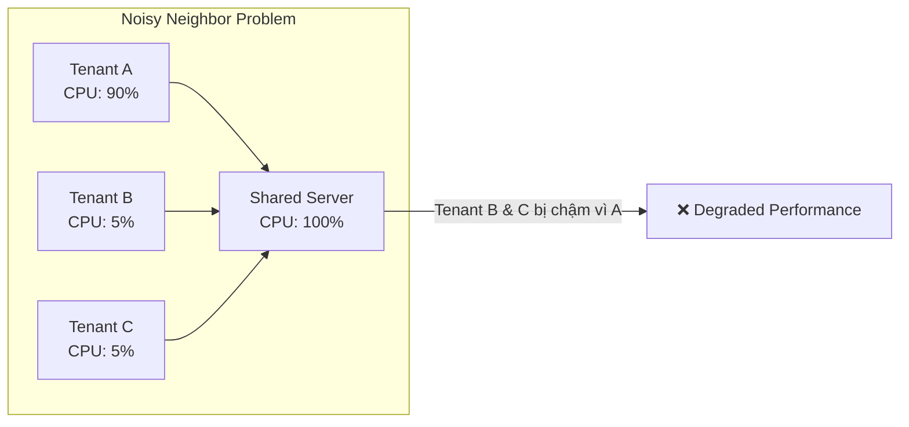

# 🏗️ Hàm ý của SaaS lên kiến trúc hệ thống

## Tổng quan

Khi một sản phẩm chuyển từ on-premise sang SaaS, **gần như mọi thành phần kiến trúc** đều bị ảnh hưởng. Phần này phân tích chi tiết từng khía cạnh.

---

## Sơ đồ: Các layer bị ảnh hưởng bởi SaaS

```mermaid
graph TB
    SAAS[Quyết định: SaaS] --> MT[Multi-tenancy]
    SAAS --> AUTH[Authentication & Identity]
    SAAS --> AUTHZ[Authorization per tenant]
    SAAS --> DEPLOY[Deployment Strategy]
    SAAS --> OBS[Observability]
    SAAS --> SCALE[Scalability]
    SAAS --> DATA[Data Isolation]
    SAAS --> CONFIG[Configuration Management]
    SAAS --> BILLING[Billing & Subscription]

    MT --> DB[Database Design]
    MT --> CACHE[Cache Strategy]
    MT --> QUEUE[Message Queue]

    AUTH --> IDP[Identity Provider]
    AUTH --> TOKEN[Token Management]

    AUTHZ --> RBAC[Role-Based Access Control]
    AUTHZ --> TP[Tenant Permission Boundary]

    DEPLOY --> CICD[CI/CD Pipeline]
    DEPLOY --> MIG[Database Migration]
    DEPLOY --> FF[Feature Flags]

    OBS --> METRIC[Metrics per Tenant]
    OBS --> LOG[Logging with Tenant Context]
```

---

## Chi tiết từng khía cạnh

### 1. Multi-tenancy → Database Design

**Vấn đề:** Nhiều tenant dùng chung database. Làm sao đảm bảo dữ liệu không bị lẫn?

| Chiến lược | Mô tả | Phù hợp khi                                             |
|-----------|-------|---------------------------------------------------------|
| Shared DB + `tenant_id` | Tất cả tenant chung bảng, phân biệt bằng cột `tenant_id` | Số tenant lớn, dữ liệu nhỏ-trung bình                   |
| Shared DB + schema per tenant | Mỗi tenant có schema riêng | Cần isolation tốt hơn nhưng vẫn chung DB                |
| DB per tenant | Mỗi tenant có DB riêng | Dữ liệu cực nhạy cảm, SLA (Service Level Agreement) cao |

> 📌 Chi tiết ở [03-multi-tenant/](../03-multi-tenant/)

### 2. Authentication → Identity Provider

**Vấn đề:** Mỗi tenant có users riêng. User của tenant A không được truy cập vào tenant B.

**Giải pháp phổ biến:**
- Centralized Identity Provider (Keycloak, Auth0)
- JWT token chứa thông tin tenant
- Login flow phải xác định đúng tenant

### 3. Authorization → RBAC per Tenant

**Vấn đề:** Admin của tenant A không phải admin của tenant B.

**Giải pháp:**
- Role và Permission gắn với tenant
- Không có "global admin" trừ khi là system admin (quản trị platform)
- Mỗi request phải verify: user thuộc tenant nào + có quyền gì

### 4. Deployment → Zero-downtime Updates

**Vấn đề:** Khi update code, tất cả tenant đều bị ảnh hưởng.

**Yêu cầu:**
- Rolling deployment (thay dần từng pod/server)/ Blue-green deployment (có 2 môi trường, bản mới sẵn sàng rồi mới switch traffic)
- Database migration phải backward compatible (bản mới vẫn tương thích với cái cũ, để chuyển đổi không bị gãy)
- Feature flags cho tính năng chưa sẵn sàng cho tất cả tenant

### 5. Observability → Tenant-aware Monitoring

**Vấn đề:** Khi hệ thống chậm, cần biết tenant nào gây tải.

**Yêu cầu:**
- Metrics phải có label `tenant_id`
- Logs phải chứa tenant context
- Alert có thể filter theo tenant

### 6. Scalability → Noisy Neighbor Problem

**Vấn đề:** Một tenant dùng quá nhiều tài nguyên → ảnh hưởng tenant khác.

**Giải pháp:**
- Rate limiting per tenant
- Resource quotas
- Tenant tiering (basic/premium → resource allocation khác nhau)

### 7. Configuration → Per-tenant Customization

**Vấn đề:** Mỗi doanh nghiệp có thể cần cấu hình khác (ví dụ: năm tài chính bắt đầu tháng nào, loại tiền tệ chính)

**Giải pháp:**
- Tenant configuration table
- Default config + override per tenant
- Không hardcode business rules

---

## Checklist: SaaS Architecture Concerns

Khi thiết kế kiến trúc SaaS, luôn kiểm tra:

- [ ] Mọi query database có filter theo tenant không?
- [ ] Token chứa thông tin tenant không?
- [ ] Logs có tenant context không?
- [ ] Cache key có tenant prefix không?
- [ ] API có validate tenant ownership không?
- [ ] Migration có backward compatible không?
- [ ] Một tenant có thể ảnh hưởng tenant khác không?
- [ ] Admin platform vs Admin tenant được phân biệt chưa?

---

## Áp dụng vào Phase 1 Demo

Trong demo Phase 1, **không cần** giải quyết tất cả vấn đề trên. Chỉ tập trung:

| Cần làm | Không cần vội |
|---------|--------------|
| `tenant_id` trong DB | Billing/Subscription |
| JWT chứa tenant info | Feature flags |
| RBAC đơn giản | Rate limiting phức tạp |
| Logging với tenant context | Tenant tiering |
| Validate tenant ownership | Auto-scaling |

> 🎯 **Nguyên tắc:** Hiểu tất cả, implement đơn giản, thiết kế để mở rộng sau.

---

*Quay lại: [README.md](../README.md) | Tiếp theo: [03-multi-tenant/](../03-multi-tenant/)*
