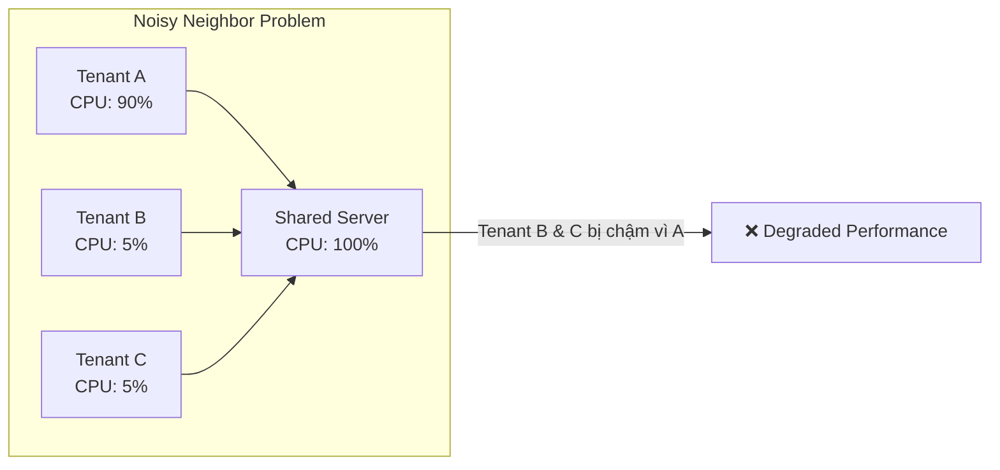

# 🏗️ Hàm ý của SaaS lên kiến trúc hệ thống

## Tổng quan

Khi sản phẩm được phân phối theo mô hình SaaS, **nhiều thành phần kiến trúc** phải được thiết kế khác so với on-premise. Chủ yếu ảnh hưởng ở các layer: data access, authentication, authorization, deployment, observability, và resource management.

> 📌 **Lưu ý:** Không phải "mọi thành phần" đều thay đổi. Business logic core (ví dụ: hạch toán kế toán, tính thuế) có thể giữ nguyên. Cái thay đổi chủ yếu là **cách phần mềm phục vụ nhiều khách hàng trên cùng nền tảng**.

---

## Sơ đồ: Các layer bị ảnh hưởng bởi SaaS

```mermaid
graph TB
    SAAS[Quyết định: SaaS] --> MT[Multi-tenancy]
    SAAS --> AUTH[Authentication & Identity]
    SAAS --> AUTHZ[Authorization per tenant]
    SAAS --> DEPLOY[Deployment Strategy]
    SAAS --> OBS[Observability]
    SAAS --> SCALE[Scalability]
    SAAS --> DATA[Data Isolation]
    SAAS --> CONFIG[Configuration Management]
    SAAS --> BILLING[Billing & Subscription]

    MT --> DB[Database Design]
    MT --> CACHE[Cache Strategy]
    MT --> QUEUE[Message Queue]

    AUTH --> IDP[Identity Provider]
    AUTH --> TOKEN[Token Management]

    AUTHZ --> RBAC[Role-Based Access Control]
    AUTHZ --> TP[Tenant Permission Boundary]

    DEPLOY --> CICD[CI/CD Pipeline]
    DEPLOY --> MIG[Database Migration]
    DEPLOY --> FF[Feature Flags]

    OBS --> METRIC[Metrics per Tenant]
    OBS --> LOG[Logging with Tenant Context]
```

---

## Chi tiết từng khía cạnh

### 1. Multi-tenancy → Database Design

**Vấn đề:** Nếu chọn multi-tenant architecture, nhiều tenant dùng chung database. Làm sao đảm bảo dữ liệu không bị lẫn?

| Chiến lược | Mô tả | Isolation | Chi phí | Phù hợp khi |
|-----------|-------|-----------|---------|-------------|
| Shared DB + `tenant_id` | Tất cả tenant chung bảng, phân biệt bằng cột `tenant_id` | Thấp (application-level) | Thấp nhất | Số tenant lớn, dữ liệu nhỏ-trung bình |
| Shared DB + schema per tenant | Mỗi tenant có schema riêng trong cùng DB | Trung bình (DB-level) | Trung bình | Cần isolation tốt hơn nhưng vẫn chung DB |
| DB per tenant | Mỗi tenant có DB riêng | Cao nhất | Cao nhất | Dữ liệu cực nhạy cảm, SLA cao, enterprise |

> ⚠️ **Rủi ro chính của Shared DB + `tenant_id`:** Nếu developer quên thêm `WHERE tenant_id = ?` trong query → **data leakage** (tenant A thấy data tenant B). Đây là lỗi bảo mật nghiêm trọng nhất trong multi-tenant.

> 📌 Chi tiết ở [03-multi-tenant/](../03-multi-tenant/)

### 2. Authentication → Identity Provider

**Vấn đề:** Mỗi tenant có users riêng. User của tenant A không được truy cập vào tenant B.

**Giải pháp phổ biến:**
- Centralized Identity Provider (Keycloak, Auth0)
- JWT token chứa thông tin tenant (claim `tenant_id`)
- Login flow phải xác định đúng tenant trước khi authenticate

### 3. Authorization → RBAC per Tenant

**Vấn đề:** Admin của tenant A không phải admin của tenant B. Quyền phải có **scope theo tenant**.

**Giải pháp:**
- Role và Permission gắn với tenant
- Mỗi request phải verify: user thuộc tenant nào + có quyền gì **trong tenant đó**
- **Phải check cả tenant ownership**, không chỉ check role. Ví dụ: Admin tenant A có quyền DELETE, nhưng chỉ được xóa record **thuộc tenant A**.

**Phân biệt 2 loại admin:**

| Loại | Scope | Ví dụ |
|------|-------|-------|
| **Tenant Admin** | Quản trị trong 1 tenant cụ thể | Admin doanh nghiệp A — quản lý user, role, data của doanh nghiệp A |
| **Platform Admin (System Admin)** | Quản trị cross-tenant, quản lý toàn bộ platform | Quản trị viên Viettel — quản lý tenant, billing, system config |

> ⚠️ Hai loại admin này có scope **hoàn toàn khác nhau**. Platform Admin là role đặc biệt, không phải "tenant admin có nhiều quyền hơn".

### 4. Deployment → Zero-downtime Updates

**Vấn đề:** Khi update code, **tất cả tenant đều bị ảnh hưởng** (vì dùng chung deployment). Nếu deploy gây lỗi → blast radius = toàn bộ khách hàng.

**Các chiến lược giảm rủi ro:**

| Chiến lược | Cách hoạt động | Giảm rủi ro thế nào |
|-----------|---------------|---------------------|
| **Rolling deployment** | Thay dần từng pod/server | Nếu pod mới lỗi, chỉ 1 phần traffic bị ảnh hưởng |
| **Blue-green deployment** | 2 môi trường, switch traffic khi bản mới sẵn sàng | Rollback nhanh bằng cách switch lại |
| **Canary deployment** | Deploy bản mới cho 1 subset nhỏ tenant/traffic trước | Phát hiện lỗi sớm trước khi rollout toàn bộ |
| **Feature flags** | Bật/tắt tính năng theo tenant hoặc nhóm tenant | Deploy code nhưng chưa bật tính năng cho tất cả |
| **Backward-compatible migration** | Schema DB mới phải tương thích với code cũ | Tránh lỗi khi code cũ và mới chạy song song trong quá trình deploy |

### 5. Observability → Tenant-aware Monitoring

**Vấn đề:** Khi hệ thống chậm, cần biết **tenant nào** gây tải, **endpoint nào** chậm cho tenant nào.

**Yêu cầu:**
- Metrics phải có label `tenant_id` (ví dụ: request count per tenant, latency per tenant)
- Logs phải chứa tenant context (mỗi dòng log phải biết thuộc tenant nào)
- Alert có thể filter theo tenant (ví dụ: alert khi 1 tenant có error rate > 5%)
- Tracing phải gắn tenant ID vào span

### 6. Scalability → Noisy Neighbor Problem

**Vấn đề:** Một tenant dùng quá nhiều tài nguyên → ảnh hưởng tenant khác. Đây gọi là **Noisy Neighbor Problem**.

**Giải pháp — 2 bài toán khác nhau:**

| Bài toán | Giải pháp | Ý nghĩa |
|----------|----------|---------|
| **Giới hạn số lượng request** | Rate limiting per tenant | Ngăn 1 tenant gửi quá nhiều request (ví dụ: 1000 req/phút) |
| **Giới hạn tài nguyên tiêu thụ** | Resource quotas, connection pool isolation | Ngăn 1 tenant chiếm quá nhiều CPU/memory/DB connections |
| **Phân cấp theo gói dịch vụ** | Tenant tiering (basic/premium) | Tenant trả nhiều hơn → được cấp nhiều resource hơn |

> ⚠️ **Rate limiting ≠ Resource isolation.** Rate limiting chỉ giới hạn số request, không giải quyết vấn đề 1 query nặng chiếm hết CPU. Cần kết hợp cả hai.

### 7. Configuration → Per-tenant Customization

**Vấn đề:** Mỗi doanh nghiệp có thể cần cấu hình khác nhau.

**Ví dụ trong dự án kế toán:**
- Năm tài chính bắt đầu tháng nào (tháng 1 hay tháng 4)?
- Loại tiền tệ chính (VND? USD?)
- Có sử dụng ngoại tệ không?
- Chế độ kế toán áp dụng (doanh nghiệp lớn / doanh nghiệp nhỏ)?

**Giải pháp:**
- Tenant configuration table (lưu config per tenant trong DB)
- Default config + override per tenant
- Không hardcode business rules — dùng config hoặc strategy pattern

---

## Checklist: SaaS Architecture Concerns

Khi thiết kế kiến trúc SaaS, luôn kiểm tra:

- [ ] Mọi query database có filter theo tenant không?
- [ ] Token chứa thông tin tenant không?
- [ ] Logs có tenant context không?
- [ ] Cache key có tenant prefix không? (ví dụ: `tenant:1:categories` thay vì `categories`)
- [ ] API có validate tenant ownership không? (không chỉ check role)
- [ ] Migration có backward compatible không?
- [ ] Một tenant có thể ảnh hưởng performance tenant khác không?
- [ ] Platform admin vs Tenant admin được phân biệt chưa?

---

## Áp dụng vào Phase 1 Demo

Trong demo Phase 1, **không cần** giải quyết tất cả vấn đề trên. Chỉ tập trung những thứ nền tảng:

| ✅ Cần làm trong Phase 1 | ⏳ Không cần vội |
|--------------------------|-----------------|
| `tenant_id` trong DB (mọi bảng) | Billing/Subscription |
| JWT chứa tenant info | Feature flags phức tạp |
| RBAC đơn giản (ADMIN / VIEWER) | Rate limiting per tenant |
| Logging với tenant context | Tenant tiering |
| Validate tenant ownership trong mọi API | Auto-scaling |
| Cache key có tenant prefix | Canary deployment |
| Phân biệt platform admin vs tenant admin | Resource quotas |

> 🎯 **Nguyên tắc Phase 1:** Hiểu tất cả các vấn đề, implement phiên bản đơn giản nhất, thiết kế sao cho có thể mở rộng sau mà không phải viết lại.

---

## Tóm tắt cho Phase 1: Cần nhớ gì?

1. **SaaS là mô hình phân phối**, không phải mô hình hạ tầng hay cách tính tiền.
2. **Multi-tenant là lựa chọn kiến trúc**, không phải bản chất SaaS — nhưng dự án này chọn multi-tenant.
3. **Mọi thứ phải tenant-aware**: DB query, cache key, log, auth, API validation.
4. **Data leakage là rủi ro số 1**: Quên `tenant_id` trong query = tenant A thấy data tenant B.
5. **Blast radius lớn**: 1 bug deploy = ảnh hưởng tất cả tenant → cần quy trình deploy cẩn thận (rolling, backward-compatible migration).
6. **Phase 1: implement đơn giản, thiết kế mở rộng.** Không cần billing, rate limiting, feature flags phức tạp — nhưng cần biết chúng tồn tại.

---

*Quay lại: [README.md](../README.md) | Tiếp theo: [03-multi-tenant/](../03-multi-tenant/)*
