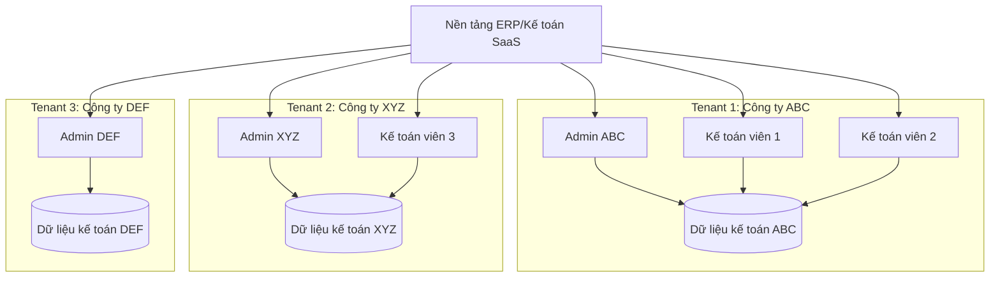
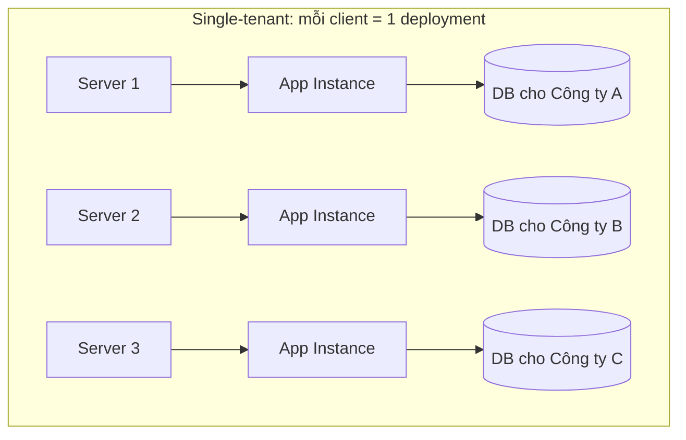
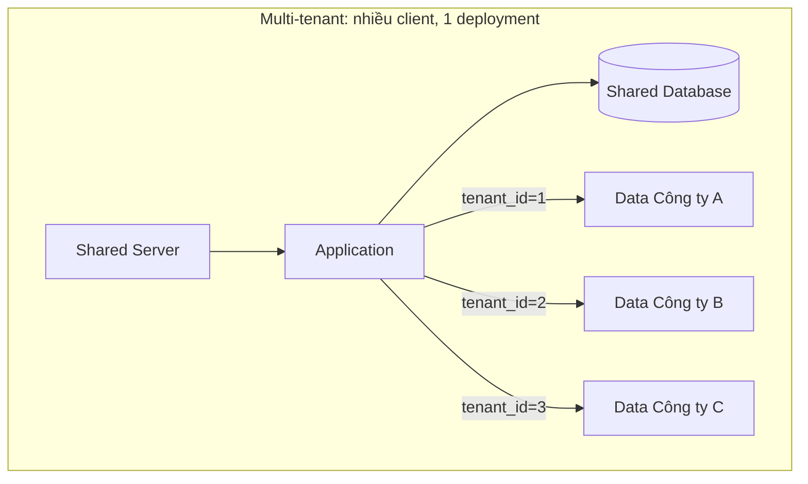
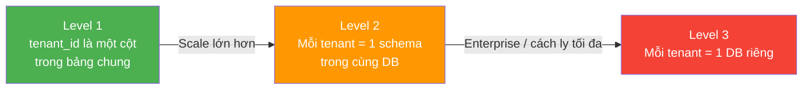

# 🏢 Multi-Tenant — Khái niệm cơ bản

## Tenant là gì?

**Tenant** (người thuê) trong ngữ cảnh SaaS là **một khách hàng tổ chức** sử dụng hệ thống.

Trong dự án này:
- Một tenant = một **doanh nghiệp** sử dụng nền tảng kế toán
- Doanh nghiệp A và doanh nghiệp B là hai tenant khác nhau
- Mỗi tenant có users, dữ liệu, cấu hình, quyền riêng

### Phân biệt: Tenant vs User

| Khái niệm | Là gì | Ví dụ |
|-----------|-------|-------|
| **Tenant** | Tổ chức/doanh nghiệp | Công ty ABC |
| **User** | Người dùng cụ thể trong tenant | Nguyễn Văn A — kế toán viên |

Một tenant có **nhiều users**. Một user thuộc **một tenant** (hoặc nhiều tenant trong một số hệ thống phức tạp).

---

## Tại sao multi-tenant quan trọng trong SaaS?

### Nếu KHÔNG multi-tenant (Single-tenant)

**Vấn đề:**
- 100 khách hàng = 100 server/deployment → chi phí server cực lớn
- Cập nhật phần mềm: phải update 100 lần
- Ops team phải quản lý 100 instance
- Không scale được

### Nếu CÓ multi-tenant

**Lợi ích:**
- 100 khách hàng = 1 deployment → chi phí chia sẻ
- Cập nhật 1 lần → tất cả được hưởng
- Ops team quản lý 1 system
- Scale theo nhu cầu thực tế

---

## Yêu cầu cốt lõi khi thiết kế multi-tenant

### 1. Data Isolation — Cách ly dữ liệu

**Đây là yêu cầu QUAN TRỌNG NHẤT.**

Dữ liệu của tenant A **tuyệt đối không được** hiển thị cho tenant B. Trong hệ thống kế toán, data leakage là:
- Vi phạm bảo mật nghiêm trọng
- Vi phạm pháp luật
- Mất uy tín hoàn toàn

### 2. Performance Isolation

Tenant A đang import 1 triệu bản ghi → Tenant B không được bị chậm theo.

### 3. Configuration Isolation

Mỗi tenant có thể có:
- Năm tài chính khác nhau
- Loại tiền tệ khác nhau
- Số lượng user khác nhau
- Gói dịch vụ khác nhau

### 4. Authentication Isolation

User của tenant A không thể login vào tenant B.

---

## Mentor nói gì về multi-tenant?

Mentor hướng dẫn hiểu multi-tenant **theo từng cấp độ tiến hóa**:

**Ý nghĩa:**
- **Bắt đầu đơn giản** → dùng `tenant_id` column
- **Hiểu rằng có thể tiến hóa** → lên schema/DB per tenant
- **Biết trade-off** của mỗi cách
- **Demo Phase 1:** dùng Level 1 (đơn giản nhất)

---

## Sai lầm phổ biến khi mới học multi-tenant

| Sai lầm | Tại sao sai | Nên làm |
|---------|------------|---------|
| Quên filter `tenant_id` trong query | Data leakage | Luôn có tenant filter, dùng middleware/interceptor |
| Hardcode tenant_id | Không flexible | Lấy từ token/context |
| Cache không có tenant prefix | Tenant A thấy data cache của B | Key format: `tenant:{id}:resource:{key}` |
| Tạo global admin vô tội vạ | Security risk | Phân biệt system admin vs tenant admin |
| Cho user thuộc nhiều tenant | Phức tạp data model | Phase 1: 1 user = 1 tenant |

---

*Đọc tiếp: [02-cac-mo-hinh-isolation.md](./02-cac-mo-hinh-isolation.md)*
