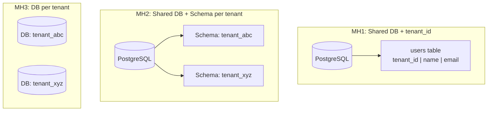
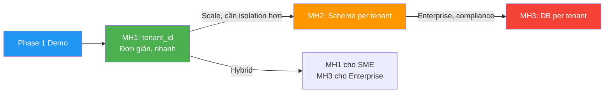

# 🔀 Các mô hình Tenant Isolation

## Tổng quan 3 mô hình



---

## Mô hình 1: Shared Database + `tenant_id` column

Tất cả tenant dùng **chung database, chung bảng**. Cột `tenant_id` phân biệt dữ liệu.

```sql
CREATE TABLE users (
    id          BIGSERIAL PRIMARY KEY,
    tenant_id   BIGINT NOT NULL REFERENCES tenants(id),
    username    VARCHAR(100) NOT NULL,
    email       VARCHAR(255) NOT NULL
);

-- Query LUÔN phải có WHERE tenant_id = ?
SELECT * FROM users WHERE tenant_id = 1 AND role = 'ACCOUNTANT';
```

### Ưu điểm
- ✅ Đơn giản nhất — 1 DB, 1 connection pool
- ✅ Chi phí thấp nhất
- ✅ Migration đơn giản — chạy 1 lần
- ✅ Cross-tenant query dễ (platform admin)
- ✅ Development nhanh

### Nhược điểm
- ❌ Data leakage risk cao — quên `WHERE tenant_id` = lộ data
- ❌ Không có DB-level isolation
- ❌ Noisy neighbor — tenant lớn làm chậm cả bảng
- ❌ Không customize schema per tenant
- ❌ Backup/restore per tenant khó

### Khi nào dùng?
- Số tenant lớn (hàng trăm → hàng nghìn)
- Dữ liệu mỗi tenant nhỏ-trung bình
- Giai đoạn MVP / demo / prototype
- **→ Phase 1 Demo dùng mô hình này**

---

## Mô hình 2: Shared Database + Schema per Tenant

Chung DB engine, nhưng mỗi tenant có **schema riêng**.

```sql
CREATE SCHEMA tenant_abc;
CREATE SCHEMA tenant_xyz;

CREATE TABLE tenant_abc.users (...);
CREATE TABLE tenant_xyz.users (...);

-- Switch schema theo request
SET search_path TO tenant_abc;
SELECT * FROM users; -- Tự động trong schema tenant_abc
```

### Ưu điểm
- ✅ Isolation tốt hơn MH1 (DB-level namespace)
- ✅ Không cần cột `tenant_id`
- ✅ Backup/restore per tenant dễ hơn
- ✅ Customize schema per tenant khả thi

### Nhược điểm
- ⚠️ Migration phức tạp — chạy cho TỪNG schema
- ⚠️ Connection phức tạp — switch schema theo request
- ⚠️ Giới hạn số schema (performance giảm khi quá nhiều)
- ⚠️ Cross-tenant query khó

### Khi nào dùng?
- Số tenant trung bình (hàng chục → vài trăm)
- Cần isolation tốt hơn MH1

---

## Mô hình 3: Database per Tenant

Mỗi tenant có **database riêng hoàn toàn**.

### Ưu điểm
- ✅ Isolation tối đa
- ✅ Performance isolation hoàn toàn
- ✅ Backup/restore per tenant đơn giản
- ✅ Compliance dễ — data nằm riêng

### Nhược điểm
- ❌ Chi phí cao nhất
- ❌ Ops cực phức tạp — quản lý N databases
- ❌ Connection pool phức tạp
- ❌ Migration chạy N lần

### Khi nào dùng?
- Tenant enterprise lớn, trả phí cao
- Dữ liệu cực nhạy cảm
- Số tenant ít (dưới vài chục)

---

## Bảng so sánh tổng hợp

| Tiêu chí | MH1: tenant_id | MH2: Schema | MH3: DB riêng |
|----------|:--------------:|:-----------:|:-------------:|
| **Setup complexity** | ⭐ Thấp | ⭐⭐ TB | ⭐⭐⭐ Cao |
| **Chi phí** | 💰 | 💰💰 | 💰💰💰 |
| **Data isolation** | 🔒 App-level | 🔒🔒 Schema-level | 🔒🔒🔒 DB-level |
| **Performance isolation** | ❌ Kém | ⚠️ TB | ✅ Tốt |
| **Migration** | ✅ Đơn giản | ⚠️ Phức tạp | ❌ Rất phức tạp |
| **Scalability (số tenant)** | ✅ Nghìn | ⚠️ Trăm | ❌ Chục |
| **Phù hợp Phase 1** | ✅ **Rất phù hợp** | ⚠️ Chưa cần | ❌ Quá phức tạp |

---

## Mô hình tiến hóa



---

*Đọc tiếp: [03-trade-off-va-lua-chon.md](./03-trade-off-va-lua-chon.md)*
