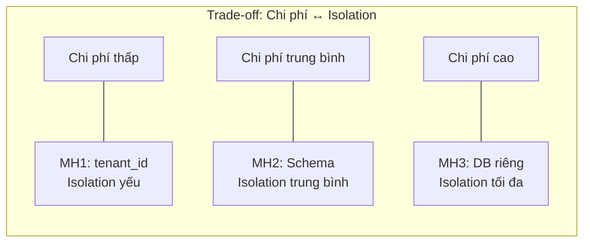
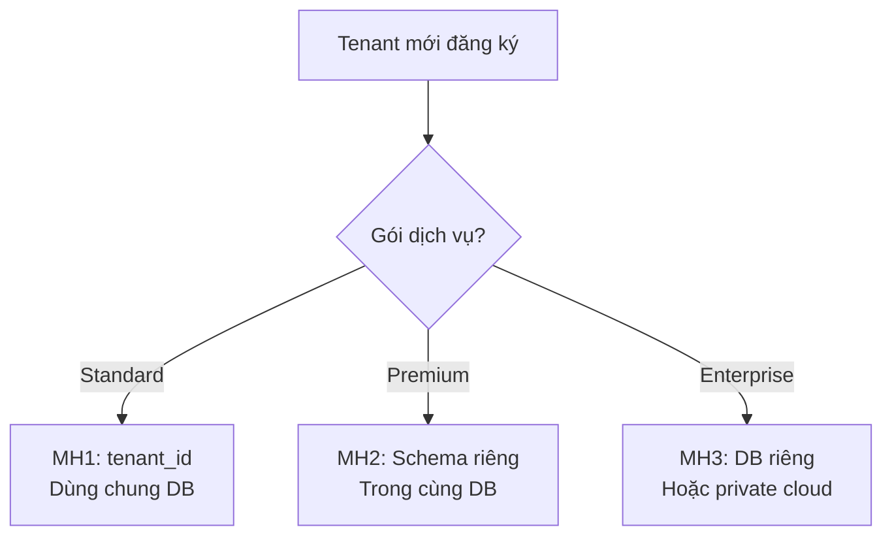

# ⚖️ Trade-off và lựa chọn Multi-tenant

## Framework đánh giá

Khi chọn mô hình tenant isolation, cần đánh giá 6 chiều:

| Chiều đánh giá | Câu hỏi cần trả lời |
|----------------|---------------------|
| **Chi phí** | Tốn bao nhiêu tiền hạ tầng? |
| **Isolation** | Dữ liệu có thể bị lẫn không? |
| **Scalability** | Thêm tenant mới có dễ không? |
| **Operations** | Vận hành phức tạp ra sao? |
| **Migration** | DB migration có khó không? |
| **Dev experience** | Developer có dễ làm việc không? |

---

## Phân tích trade-off chi tiết

### Chi phí vs Isolation

**Kết luận:** Isolation cao hơn = chi phí cao hơn. Phải chọn mức isolation **vừa đủ** cho use case.

### Scalability vs Operations

| Số tenant | MH1 | MH2 | MH3 |
|-----------|-----|-----|-----|
| 10 | Tốt | Tốt | Tốt |
| 100 | Tốt | OK | Khó quản lý |
| 1,000 | Tốt | Chậm | Cực kỳ khó |
| 10,000 | OK (cần sharding) | Không khả thi | Không khả thi |

---

## Lựa chọn cho dự án kế toán SaaS

### Phân tích context dự án

- Dữ liệu kế toán **nhạy cảm nhưng chưa phải cấp quân sự**
- Số tenant dự kiến **hàng trăm → hàng nghìn** doanh nghiệp
- Team **đang xây dựng mới**, cần tốc độ phát triển
- Production architecture có thể dùng **hybrid** sau

### Đề xuất cho production (tham khảo)

### Đề xuất cho Phase 1 Demo

**→ MH1 (tenant_id column)** vì:
1. Nhanh implement
2. Đủ minh họa concept
3. Mentor muốn "bắt đầu với tenant là một bản ghi"
4. Dễ tạo mock data cho 10 tenants
5. Có thể tiến hóa sau

---

## Checklist thiết kế multi-tenant cho MH1

- [ ] Mọi bảng business data có cột `tenant_id`
- [ ] Có middleware extract `tenant_id` từ JWT token
- [ ] Repository/DAO layer tự động filter theo `tenant_id`
- [ ] Cache key luôn có prefix `tenant:{id}`
- [ ] API endpoint validate user thuộc đúng tenant
- [ ] Test case verify không có data leakage
- [ ] Index trên `tenant_id` ở mọi bảng lớn
- [ ] Foreign key reference tới bảng `tenants`

---

*Đọc tiếp: [04-ap-dung-vao-demo.md](./04-ap-dung-vao-demo.md)*
