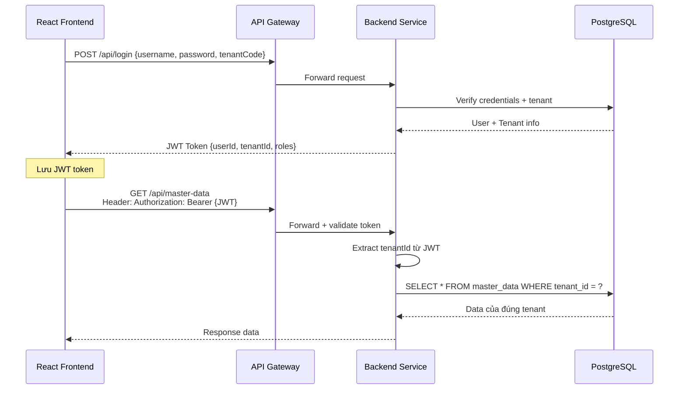

# 🔨 Áp dụng Multi-tenant vào Demo Phase 1

## Chiến lược cho Demo

Demo Phase 1 sử dụng **MH1: Shared DB + tenant_id column** với:
- 1 PostgreSQL database
- ~10 tenants (mock data)
- Mỗi tenant có users, roles, master-data riêng

---

## Tenant Context Flow



---

## Data Model đề xuất

### Bảng tenants
```sql
CREATE TABLE tenants (
    id          BIGSERIAL PRIMARY KEY,
    code        VARCHAR(50) UNIQUE NOT NULL,  -- 'COMPANY_ABC'
    name        VARCHAR(255) NOT NULL,         -- 'Công ty ABC'
    is_active   BOOLEAN DEFAULT TRUE,
    created_at  TIMESTAMP DEFAULT CURRENT_TIMESTAMP
);
```

### Bảng users
```sql
CREATE TABLE users (
    id          BIGSERIAL PRIMARY KEY,
    tenant_id   BIGINT NOT NULL REFERENCES tenants(id),
    username    VARCHAR(100) NOT NULL,
    email       VARCHAR(255),
    password    VARCHAR(255) NOT NULL,  -- bcrypt hash
    is_active   BOOLEAN DEFAULT TRUE,
    created_at  TIMESTAMP DEFAULT CURRENT_TIMESTAMP,
    UNIQUE(tenant_id, username)
);
```

### Pattern: Tenant-aware base entity

Trong code Java/Spring Boot:

```java
@MappedSuperclass
public abstract class TenantAwareEntity {
    @Column(name = "tenant_id", nullable = false)
    private Long tenantId;
    
    // getter, setter
}

// Mọi entity business đều extend từ đây
@Entity
@Table(name = "master_data")
public class MasterData extends TenantAwareEntity {
    @Id
    @GeneratedValue(strategy = GenerationType.IDENTITY)
    private Long id;
    private String code;
    private String name;
    // ...
}
```

---

## Cách tự động inject tenant_id

### Cách 1: Interceptor/Filter (Khuyến nghị cho demo)

```java
// TenantFilter.java - extract tenant từ JWT
@Component
public class TenantFilter extends OncePerRequestFilter {
    @Override
    protected void doFilterInternal(HttpServletRequest request, 
            HttpServletResponse response, FilterChain chain) {
        String token = extractToken(request);
        Long tenantId = jwtService.extractTenantId(token);
        TenantContext.setCurrentTenant(tenantId);
        try {
            chain.doFilter(request, response);
        } finally {
            TenantContext.clear();
        }
    }
}

// TenantContext.java - ThreadLocal storage
public class TenantContext {
    private static final ThreadLocal<Long> CURRENT_TENANT = new ThreadLocal<>();
    
    public static void setCurrentTenant(Long tenantId) {
        CURRENT_TENANT.set(tenantId);
    }
    
    public static Long getCurrentTenant() {
        return CURRENT_TENANT.get();
    }
    
    public static void clear() {
        CURRENT_TENANT.remove();
    }
}
```

### Cách 2: Hibernate Filter (nâng cao hơn)

```java
@FilterDef(name = "tenantFilter", 
    parameters = @ParamDef(name = "tenantId", type = Long.class))
@Filter(name = "tenantFilter", 
    condition = "tenant_id = :tenantId")
@Entity
public class MasterData extends TenantAwareEntity { ... }
```

---

## Mock Data cho 10 Tenants

```sql
INSERT INTO tenants (code, name) VALUES
('ALPHA_CO', 'Công ty TNHH Alpha'),
('BETA_JSC', 'Công ty CP Beta'),
('GAMMA_LTD', 'Công ty Gamma Limited'),
('DELTA_VN', 'Công ty TNHH Delta Việt Nam'),
('EPSILON', 'Doanh nghiệp tư nhân Epsilon'),
('ZETA_CORP', 'Tập đoàn Zeta'),
('ETA_TRADE', 'Công ty TM Eta'),
('THETA_SVC', 'Công ty DV Theta'),
('IOTA_TECH', 'Công ty CN Iota'),
('KAPPA_MFG', 'Công ty SX Kappa');
```

---

## Lưu ý quan trọng

1. **Mọi repository method phải có tenant filter**
2. **Test data leakage:** login tenant A, gọi API → chỉ thấy data tenant A
3. **Không hardcode tenant_id:** luôn lấy từ TenantContext
4. **Index tenant_id** ở mọi bảng có dữ liệu lớn

---

*Quay lại: [README.md](../README.md) | Tiếp theo: [04-phan-tach-service/](../04-phan-tach-service/)*
