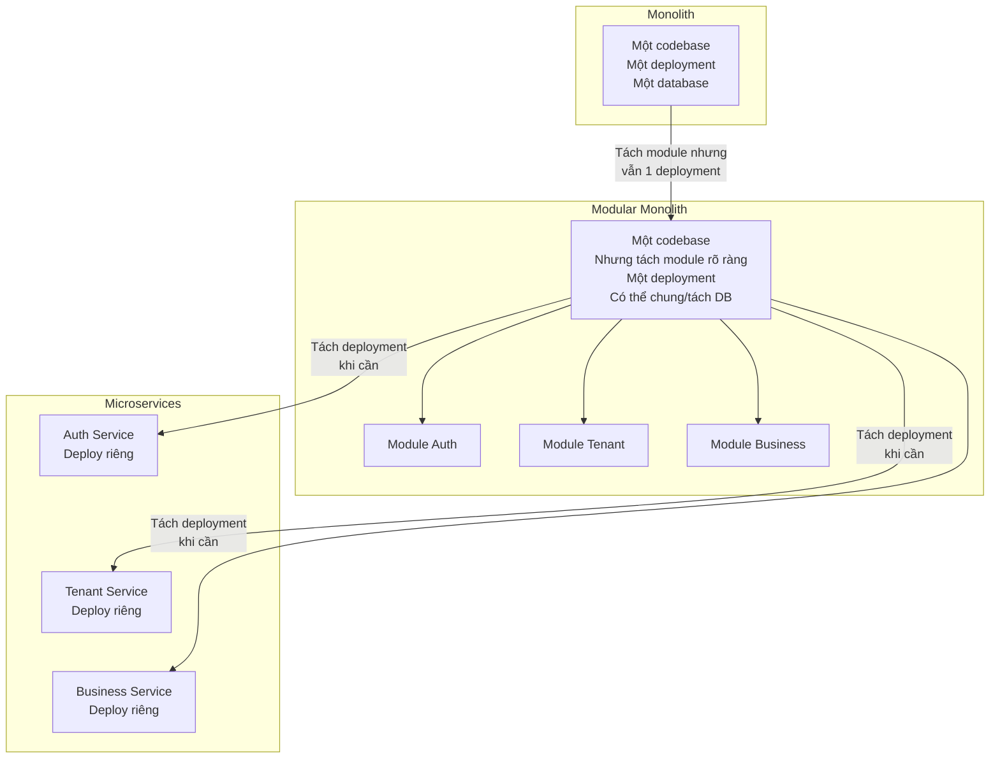
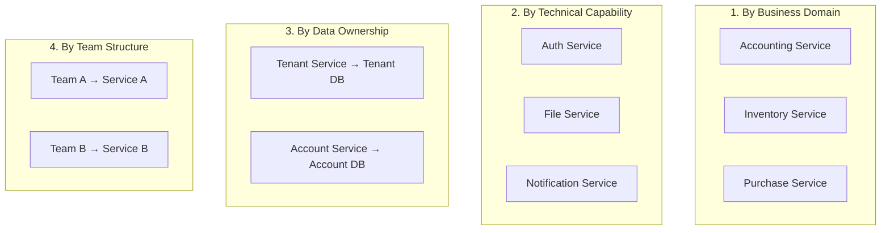
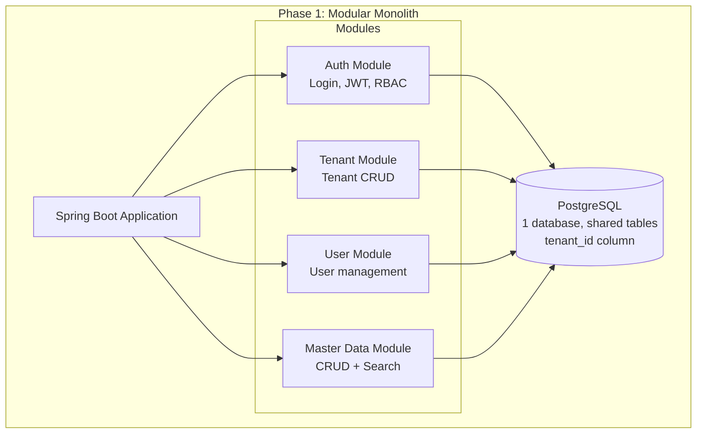
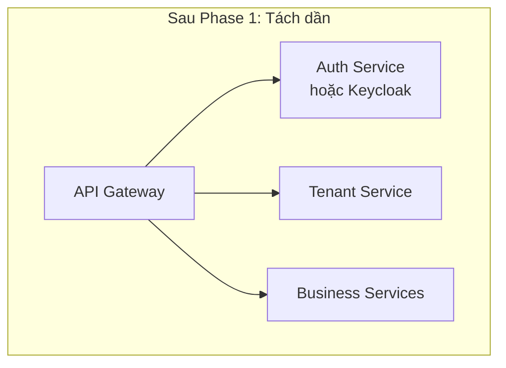

# 🧩 Phân tách Service — Tư duy kiến trúc

## Tại sao cần phân tách service?

Khi hệ thống lớn lên, một codebase monolithic gặp vấn đề:
- **Khó maintain**: thay đổi 1 chỗ ảnh hưởng nhiều nơi
- **Khó scale**: phải scale cả hệ thống dù chỉ 1 phần bị tải
- **Khó deploy**: deploy = risk cho toàn bộ
- **Khó phân chia team**: nhiều team sửa chung 1 repo

### Nhưng: Phân tách CŨNG có chi phí

| Chi phí của microservices | Giải thích |
|--------------------------|-----------|
| Network latency | Gọi qua mạng chậm hơn gọi trong process |
| Distributed complexity | Transaction, consistency, debugging khó hơn |
| Ops overhead | Nhiều service = nhiều deployment, monitoring |
| Data consistency | Không có DB transaction cross-service |
| Team coordination | API contract, versioning |

---

## Monolith vs Modular Monolith vs Microservices

### So sánh

| Tiêu chí | Monolith | Modular Monolith | Microservices |
|----------|----------|-----------------|---------------|
| **Complexity** | Thấp | Trung bình | Cao |
| **Deploy** | Đơn giản | Đơn giản | Phức tạp |
| **Scale** | Scale cả app | Scale cả app | Scale từng service |
| **Team independence** | Thấp | Trung bình | Cao |
| **Debug** | Dễ | Trung bình | Khó |
| **Data consistency** | DB transaction | DB transaction | Eventual consistency |
| **Phù hợp Phase 1** | ⚠️ Quá đơn giản | ✅ **Tốt nhất** | ⚠️ Quá phức tạp |

> 💡 **Khuyến nghị Phase 1:** Bắt đầu bằng **Modular Monolith** — tách module rõ ràng nhưng vẫn 1 deployment. Khi đã hiểu rõ boundary, có thể tách thành microservices sau.

---

## Chiến lược phân tách service

### 4 cách phổ biến

### Kiến trúc target dùng cách nào?

Nhìn vào sơ đồ kiến trúc, hệ thống target **kết hợp nhiều cách**:
- **By Technical Capability**: Auth, File, Notification, Search
- **By Business Domain**: Accounting, Invoice, Purchase
- **By Data Ownership**: Tenant Service → Tenant DB, Account → Account DB

---

## Câu hỏi phải hỏi trước khi tách service

| # | Câu hỏi | Nếu trả lời "Có" |
|---|---------|-------------------|
| 1 | Domain này có thể phát triển **độc lập** không? | Có thể tách |
| 2 | Team **riêng** quản lý phần này không? | Có thể tách |
| 3 | Phần này cần **scale khác** với phần còn lại không? | Nên tách |
| 4 | Phần này có thể **deploy riêng** mà không ảnh hưởng phần khác? | Nên tách |
| 5 | Hai phần này giao tiếp **ít** hay **nhiều**? | Ít → tách, nhiều → giữ chung |
| 6 | Tách ra có làm **tăng complexity** quá mức không? | Nếu có → chưa nên tách |

---

## Phân tích: Auth nên tách riêng không?

### Lập luận **nên tách**
- Auth là **cross-cutting concern** — mọi service đều cần
- Auth thay đổi **ít** so với business logic
- Auth cần **scale riêng** (login spike != business spike)
- Nhiều **giải pháp có sẵn** (Keycloak, Auth0)

### Lập luận **chưa cần tách** (trong Phase 1)
- Demo chỉ có **1 backend** → tách ra = thêm complexity
- JWT validation có thể làm **trong cùng app** bằng library
- Chưa có multiple services cần shared auth

### Kết luận Phase 1
→ **Tách thành module** trong cùng app (modular monolith), chưa tách deployment.

---

## Phân tích: File service nên tách riêng không?

### Lập luận **nên tách**
- File xử lý **binary data** — khác với business logic
- File cần **storage riêng** (MinIO/S3)
- Upload/download file **tải khác** với CRUD API
- Dễ tái sử dụng cho nhiều business service

### Kết luận Phase 1
→ **Chưa cần** trong demo. Nếu cần upload file, làm endpoint đơn giản trong backend chính.

---

## Đề xuất service/module cho Phase 1 Demo

### Sau này có thể tiến hóa

---

*Tiếp theo: [05-auth-authz-rbac/](../05-auth-authz-rbac/)*
