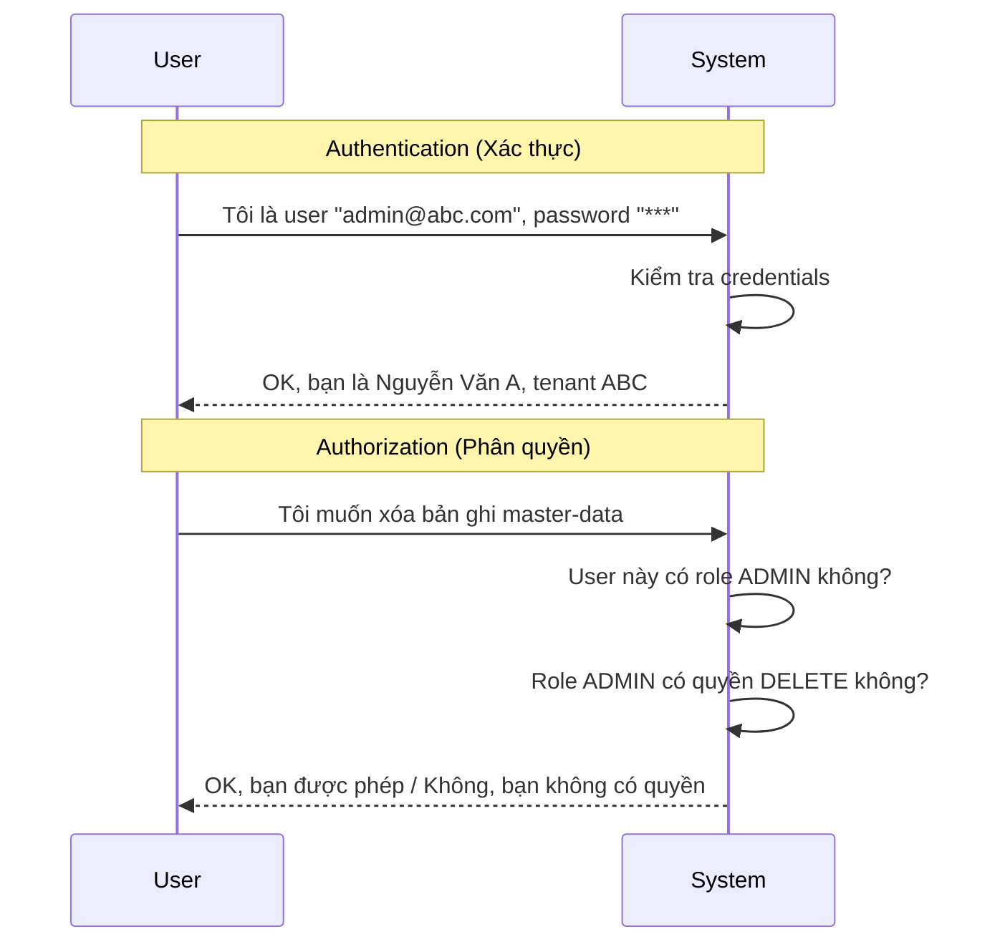
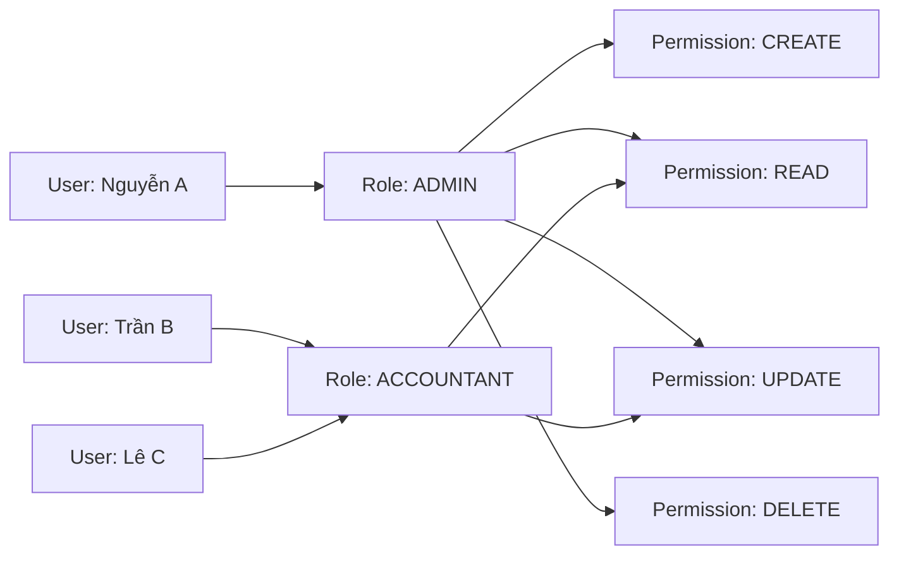
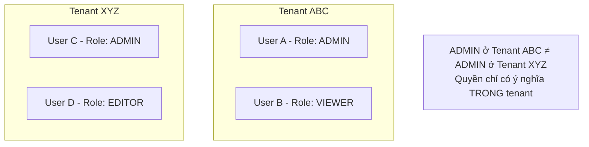
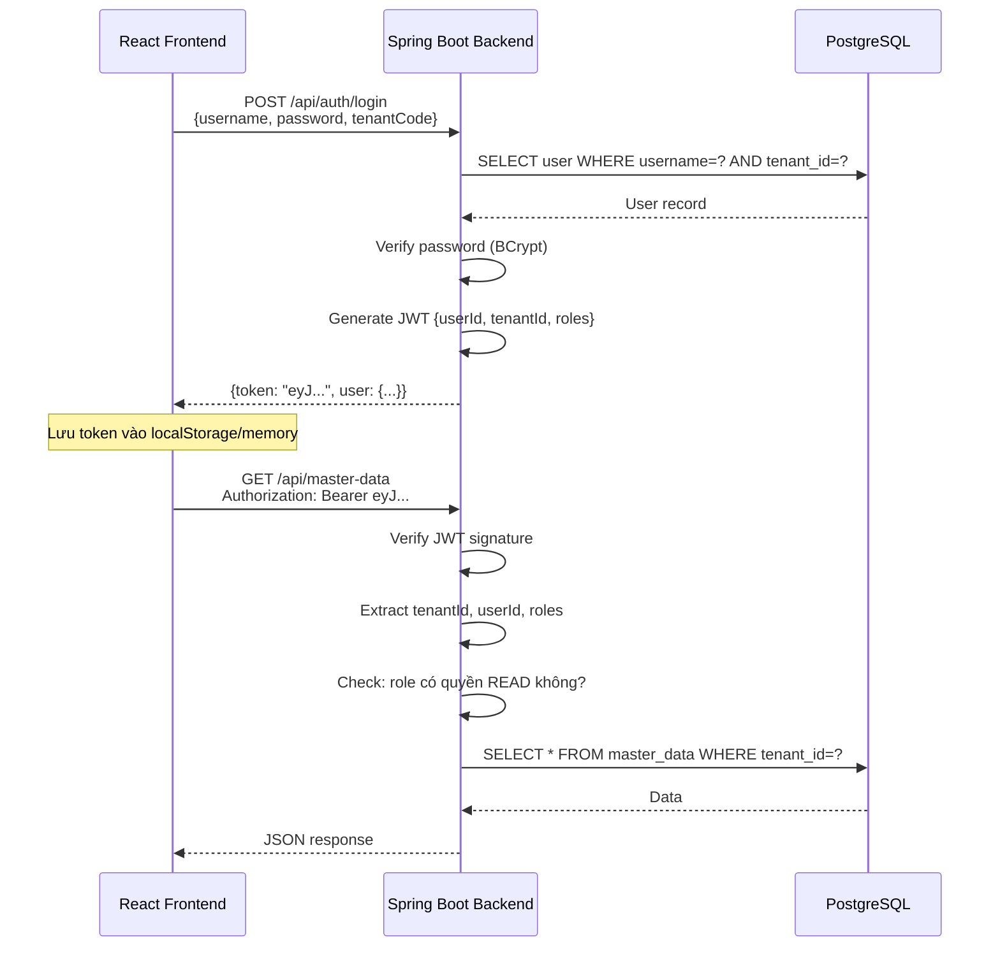
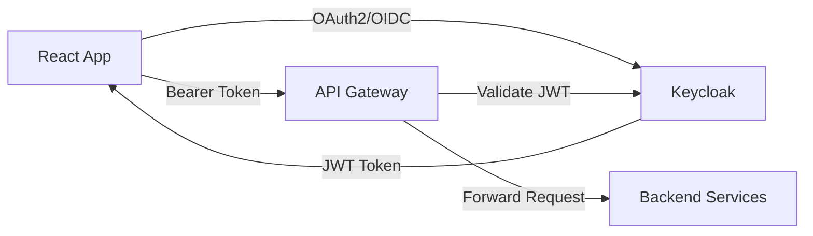
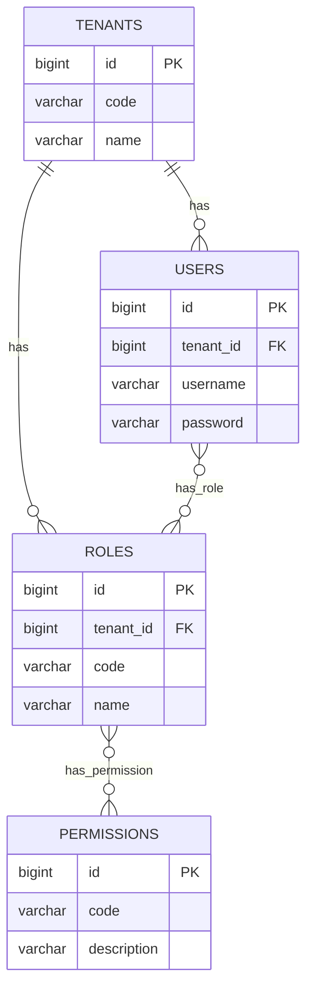

# 🔐 Authentication, Authorization & RBAC

## Phân biệt Authentication vs Authorization

| Khái niệm | Authentication (Xác thực) | Authorization (Phân quyền) |
|-----------|--------------------------|---------------------------|
| **Câu hỏi** | "Bạn là ai?" | "Bạn được phép làm gì?" |
| **Thời điểm** | Khi login | Khi truy cập tài nguyên |
| **Kết quả** | Identity (danh tính) | Permission (quyền) |
| **Ví dụ** | Username + Password → xác nhận là Nguyễn Văn A | Nguyễn Văn A có quyền xem báo cáo không? |
| **Viết tắt** | AuthN | AuthZ |



---

## RBAC — Role-Based Access Control

### RBAC là gì?

RBAC là mô hình phân quyền dựa trên **vai trò (role)**, không phải gán quyền trực tiếp cho user.



### Tại sao RBAC thay vì gán permission trực tiếp?

| Direct Permission | RBAC |
|------------------|------|
| 100 users × 20 permissions = 2000 records | 100 users × 3 roles + 3 roles × 20 permissions = ~360 records |
| Thêm permission mới → sửa từng user | Thêm permission vào role → tất cả user có role đó được hưởng |
| Khó audit "ai có quyền gì" | Dễ audit: xem role → biết quyền |

### RBAC trong ngữ cảnh Multi-tenant

**Quan trọng:** Role và Permission phải gắn với tenant.



---

## Token-Based Authentication (JWT)

### JWT là gì?

**JWT (JSON Web Token)** là chuỗi mã hóa chứa thông tin user, được server cấp sau khi login thành công.

```
eyJhbGciOiJIUzI1NiJ9.eyJ1c2VySWQiOjEsInRlbmFudElkIjoxLCJyb2xlcyI6WyJBRE1JTiJdfQ.xxxxx
```

Giải mã phần payload:
```json
{
  "userId": 1,
  "tenantId": 1,
  "username": "admin@abc.com",
  "roles": ["ADMIN"],
  "iat": 1713700000,
  "exp": 1713703600
}
```

### Tại sao JWT thay vì Session?

| Session-based | Token-based (JWT) |
|--------------|-------------------|
| Server lưu session state | Server stateless |
| Khó scale horizontal | Dễ scale horizontal |
| Cần session store (Redis) | Không cần server-side store |
| Mỗi request lookup session | Mỗi request tự verify token |
| Phù hợp monolith | Phù hợp microservices |

### Auth Flow cho Demo Phase 1



---

## Keycloak — Identity Provider

### Keycloak là gì?

**Keycloak** là Identity Provider (IdP) open-source, cung cấp sẵn:
- Login / Register / Forgot Password UI
- OAuth2 / OpenID Connect
- Social login (Google, Facebook...)
- Multi-tenant (Realm concept)
- RBAC
- Token management
- Admin console

### Keycloak trong kiến trúc target



### Phase 1: Dùng Keycloak hay tự implement?

| Tiêu chí | Tự implement | Dùng Keycloak |
|----------|-------------|---------------|
| **Học được nhiều** | ✅ Hiểu sâu auth flow | ⚠️ Dùng có sẵn, ít hiểu |
| **Tốc độ dev** | ⚠️ Chậm hơn | ✅ Nhanh |
| **Production-ready** | ❌ Nhiều lỗ hổng | ✅ Battle-tested |
| **Complexity** | ⭐ Ít dependency | ⭐⭐⭐ Docker, config |
| **Phase 1 phù hợp?** | ✅ **Nên tự implement để học** | ⚠️ Có thể thêm sau |

**Khuyến nghị Phase 1:** Tự implement JWT auth đơn giản bằng Spring Security + jjwt library. Hiểu sâu flow trước, sau đó migrate sang Keycloak.

---

## Data Model cho Auth trong Demo

```sql
-- Bảng roles
CREATE TABLE roles (
    id          BIGSERIAL PRIMARY KEY,
    tenant_id   BIGINT NOT NULL REFERENCES tenants(id),
    code        VARCHAR(50) NOT NULL,    -- 'ADMIN', 'ACCOUNTANT', 'VIEWER'
    name        VARCHAR(100) NOT NULL,
    UNIQUE(tenant_id, code)
);

-- Bảng user_roles (many-to-many)
CREATE TABLE user_roles (
    user_id     BIGINT NOT NULL REFERENCES users(id),
    role_id     BIGINT NOT NULL REFERENCES roles(id),
    PRIMARY KEY (user_id, role_id)
);

-- Bảng permissions
CREATE TABLE permissions (
    id          BIGSERIAL PRIMARY KEY,
    code        VARCHAR(100) NOT NULL UNIQUE,  -- 'MASTER_DATA:READ'
    description VARCHAR(255)
);

-- Bảng role_permissions
CREATE TABLE role_permissions (
    role_id       BIGINT NOT NULL REFERENCES roles(id),
    permission_id BIGINT NOT NULL REFERENCES permissions(id),
    PRIMARY KEY (role_id, permission_id)
);
```



---

## Áp dụng vào CRUD Demo

### Permission mapping cho module Master Data

| Action | Permission Code | Roles mặc định |
|--------|----------------|-----------------|
| Xem danh sách | `MASTER_DATA:READ` | ADMIN, ACCOUNTANT, VIEWER |
| Tạo mới | `MASTER_DATA:CREATE` | ADMIN, ACCOUNTANT |
| Sửa | `MASTER_DATA:UPDATE` | ADMIN, ACCOUNTANT |
| Xóa | `MASTER_DATA:DELETE` | ADMIN |
| Tìm kiếm | `MASTER_DATA:SEARCH` | ADMIN, ACCOUNTANT, VIEWER |

### Spring Security annotation

```java
@RestController
@RequestMapping("/api/master-data")
public class MasterDataController {

    @GetMapping
    @PreAuthorize("hasPermission('MASTER_DATA:READ')")
    public ResponseEntity<List<MasterDataDTO>> getAll() { ... }

    @PostMapping
    @PreAuthorize("hasPermission('MASTER_DATA:CREATE')")
    public ResponseEntity<MasterDataDTO> create(@RequestBody MasterDataDTO dto) { ... }

    @DeleteMapping("/{id}")
    @PreAuthorize("hasPermission('MASTER_DATA:DELETE')")
    public ResponseEntity<Void> delete(@PathVariable Long id) { ... }
}
```

---

*Tiếp theo: [06-api-gateway-kong/](../06-api-gateway-kong/)*
