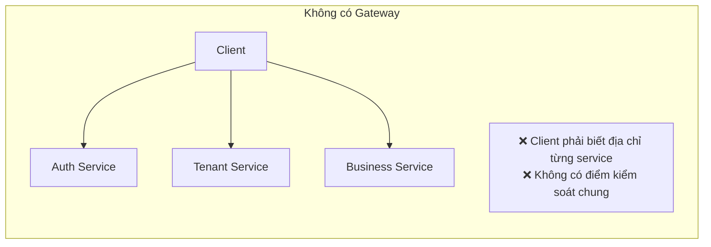
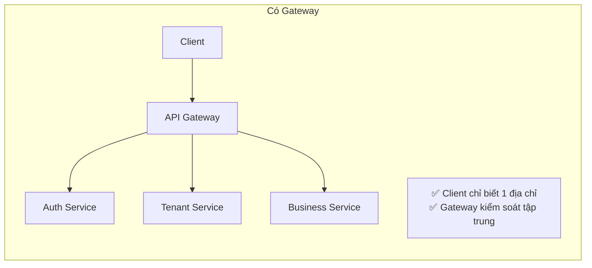
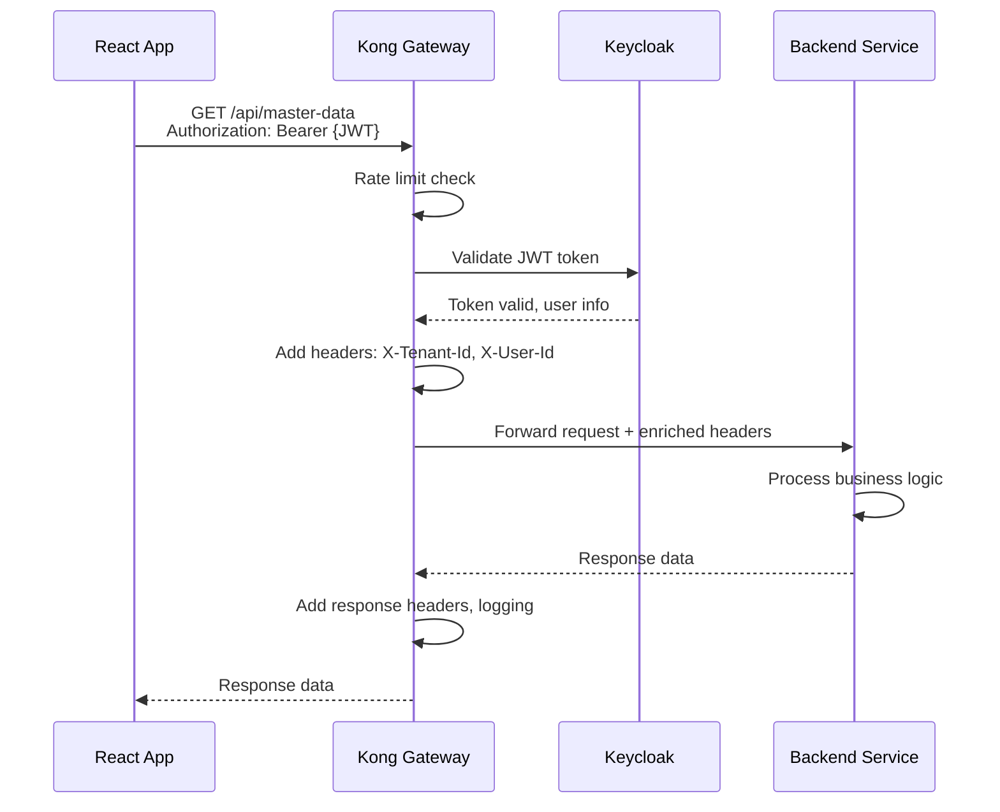
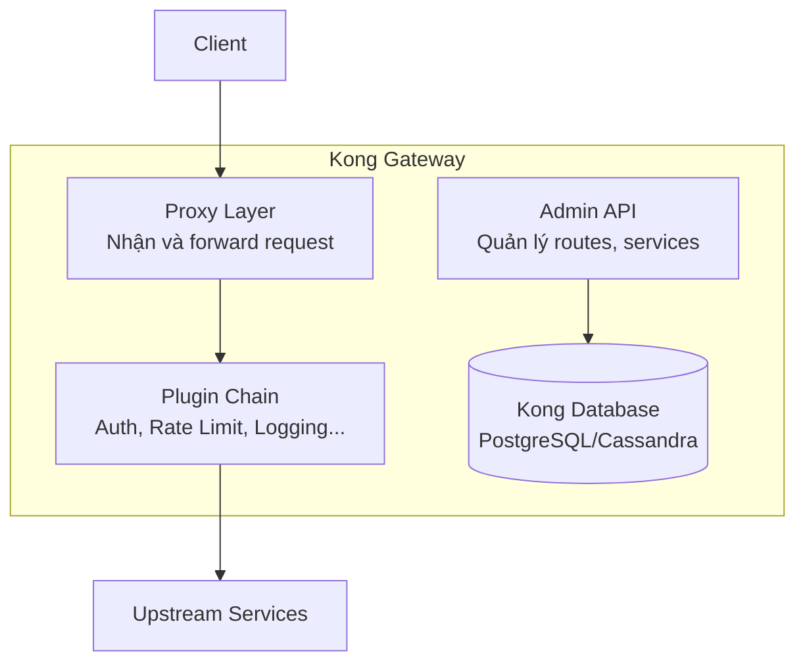
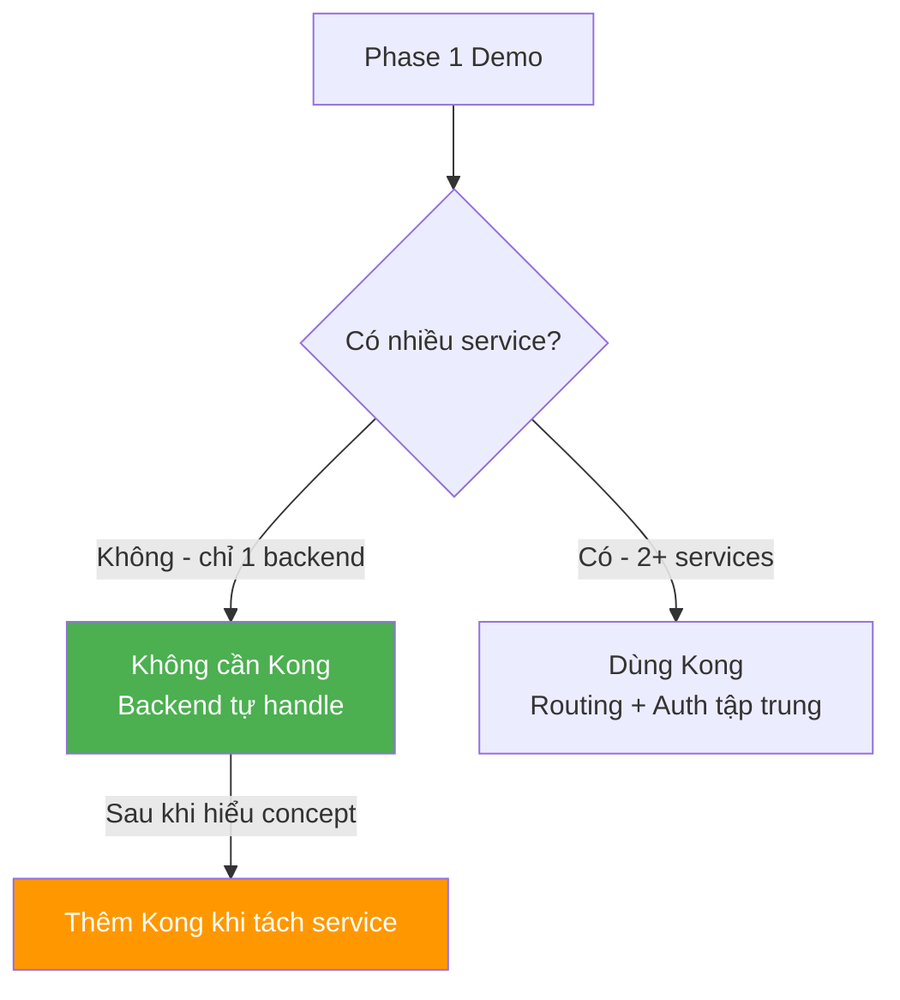

# 🚪 API Gateway & Kong

## API Gateway là gì?

API Gateway là **điểm vào duy nhất** (single entry point) cho tất cả request từ client vào hệ thống backend.





---

## Các chức năng chính của API Gateway

| Chức năng | Mô tả | Tại sao cần |
|-----------|-------|-------------|
| **Routing** | Chuyển request đến đúng service | Client không cần biết internal topology |
| **Authentication** | Verify JWT token | Kiểm tra auth tập trung, service không cần tự verify |
| **Rate Limiting** | Giới hạn số request/giây | Bảo vệ backend khỏi quá tải |
| **Load Balancing** | Phân tải giữa các instance | Scalability |
| **SSL Termination** | Xử lý HTTPS | Service nội bộ dùng HTTP cho đơn giản |
| **Request Transform** | Thêm/sửa header | Inject tenant_id, correlation_id |
| **Logging/Metrics** | Ghi log tập trung | Observability |
| **CORS** | Xử lý cross-origin | Frontend ở domain khác |

---

## Request Flow qua API Gateway



---

## Kong API Gateway

### Tại sao Kong?

Kong là API Gateway phổ biến nhất cho microservices:

| Tiêu chí | Kong | Nginx (raw) | AWS API Gateway | Traefik |
|----------|------|-------------|-----------------|---------|
| **Open-source** | ✅ (Community) | ✅ | ❌ (AWS-only) | ✅ |
| **Plugin ecosystem** | ✅ Rất phong phú | ⚠️ Ít | ✅ AWS ecosystem | ⚠️ Trung bình |
| **Admin API** | ✅ REST API | ❌ Config file | ✅ Console | ✅ |
| **Service Discovery** | ✅ Built-in | ❌ | ✅ | ✅ |
| **Rate Limiting** | ✅ Plugin | ⚠️ Tự config | ✅ | ✅ |
| **Auth plugins** | ✅ JWT, OAuth2 | ⚠️ Basic | ✅ | ⚠️ |
| **Learning curve** | ⭐⭐ | ⭐ | ⭐⭐ | ⭐⭐ |
| **Performance** | ✅ Rất cao (Lua/Nginx) | ✅ Rất cao | ✅ | ✅ |

### Kong architecture



---

## Phase 1: Dùng Gateway hay chưa?

### Phân tích

| Tiêu chí | Dùng Kong ngay | Không dùng vội |
|----------|----------------|----------------|
| **Học được** | Hiểu gateway concept thực tế | Tập trung học backend |
| **Complexity** | Thêm 1 container (Docker) | Đơn giản hơn |
| **Cần thiết?** | Chỉ có 1 backend service | Chưa cần route nhiều service |
| **Auth** | Kong verify JWT | Backend tự verify JWT |

### Khuyến nghị



**Kết luận Phase 1:**
- **Ban đầu:** Không cần Kong. Backend Spring Boot tự handle auth + routing.
- **Khi hiểu concept:** Thêm Kong vào Docker Compose, thử route request.
- **Khi tách service:** Kong trở nên cần thiết.

---

## Nếu thêm Kong vào Demo

```yaml
# docker-compose.yml (tham khảo)
services:
  kong:
    image: kong:latest
    environment:
      KONG_DATABASE: postgres
      KONG_PG_HOST: kong-db
    ports:
      - "8000:8000"   # Proxy
      - "8001:8001"   # Admin API
  
  kong-db:
    image: postgres:15
    environment:
      POSTGRES_DB: kong
```

Cấu hình route:
```bash
# Tạo service
curl -i -X POST http://localhost:8001/services \
  --data name=backend-service \
  --data url=http://backend:8080

# Tạo route
curl -i -X POST http://localhost:8001/services/backend-service/routes \
  --data paths=/api
```

---

*Tiếp theo: [07-postgresql-data-modeling/](../07-postgresql-data-modeling/)*
