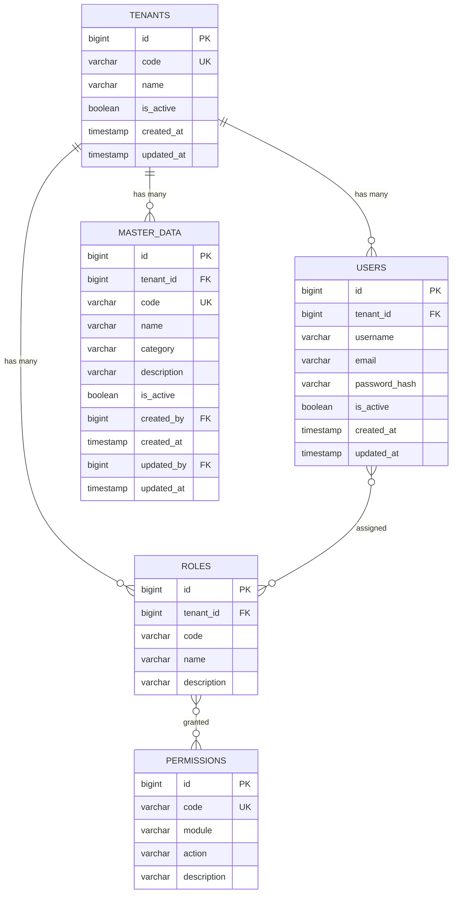

# 🐘 PostgreSQL & Data Modeling đa Tenant

## Tại sao PostgreSQL?

| Tiêu chí | PostgreSQL | MySQL | SQL Server | MongoDB |
|----------|-----------|-------|-----------|---------|
| **Open-source** | ✅ Hoàn toàn | ✅ (Community) | ❌ License | ✅ |
| **ACID compliance** | ✅ Rất mạnh | ✅ | ✅ | ⚠️ Tuỳ config |
| **JSON support** | ✅ jsonb rất mạnh | ⚠️ Cơ bản | ⚠️ | ✅ Native |
| **Schema support** | ✅ (multi-schema) | ❌ | ✅ | N/A |
| **Extension ecosystem** | ✅ Rất phong phú | ⚠️ | ⚠️ | ⚠️ |
| **Phù hợp SaaS** | ✅ | ✅ | ⚠️ Chi phí | ⚠️ Không phù hợp kế toán |
| **Phù hợp kế toán** | ✅ ACID, consistency | ✅ | ✅ | ❌ Eventual consistency |

**Kết luận:** PostgreSQL phù hợp nhất cho hệ thống kế toán SaaS vì:
- ACID transaction mạnh → dữ liệu tài chính phải chính xác
- Schema support → có thể dùng schema per tenant sau
- Open-source → không lo license
- jsonb → linh hoạt khi cần dynamic fields

---

## Data Model cho Phase 1 Demo

### ER Diagram tổng thể



---

## Tenant-aware Query Patterns

### ❌ SAI — Quên filter tenant

```sql
-- NGUY HIỂM: Trả về data của TẤT CẢ tenant!
SELECT * FROM master_data WHERE category = 'MATERIAL';
```

### ✅ ĐÚNG — Luôn có tenant filter

```sql
-- AN TOÀN: Chỉ trả về data của tenant hiện tại
SELECT * FROM master_data 
WHERE tenant_id = :tenantId AND category = 'MATERIAL';
```

### Pattern: Repository layer tự động filter

```java
// BaseRepository.java — luôn thêm tenant_id
public abstract class TenantAwareRepository<T extends TenantAwareEntity> {
    
    public List<T> findAll() {
        Long tenantId = TenantContext.getCurrentTenant();
        return entityManager
            .createQuery("SELECT e FROM " + entityClass.getSimpleName() 
                + " e WHERE e.tenantId = :tid", entityClass)
            .setParameter("tid", tenantId)
            .getResultList();
    }
    
    public Optional<T> findById(Long id) {
        Long tenantId = TenantContext.getCurrentTenant();
        // Tìm theo ID + tenant_id (tránh truy cập data tenant khác)
        return entityManager
            .createQuery("SELECT e FROM " + entityClass.getSimpleName() 
                + " e WHERE e.id = :id AND e.tenantId = :tid", entityClass)
            .setParameter("id", id)
            .setParameter("tid", tenantId)
            .getResultStream().findFirst();
    }
}
```

---

## Search cơ bản

Cho demo Phase 1, search có thể dùng SQL `LIKE` hoặc `ILIKE`:

```sql
-- Tìm master-data theo tên hoặc code
SELECT * FROM master_data 
WHERE tenant_id = :tenantId 
  AND (
    LOWER(name) LIKE LOWER('%' || :keyword || '%')
    OR LOWER(code) LIKE LOWER('%' || :keyword || '%')
  )
ORDER BY name
LIMIT 20 OFFSET 0;
```

### Pagination

```sql
-- Sử dụng LIMIT/OFFSET (đơn giản, phù hợp demo)
SELECT * FROM master_data 
WHERE tenant_id = :tenantId
ORDER BY created_at DESC
LIMIT :pageSize OFFSET :pageSize * :pageNumber;
```

---

## Soft Delete & Audit

### Soft Delete

Thay vì `DELETE FROM table`, dùng cột `is_active` hoặc `deleted_at`:

```sql
-- Soft delete
UPDATE master_data SET is_active = FALSE, updated_at = NOW() 
WHERE id = :id AND tenant_id = :tenantId;

-- Query chỉ lấy active records
SELECT * FROM master_data 
WHERE tenant_id = :tenantId AND is_active = TRUE;
```

### Audit columns

Mọi bảng business nên có:
```sql
created_at   TIMESTAMP DEFAULT CURRENT_TIMESTAMP,
created_by   BIGINT REFERENCES users(id),
updated_at   TIMESTAMP,
updated_by   BIGINT REFERENCES users(id)
```

---

## Index Strategy

```sql
-- Index cho tenant filter (quan trọng nhất)
CREATE INDEX idx_master_data_tenant ON master_data(tenant_id);

-- Composite index cho query phổ biến
CREATE INDEX idx_master_data_tenant_active ON master_data(tenant_id, is_active);

-- Index cho search
CREATE INDEX idx_master_data_tenant_name ON master_data(tenant_id, name);

-- Unique constraint tenant-aware
ALTER TABLE master_data ADD CONSTRAINT uq_master_data_tenant_code 
    UNIQUE(tenant_id, code);
```

---

## Lưu ý quan trọng

1. **Unique constraint phải tenant-aware**: `UNIQUE(tenant_id, code)` — không phải `UNIQUE(code)`
2. **Foreign key trong cùng tenant**: Nếu bảng A reference bảng B, cả hai phải cùng `tenant_id`
3. **Không dùng auto-increment cho public ID**: Có thể dùng UUID cho API, auto-increment cho internal
4. **Migration tool**: Dùng Flyway hoặc Liquibase

---

*Tiếp theo: [08-redis-cache/](../08-redis-cache/)*
