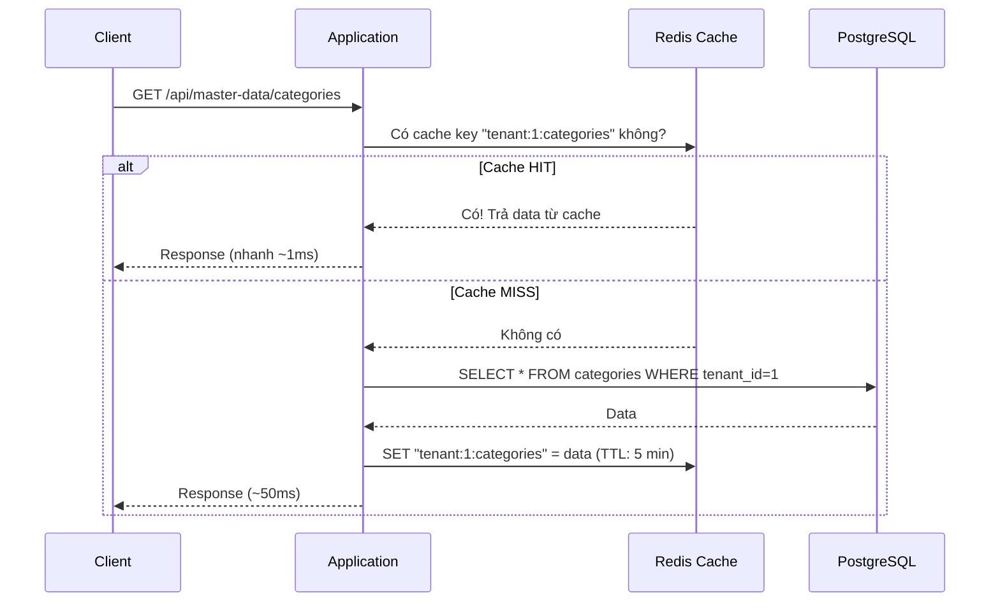
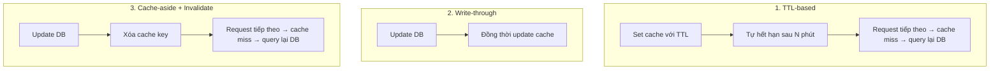
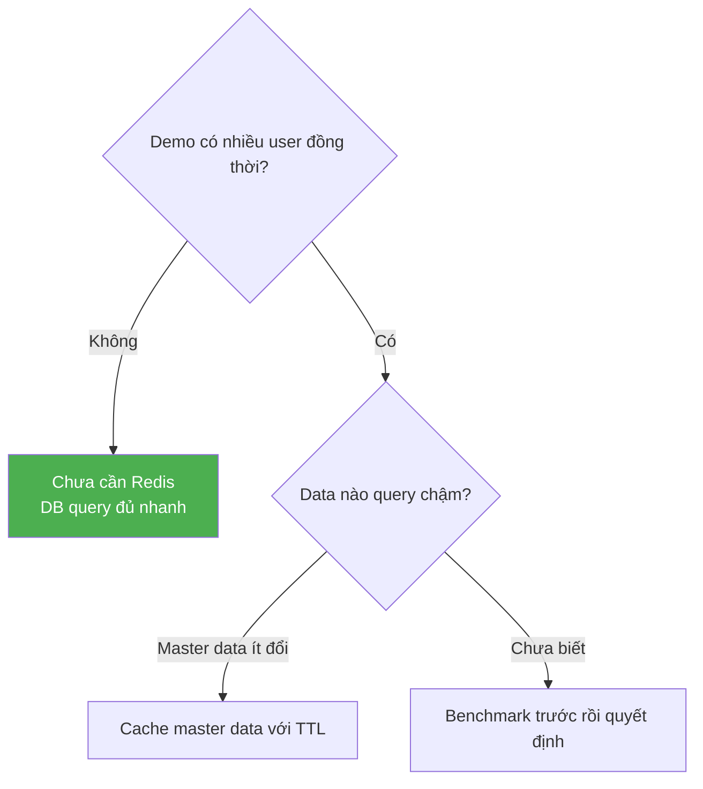

# ⚡ Redis Cache

## Cache là gì?

Cache là lớp **lưu trữ tạm thời** dữ liệu thường xuyên truy cập, giúp giảm thời gian phản hồi và giảm tải cho database.



---

## Tại sao Redis?

| Tiêu chí | Redis | Memcached | Local Cache (HashMap) |
|----------|-------|-----------|----------------------|
| **Data structures** | ✅ String, Hash, List, Set, Sorted Set | ⚠️ Chỉ String | ✅ Tuỳ ý |
| **Persistence** | ✅ Có thể persist | ❌ | ❌ (mất khi restart) |
| **Distributed** | ✅ | ✅ | ❌ (chỉ trong 1 instance) |
| **Pub/Sub** | ✅ | ❌ | ❌ |
| **TTL** | ✅ Per key | ✅ Per key | ⚠️ Tự implement |
| **Cluster** | ✅ Redis Cluster | ✅ | ❌ |
| **Phù hợp microservices** | ✅ | ✅ | ❌ |

---

## Các use case cache trong dự án

| Use Case | Cache Key Pattern | TTL | Ưu tiên Phase 1 |
|----------|------------------|-----|-----------------|
| Master-data (ít thay đổi) | `tenant:{id}:master:{type}` | 10 phút | ✅ Có thể demo |
| User session/token | `session:{token}` | 1 giờ | ⚠️ JWT đã stateless |
| Permission list per user | `tenant:{id}:user:{uid}:perms` | 5 phút | ⚠️ Chưa cần |
| Config per tenant | `tenant:{id}:config` | 30 phút | ⚠️ Chưa cần |
| Rate limit counter | `ratelimit:{ip}:{endpoint}` | 1 phút | ❌ Chưa cần |

---

## Cache Invalidation — Vấn đề khó nhất

> "There are only two hard things in Computer Science: cache invalidation and naming things." — Phil Karlton

### 3 chiến lược invalidation phổ biến



| Chiến lược | Ưu điểm | Nhược điểm | Phù hợp khi |
|-----------|---------|-----------|-------------|
| **TTL-based** | Đơn giản nhất | Data có thể stale trong TTL | Data ít critical |
| **Write-through** | Luôn consistent | Phức tạp, write chậm hơn | Data critical, read-heavy |
| **Cache-aside** | Cân bằng | Có window stale ngắn | Phổ biến nhất |

---

## Cache Key với Multi-tenant

**Quan trọng:** Cache key **phải** chứa `tenant_id` để tránh data leakage.

```
❌ SAI:   "categories"          → Tenant A thấy data cache của tenant B!
✅ ĐÚNG:  "tenant:1:categories"  → Chỉ tenant 1 thấy cache của mình
```

### Convention đề xuất

```
tenant:{tenantId}:{module}:{resource}:{identifier}

Ví dụ:
tenant:1:master:categories:all
tenant:1:master:items:page:1:size:20
tenant:2:user:permissions:userId:42
```

---

## Phase 1: Khi nào cần Redis?



### Khuyến nghị

1. **Ban đầu:** Không dùng Redis, focus vào business logic
2. **Khi hiểu concept:** Thêm Redis vào Docker Compose, cache 1 endpoint
3. **Khi cần:** Cache master-data lookups, tenant config

```yaml
# docker-compose.yml
services:
  redis:
    image: redis:7-alpine
    ports:
      - "6379:6379"
```

```java
// Spring Boot config đơn giản
@Cacheable(value = "masterData", key = "#tenantId + ':' + #category")
public List<MasterData> findByCategory(Long tenantId, String category) {
    return masterDataRepository.findByTenantIdAndCategory(tenantId, category);
}
```

---

*Tiếp theo: [09-kafka-async/](../09-kafka-async/)*
