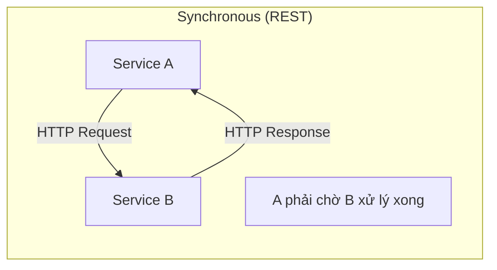
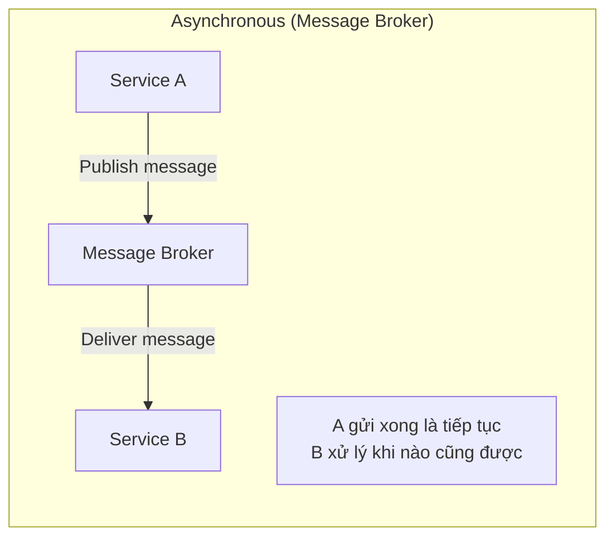
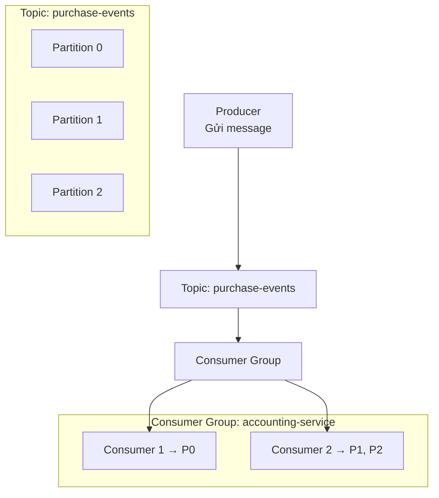
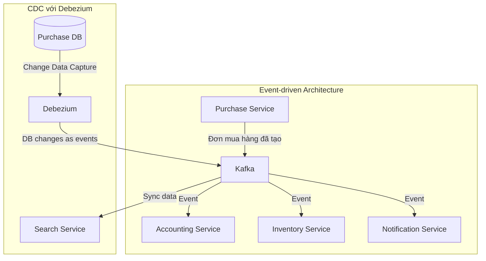
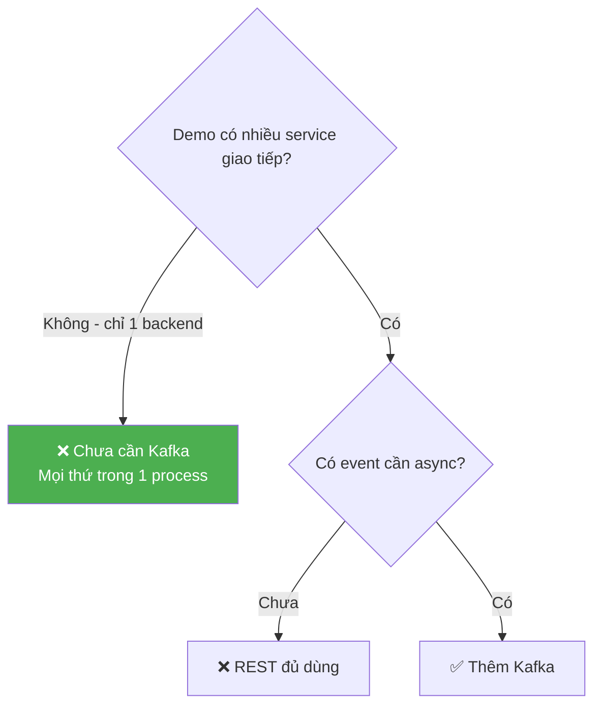

# 📨 Kafka & Async Messaging

## Message Broker là gì?

Message Broker là hệ thống **trung gian** giúp các service giao tiếp **không đồng bộ** với nhau.

---

## Sync vs Async Communication

| Tiêu chí | Synchronous (REST/gRPC) | Asynchronous (Message Broker) |
|----------|------------------------|-------------------------------|
| **Coupling** | Tight — A phải biết B | Loose — A chỉ biết topic/queue |
| **Availability** | B down → A fail | B down → message chờ trong queue |
| **Response** | Ngay lập tức | Không có response trực tiếp |
| **Complexity** | Đơn giản | Phức tạp hơn (message format, retry, ordering) |
| **Use case** | Query data, CRUD | Event notification, background processing |
| **Debug** | Dễ trace | Khó trace hơn |

---

## Kafka là gì?

**Apache Kafka** là distributed event streaming platform, hoạt động như message broker hiệu suất cao.

### Khái niệm cốt lõi

| Khái niệm | Giải thích | Ví dụ |
|-----------|-----------|-------|
| **Producer** | Gửi message vào topic | Purchase Service gửi event "đơn hàng đã tạo" |
| **Consumer** | Đọc message từ topic | Accounting Service nhận event để tạo bút toán |
| **Topic** | Kênh chứa message theo chủ đề | `purchase-events`, `user-events` |
| **Partition** | Chia topic thành phần nhỏ để parallel | Message cùng key → cùng partition → đúng thứ tự |
| **Consumer Group** | Nhóm consumer chia nhau đọc partitions | Scale consumer mà không đọc trùng |

---

## Kafka trong kiến trúc target

### Use cases trong dự án kế toán

| Use case | Producer | Consumer | Tại sao async? |
|----------|----------|----------|----------------|
| Tạo bút toán khi mua hàng | Purchase Service | Accounting Service | Hạch toán phức tạp, không cần chờ |
| Sync data sang search | Debezium CDC | Search Service | Indexing nặng, không block business |
| Gửi notification | Bất kỳ service | Notification Service | Gửi email/SMS không cần chờ |
| Audit logging | Bất kỳ service | Audit Service | Ghi log không block request |

---

## Kafka vs Alternatives

| Tiêu chí | Kafka | RabbitMQ | AWS SQS |
|----------|-------|----------|---------|
| **Throughput** | ✅ Cực cao (triệu msg/s) | ⚠️ Cao | ⚠️ Trung bình |
| **Message retention** | ✅ Lưu lâu dài | ❌ Xóa sau consume | ⚠️ 14 ngày max |
| **Ordering** | ✅ Per partition | ⚠️ Per queue | ⚠️ FIFO queue |
| **Replay** | ✅ Có thể đọc lại | ❌ | ❌ |
| **Complexity** | ⭐⭐⭐ Cao | ⭐⭐ Trung bình | ⭐ Thấp |
| **Use case chính** | Event streaming, CDC | Task queue, RPC | Simple queue |

---

## Phase 1: Khi nào cần Kafka?

### Decision Framework

| Câu hỏi | Trả lời cho Phase 1 | Kết luận |
|---------|---------------------|---------|
| Có nhiều service giao tiếp? | Không, modular monolith | Chưa cần |
| Có xử lý nặng cần background? | Chưa | Chưa cần |
| Có cần event replay? | Chưa | Chưa cần |
| Cần CDC sync? | Chưa | Chưa cần |
| **Khi nào cần?** | Khi tách service hoặc cần async processing | Phase 2+ |

### Khuyến nghị
1. **Phase 1:** Hiểu concept Kafka, KHÔNG implement
2. **Khi tách service:** Thêm Kafka cho inter-service communication
3. **Khi cần CDC:** Thêm Debezium + Kafka

---

*Tiếp theo: [10-minio-file-storage/](../10-minio-file-storage/)*
