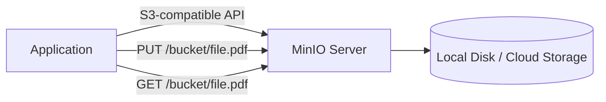
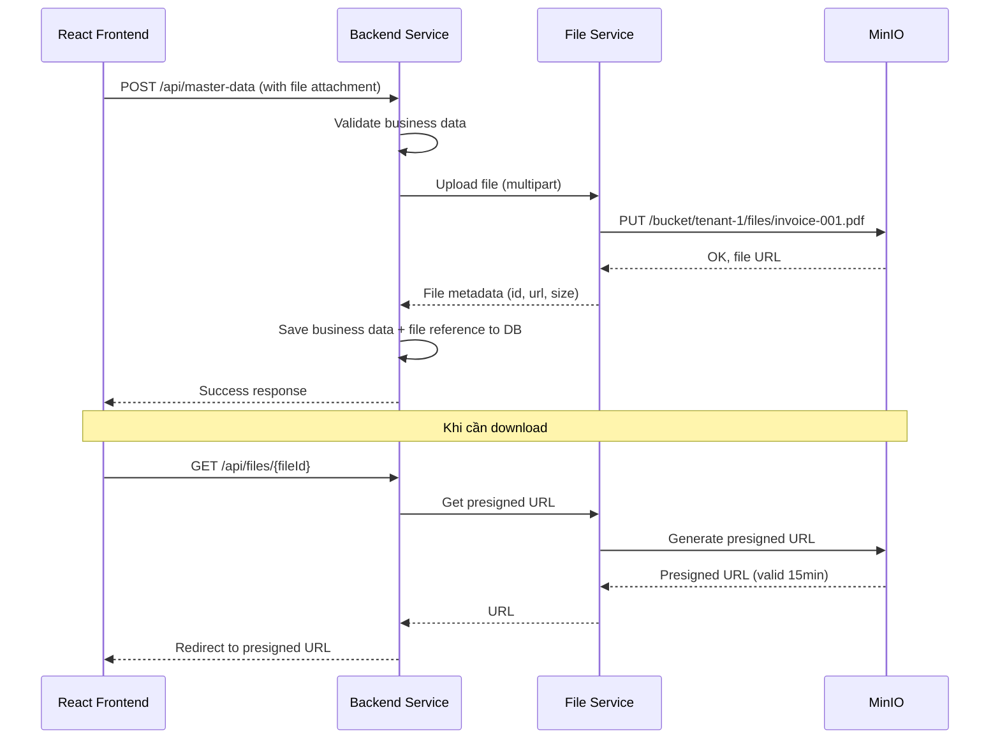

# 📦 MinIO & File Management

## Object Storage là gì?

**Object Storage** là hệ thống lưu trữ file dưới dạng "object" — mỗi object gồm: data + metadata + unique ID.

### So sánh các loại storage

| Loại | Cách tổ chức | Ví dụ | Phù hợp cho |
|------|-------------|-------|-------------|
| **Block Storage** | Blocks trên disk | Hard drive, EBS | OS, databases |
| **File Storage** | File tree (thư mục) | NFS, NAS | Shared folders |
| **Object Storage** | Flat namespace, key-value | S3, MinIO | File uploads, images, backups |

### Tại sao file khác data quan hệ?

| Relational Data (PostgreSQL) | File Data (MinIO) |
|-----------------------------|-------------------|
| Cấu trúc rõ ràng (schema) | Không có schema |
| Nhỏ (KB per row) | Lớn (MB-GB per file) |
| Query, join, aggregate | Chỉ GET/PUT/DELETE |
| Transaction critical | Không cần transaction |
| Text-based | Binary |

→ Lưu file trong database = **sai thiết kế**. File nên nằm ở object storage riêng.

---

## MinIO là gì?

**MinIO** là object storage server **tương thích S3 API**, self-hosted.



### Tại sao MinIO thay vì S3?

| Tiêu chí | AWS S3 | MinIO |
|----------|--------|-------|
| **Hosting** | AWS cloud only | Self-hosted |
| **API** | S3 API | S3-compatible API |
| **Chi phí** | Trả theo dung lượng | Miễn phí (tự host) |
| **Control** | AWS quản lý | Mình quản lý hoàn toàn |
| **Phù hợp dev/staging** | ⚠️ Tốn tiền | ✅ Docker miễn phí |
| **Migration lên S3** | N/A | ✅ Chỉ đổi endpoint |

---

## File Service trong kiến trúc



### Bucket structure cho multi-tenant

```
minio/
├── tenant-1/
│   ├── invoices/
│   │   ├── INV-001.pdf
│   │   └── INV-002.pdf
│   ├── attachments/
│   │   └── receipt-001.jpg
│   └── exports/
│       └── report-2026-04.xlsx
├── tenant-2/
│   ├── invoices/
│   └── attachments/
└── tenant-3/
    └── ...
```

---

## Phase 1: Cần MinIO không?

| Câu hỏi | Trả lời | Kết luận |
|---------|---------|---------|
| Demo có upload file? | Có thể không cần | Chưa cần |
| Module CRUD cần attachment? | Tuỳ, có thể bỏ qua | Optional |
| Cần hiểu concept? | Có | Đọc lý thuyết |

### Khuyến nghị
1. **Phase 1:** Hiểu concept, KHÔNG implement
2. **Nếu muốn thử:** Thêm MinIO vào Docker Compose, thử upload 1 file

```yaml
# docker-compose.yml
services:
  minio:
    image: minio/minio
    command: server /data --console-address ":9001"
    ports:
      - "9000:9000"  # API
      - "9001:9001"  # Console
    environment:
      MINIO_ROOT_USER: minioadmin
      MINIO_ROOT_PASSWORD: minioadmin
```

---

*Tiếp theo: [11-observability/](../11-observability/)*
