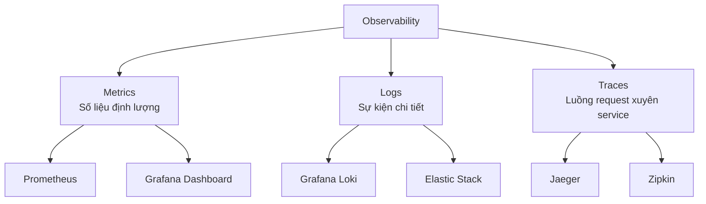
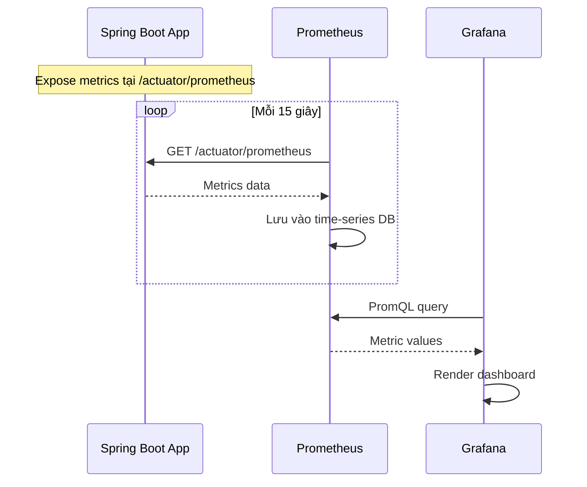
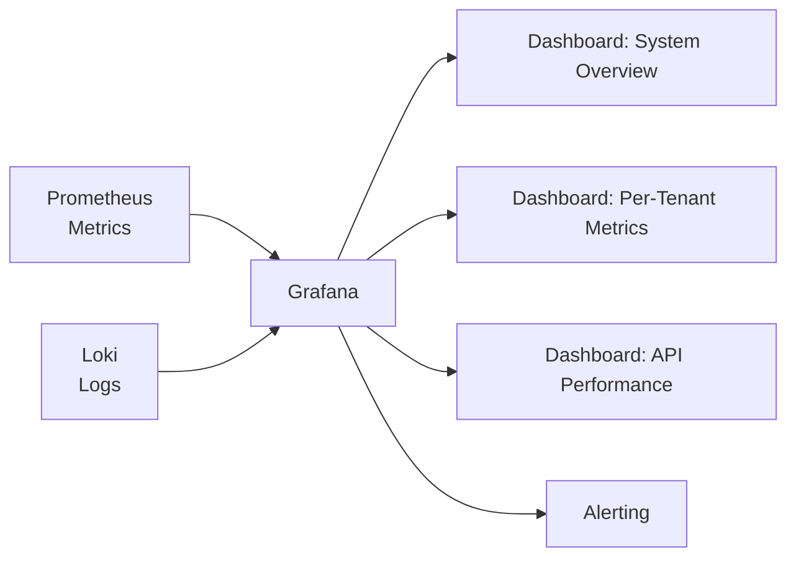

# 📊 Observability — Prometheus, Grafana, Logging

## Ba trụ cột của Observability



| Trụ cột | Trả lời câu hỏi | Ví dụ |
|---------|-----------------|-------|
| **Metrics** | "Hệ thống đang hoạt động thế nào?" | CPU 80%, latency p99 = 200ms, 500 req/s |
| **Logs** | "Chuyện gì đã xảy ra?" | "ERROR: NullPointerException at line 42" |
| **Traces** | "Request đi qua đâu và mất bao lâu ở mỗi chỗ?" | FE → Gateway (2ms) → Auth (5ms) → Service (50ms) → DB (20ms) |

---

## Prometheus

### Prometheus là gì?
Hệ thống **thu thập và lưu trữ metrics** theo time-series.

### Cách hoạt động



### Metrics phổ biến cần monitor

| Metric | Ý nghĩa | Alert khi |
|--------|---------|----------|
| `http_requests_total` | Tổng số request | Spike bất thường |
| `http_request_duration_seconds` | Thời gian xử lý | p99 > 500ms |
| `jvm_memory_used_bytes` | Memory đang dùng | > 80% heap |
| `db_connection_pool_active` | DB connections active | > 80% pool |
| `http_server_errors_total` | Số lỗi 5xx | > 1% error rate |

---

## Grafana

**Grafana** là công cụ **visualization** — tạo dashboard từ nhiều data source.

### Grafana trong hệ thống



---

## Minimum Viable Observability cho Phase 1

### Cần làm ngay

| Việc | Tool | Effort |
|------|------|--------|
| Structured logging | SLF4J + Logback | Thấp |
| Log có tenant context | MDC filter | Thấp |
| Health check endpoint | Spring Actuator | Rất thấp |

### Có thể thêm khi đủ thời gian

| Việc | Tool | Effort |
|------|------|--------|
| Metrics endpoint | Micrometer + Actuator | Thấp |
| Prometheus scrape | Docker Compose | Trung bình |
| Grafana dashboard | Docker Compose + JSON | Trung bình |

### Chưa cần

- Distributed tracing (Jaeger/Zipkin) — chỉ 1 service
- Loki/ELK — structured logging vào file đủ dùng
- Complex alerting

### Logging có tenant context

```java
// MDC Filter — thêm tenantId vào mọi log
public class TenantMDCFilter extends OncePerRequestFilter {
    @Override
    protected void doFilterInternal(HttpServletRequest req, 
            HttpServletResponse res, FilterChain chain) {
        Long tenantId = TenantContext.getCurrentTenant();
        MDC.put("tenantId", String.valueOf(tenantId));
        try {
            chain.doFilter(req, res);
        } finally {
            MDC.remove("tenantId");
        }
    }
}

// logback-spring.xml pattern
// %d{yyyy-MM-dd HH:mm:ss} [%X{tenantId}] %-5level %logger - %msg%n
```

**Output:**
```
2026-04-21 15:00:01 [tenant:1] INFO  MasterDataController - GET /api/master-data, found 42 records
2026-04-21 15:00:02 [tenant:3] ERROR MasterDataService - Failed to create: duplicate code
```

---

### Docker Compose cho observability

```yaml
services:
  prometheus:
    image: prom/prometheus
    volumes:
      - ./prometheus.yml:/etc/prometheus/prometheus.yml
    ports:
      - "9090:9090"
  
  grafana:
    image: grafana/grafana
    ports:
      - "3001:3000"
    environment:
      GF_SECURITY_ADMIN_PASSWORD: admin
```

---

*Tiếp theo: [12-clean-code-conventions/](../12-clean-code-conventions/)*
