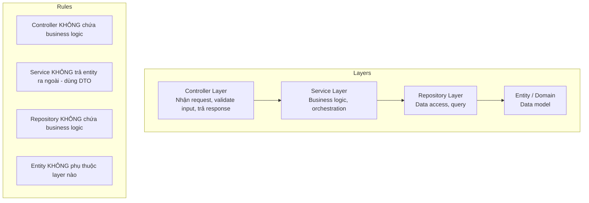

# 🧹 Clean Code & Convention Code

## Tại sao convention quan trọng?

Trong hệ thống multi-service, multi-tenant, nếu không có convention:
- Mỗi người code một kiểu → khó review, khó maintain
- Tên biến/hàm không nhất quán → mất thời gian đọc hiểu
- Cấu trúc project khác nhau giữa services → khó onboard
- Bug tiềm ẩn do thiếu quy chuẩn validation, error handling

---

## Naming Conventions

### Java / Spring Boot

| Loại | Convention | Ví dụ đúng | Ví dụ sai |
|------|-----------|-----------|----------|
| **Class** | PascalCase | `MasterDataService` | `masterDataService`, `master_data_service` |
| **Method** | camelCase, verb + noun | `findByTenantId()` | `data()`, `get()` |
| **Variable** | camelCase | `tenantId` | `TenantId`, `tenant_id` |
| **Constant** | UPPER_SNAKE | `MAX_PAGE_SIZE` | `maxPageSize` |
| **Package** | lowercase | `com.viettel.accounting.service` | `com.viettel.Accounting` |
| **Table/Column** | snake_case | `master_data`, `tenant_id` | `MasterData`, `tenantId` |
| **API endpoint** | kebab-case, plural noun | `/api/master-data` | `/api/getMasterData` |
| **DTO** | PascalCase + suffix | `MasterDataDTO`, `CreateMasterDataRequest` | `MasterDataObj` |

### React / Frontend

| Loại | Convention | Ví dụ |
|------|-----------|-------|
| **Component** | PascalCase | `MasterDataList.jsx` |
| **Hook** | camelCase, prefix `use` | `useMasterData()` |
| **File component** | PascalCase | `LoginPage.jsx` |
| **CSS module** | camelCase | `styles.container` |
| **Constant** | UPPER_SNAKE | `API_BASE_URL` |

---

## Folder Structure Convention — Spring Boot

```
src/main/java/com/viettel/demo/
├── config/                     # Cấu hình: Security, CORS, etc.
│   ├── SecurityConfig.java
│   └── WebConfig.java
├── common/                     # Shared utilities
│   ├── dto/
│   │   ├── ApiResponse.java    # Response wrapper chuẩn
│   │   └── PageResponse.java
│   ├── exception/
│   │   ├── BusinessException.java
│   │   └── GlobalExceptionHandler.java
│   └── tenant/
│       ├── TenantContext.java
│       └── TenantFilter.java
├── module/                     # Business modules
│   ├── auth/
│   │   ├── controller/AuthController.java
│   │   ├── service/AuthService.java
│   │   ├── dto/LoginRequest.java
│   │   └── dto/LoginResponse.java
│   ├── tenant/
│   │   ├── controller/
│   │   ├── service/
│   │   ├── repository/
│   │   ├── entity/Tenant.java
│   │   └── dto/
│   └── masterdata/
│       ├── controller/MasterDataController.java
│       ├── service/MasterDataService.java
│       ├── repository/MasterDataRepository.java
│       ├── entity/MasterData.java
│       └── dto/
│           ├── MasterDataDTO.java
│           ├── CreateMasterDataRequest.java
│           └── UpdateMasterDataRequest.java
└── DemoApplication.java
```

---

## Layered Architecture



### Trách nhiệm từng layer

| Layer | Trách nhiệm | KHÔNG được làm |
|-------|-------------|----------------|
| **Controller** | Validate input, gọi service, map response | Chứa business logic, gọi repository trực tiếp |
| **Service** | Business logic, transaction management | Return entity trực tiếp, gọi controller khác |
| **Repository** | Data access, query | Chứa business logic |
| **DTO** | Transfer data giữa layers | Chứa logic |
| **Entity** | Mapping với database table | Phụ thuộc layer khác |

### Ví dụ chuẩn

```java
// Controller — chỉ validate + delegate
@RestController
@RequestMapping("/api/master-data")
public class MasterDataController {
    
    private final MasterDataService service;
    
    @PostMapping
    public ResponseEntity<ApiResponse<MasterDataDTO>> create(
            @Valid @RequestBody CreateMasterDataRequest request) {
        MasterDataDTO result = service.create(request);
        return ResponseEntity.status(201)
            .body(ApiResponse.success(result));
    }
}

// Service — business logic
@Service
@Transactional
public class MasterDataService {
    
    private final MasterDataRepository repository;
    
    public MasterDataDTO create(CreateMasterDataRequest request) {
        Long tenantId = TenantContext.getCurrentTenant();
        
        // Business validation
        if (repository.existsByTenantIdAndCode(tenantId, request.getCode())) {
            throw new BusinessException("Code already exists");
        }
        
        MasterData entity = new MasterData();
        entity.setTenantId(tenantId);
        entity.setCode(request.getCode());
        entity.setName(request.getName());
        
        MasterData saved = repository.save(entity);
        return MasterDataDTO.fromEntity(saved);
    }
}
```

---

## API Response Convention

### Response wrapper chuẩn

```java
public class ApiResponse<T> {
    private boolean success;
    private String message;
    private T data;
    private List<FieldError> errors;
    
    public static <T> ApiResponse<T> success(T data) { ... }
    public static <T> ApiResponse<T> error(String message) { ... }
}
```

```json
// Success
{ "success": true, "message": null, "data": { ... }, "errors": null }

// Error
{ "success": false, "message": "Validation failed", "data": null, 
  "errors": [{"field": "code", "message": "must not be blank"}] }
```

### HTTP Status codes chuẩn

| Status | Khi nào dùng |
|--------|-------------|
| `200 OK` | GET thành công, UPDATE thành công |
| `201 Created` | POST tạo mới thành công |
| `204 No Content` | DELETE thành công |
| `400 Bad Request` | Input validation fail |
| `401 Unauthorized` | Chưa login / token hết hạn |
| `403 Forbidden` | Không có quyền |
| `404 Not Found` | Resource không tồn tại |
| `409 Conflict` | Trùng dữ liệu (duplicate) |
| `500 Internal Server Error` | Lỗi server không mong đợi |

---

## Validation Boundaries

```mermaid
graph LR
    INPUT[Client Input] --> V1[Controller<br/>@Valid, format check]
    V1 --> V2[Service<br/>Business rule check]
    V2 --> V3[Repository<br/>DB constraint check]
    
    V1 -.->|400 Bad Request| ERR1[Field format errors]
    V2 -.->|409 Conflict| ERR2[Business rule violation]
    V3 -.->|500| ERR3[DB constraint violation]
```

| Tầng | Validate gì | Ví dụ |
|------|------------|-------|
| **Controller** | Format, required, size | `@NotBlank`, `@Size(max=100)` |
| **Service** | Business rules | Code đã tồn tại? Tenant hợp lệ? |
| **Database** | Constraints | UNIQUE, NOT NULL, FK |

---

*Tiếp theo: [13-design-patterns/](../13-design-patterns/)*
