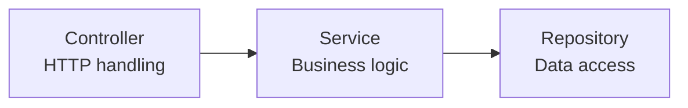
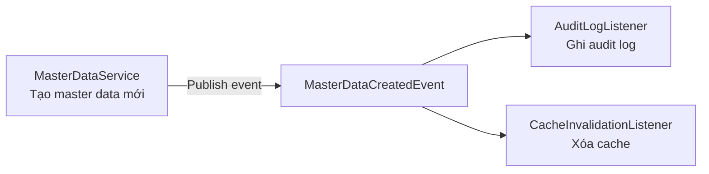
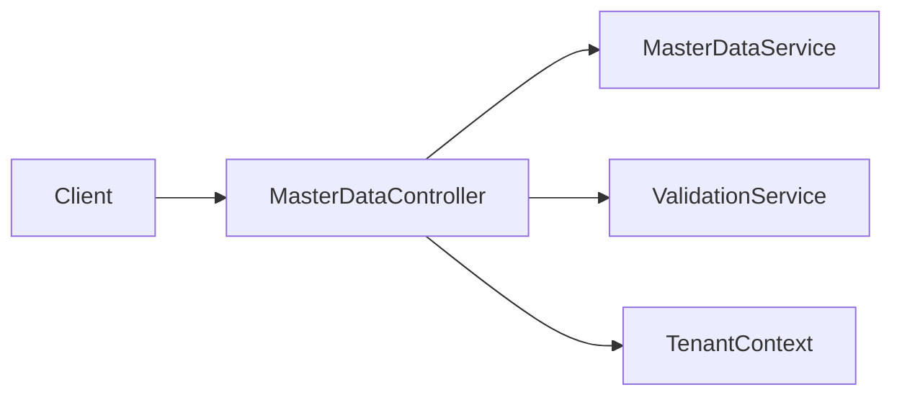

# 🎨 Design Patterns áp dụng cho Demo

> Chỉ tập trung vào các pattern **thực sự cần thiết** cho Phase 1 Demo. Không học tất cả design patterns — chỉ học cái dùng được.

---

## 1. Repository Pattern

### Là gì?
Tạo lớp trung gian giữa business logic và data access. Service không biết data lấy từ đâu (DB, cache, API).

### Tại sao cần?
- Tách biệt business logic khỏi SQL/JPA queries
- Dễ test (mock repository)
- Dễ thay đổi data source sau

### Áp dụng trong Demo

```java
// Repository interface
public interface MasterDataRepository extends JpaRepository<MasterData, Long> {
    List<MasterData> findByTenantIdAndIsActiveTrue(Long tenantId);
    Optional<MasterData> findByTenantIdAndCode(Long tenantId, String code);
    boolean existsByTenantIdAndCode(Long tenantId, String code);
}

// Service dùng repository — không biết SQL
@Service
public class MasterDataService {
    private final MasterDataRepository repository;
    
    public List<MasterDataDTO> findAll() {
        Long tenantId = TenantContext.getCurrentTenant();
        return repository.findByTenantIdAndIsActiveTrue(tenantId)
            .stream().map(MasterDataDTO::fromEntity).toList();
    }
}
```

### Khi nào KHÔNG cần?
- App cực nhỏ, 1–2 bảng → trực tiếp JPA cũng OK
- Nhưng ngay cả demo nhỏ, dùng Repository vẫn tốt vì Spring Data JPA đã có sẵn

---

## 2. Service Layer Pattern

### Là gì?
Tầng chứa business logic, đứng giữa Controller và Repository.

### Tại sao cần?
- Controller chỉ lo nhận request / trả response
- Business logic tập trung một chỗ → dễ test, dễ tái sử dụng
- Transaction management ở tầng service



### Áp dụng: Luôn luôn dùng trong Spring Boot.

---

## 3. DTO Pattern (Data Transfer Object)

### Là gì?
Object dùng để truyền data giữa các layers, KHÔNG phải entity.

### Tại sao cần?
- Không expose entity structure ra API
- Control chính xác field nào client thấy
- Request DTO khác Response DTO khác Entity

```java
// Entity — mapping với DB, có tenant_id, password_hash...
@Entity
public class User {
    private Long id;
    private Long tenantId;
    private String username;
    private String passwordHash; // KHÔNG ĐƯỢC trả ra API!
}

// Response DTO — chỉ trả những gì client cần
public record UserDTO(Long id, String username, String email, String role) {
    public static UserDTO fromEntity(User user) {
        return new UserDTO(user.getId(), user.getUsername(), 
            user.getEmail(), /* role lookup */);
    }
}
```

---

## 4. Strategy Pattern

### Là gì?
Cho phép chọn thuật toán/logic khác nhau tại runtime.

### Áp dụng trong dự án: Tenant Isolation Strategy

```java
// Interface
public interface TenantResolver {
    Long resolve(HttpServletRequest request);
}

// Strategy 1: Từ JWT token
public class JwtTenantResolver implements TenantResolver {
    public Long resolve(HttpServletRequest request) {
        String token = extractToken(request);
        return jwtService.extractTenantId(token);
    }
}

// Strategy 2: Từ subdomain (tenant1.app.com)
public class SubdomainTenantResolver implements TenantResolver {
    public Long resolve(HttpServletRequest request) {
        String host = request.getServerName(); // "tenant1.app.com"
        String subdomain = host.split("\\.")[0]; // "tenant1"
        return tenantService.findByCode(subdomain).getId();
    }
}

// Strategy 3: Từ header
public class HeaderTenantResolver implements TenantResolver {
    public Long resolve(HttpServletRequest request) {
        return Long.parseLong(request.getHeader("X-Tenant-Id"));
    }
}
```

### Phase 1: Dùng Strategy 1 (JWT). Nhưng thiết kế interface → dễ switch sau.

---

## 5. Dependency Injection (DI)

### Là gì?
Thay vì tự tạo dependency, để framework inject vào.

### Tại sao cần?
- Loose coupling giữa các class
- Dễ test (inject mock)
- Spring Boot dùng DI mặc định

```java
// ❌ SAI — tự tạo dependency
public class MasterDataController {
    private MasterDataService service = new MasterDataService(); // tight coupling!
}

// ✅ ĐÚNG — inject qua constructor
@RestController
public class MasterDataController {
    private final MasterDataService service;
    
    public MasterDataController(MasterDataService service) { // Spring inject
        this.service = service;
    }
}
```

### Phase 1: Spring Boot tự lo DI. Chỉ cần dùng `@Service`, `@Repository`, `@RestController`.

---

## 6. Observer / Pub-Sub Pattern

### Là gì?
Khi event xảy ra, tự động notify các subscriber.

### Áp dụng trong dự án



```java
// Spring Application Events — đơn giản, trong cùng app
@Service
public class MasterDataService {
    private final ApplicationEventPublisher eventPublisher;
    
    public MasterDataDTO create(CreateMasterDataRequest request) {
        MasterData saved = repository.save(entity);
        eventPublisher.publishEvent(new MasterDataCreatedEvent(saved));
        return MasterDataDTO.fromEntity(saved);
    }
}

@Component
public class AuditLogListener {
    @EventListener
    public void onMasterDataCreated(MasterDataCreatedEvent event) {
        // Ghi audit log
    }
}
```

### Phase 1: Có thể dùng Spring ApplicationEvent. Chưa cần Kafka.

---

## 7. Facade Pattern

### Là gì?
Tạo interface đơn giản che giấu hệ thống phức tạp bên dưới.

### Áp dụng: API Controller chính là Facade



Client chỉ biết 1 endpoint, không biết bên trong có bao nhiêu service phối hợp.

---

## Tổng kết: Pattern nào dùng trong Phase 1?

| Pattern | Dùng không? | Lý do |
|---------|:-----------:|-------|
| Repository | ✅ | Spring Data JPA có sẵn |
| Service Layer | ✅ | Tách business logic |
| DTO | ✅ | Không expose entity |
| Strategy | ✅ | Tenant resolver |
| DI | ✅ | Spring Boot mặc định |
| Observer | ⚠️ Optional | Audit log, cache invalidation |
| Facade | ✅ | Controller = facade |
| Factory | ⚠️ Optional | Nếu cần tạo object phức tạp |
| Adapter | ❌ Chưa cần | Khi integrate external system |
| Outbox | ❌ Chưa cần | Khi cần reliable async |

---

*Tiếp theo: [14-react-cho-demo/](../14-react-cho-demo/)*
