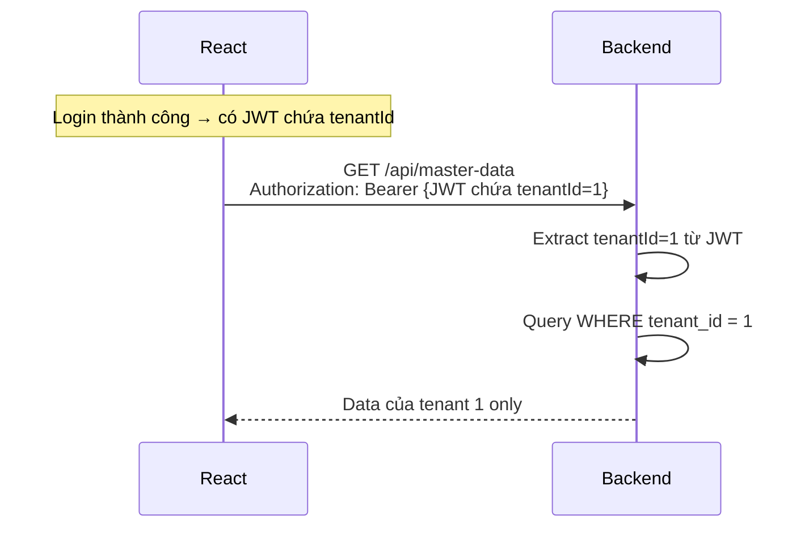

# ⚛️ React cho Demo Phase 1

> Tài liệu này KHÔNG phải React tutorial tổng quát. Chỉ tập trung vào những gì cần cho demo Phase 1.

## Cần biết gì về React cho demo?

| Cần biết | Mức độ | Tại sao |
|----------|--------|---------|
| Component & Props | Cơ bản | Xây UI blocks |
| State (useState) | Cơ bản | Quản lý form, data |
| useEffect | Cơ bản | Gọi API khi component mount |
| React Router | Cơ bản | Routing giữa các trang |
| Fetch/Axios | Cơ bản | Gọi backend API |
| Auth state management | Trung bình | Lưu token, protected routes |
| Form handling | Cơ bản | Login form, CRUD form |

---

## Cấu trúc Frontend Demo

```
frontend/
├── public/
├── src/
│   ├── api/                    # API calls
│   │   ├── axiosConfig.js      # Axios instance + interceptor
│   │   ├── authApi.js
│   │   └── masterDataApi.js
│   ├── components/             # Reusable components
│   │   ├── Layout.jsx
│   │   ├── Navbar.jsx
│   │   ├── ProtectedRoute.jsx
│   │   └── SearchBar.jsx
│   ├── pages/                  # Pages
│   │   ├── LoginPage.jsx
│   │   ├── DashboardPage.jsx
│   │   └── MasterDataPage.jsx
│   ├── context/                # Context providers
│   │   └── AuthContext.jsx
│   ├── App.jsx                 # Routes
│   └── main.jsx                # Entry point
└── package.json
```

---

## Route Structure

```mermaid
graph TB
    APP[App.jsx]
    
    APP --> PUBLIC[Public Routes]
    APP --> PRIVATE[Protected Routes]
    
    PUBLIC --> LOGIN[/login<br/>LoginPage]
    
    PRIVATE --> DASH[/dashboard<br/>DashboardPage]
    PRIVATE --> MASTER[/master-data<br/>MasterDataPage]
    
    PRIVATE -.->|Chưa login| LOGIN
```

```jsx
// App.jsx
function App() {
  return (
    <AuthProvider>
      <BrowserRouter>
        <Routes>
          <Route path="/login" element={<LoginPage />} />
          <Route element={<ProtectedRoute />}>
            <Route path="/dashboard" element={<DashboardPage />} />
            <Route path="/master-data" element={<MasterDataPage />} />
          </Route>
        </Routes>
      </BrowserRouter>
    </AuthProvider>
  );
}
```

---

## Auth State Management

```jsx
// context/AuthContext.jsx
const AuthContext = createContext();

export function AuthProvider({ children }) {
  const [user, setUser] = useState(null);
  const [token, setToken] = useState(localStorage.getItem('token'));

  const login = async (username, password, tenantCode) => {
    const response = await authApi.login({ username, password, tenantCode });
    setToken(response.token);
    setUser(response.user);
    localStorage.setItem('token', response.token);
  };

  const logout = () => {
    setToken(null);
    setUser(null);
    localStorage.removeItem('token');
  };

  return (
    <AuthContext.Provider value={{ user, token, login, logout }}>
      {children}
    </AuthContext.Provider>
  );
}
```

---

## Axios Interceptor — Auto-attach Token

```javascript
// api/axiosConfig.js
import axios from 'axios';

const api = axios.create({ baseURL: 'http://localhost:8080/api' });

// Request interceptor: thêm JWT vào mọi request
api.interceptors.request.use((config) => {
  const token = localStorage.getItem('token');
  if (token) {
    config.headers.Authorization = `Bearer ${token}`;
  }
  return config;
});

// Response interceptor: xử lý 401
api.interceptors.response.use(
  (response) => response,
  (error) => {
    if (error.response?.status === 401) {
      localStorage.removeItem('token');
      window.location.href = '/login';
    }
    return Promise.reject(error);
  }
);

export default api;
```

---

## CRUD Page Pattern

```jsx
// pages/MasterDataPage.jsx — pattern cho CRUD
function MasterDataPage() {
  const [data, setData] = useState([]);
  const [search, setSearch] = useState('');
  const [showForm, setShowForm] = useState(false);

  useEffect(() => {
    loadData();
  }, [search]);

  const loadData = async () => {
    const result = await masterDataApi.search(search);
    setData(result);
  };

  const handleCreate = async (formData) => {
    await masterDataApi.create(formData);
    loadData(); // Refresh list
    setShowForm(false);
  };

  return (
    <div>
      <h1>Master Data</h1>
      <SearchBar value={search} onChange={setSearch} />
      <button onClick={() => setShowForm(true)}>Thêm mới</button>
      <DataTable data={data} onEdit={...} onDelete={...} />
      {showForm && <CreateForm onSubmit={handleCreate} />}
    </div>
  );
}
```

---

## Tenant-aware Request

Frontend không tự quản lý tenant — JWT token đã chứa `tenantId`. Backend tự extract từ token.



**→ Frontend không cần gửi tenant_id. Backend tự lấy từ token.**

---

*Tiếp theo: [15-kien-truc-demo-phase-1/](../15-kien-truc-demo-phase-1/)*
