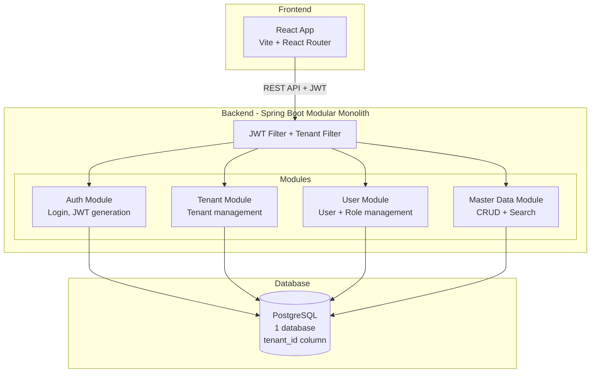
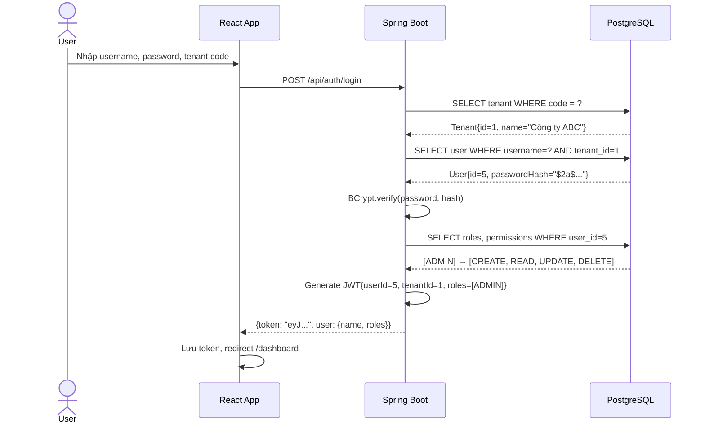
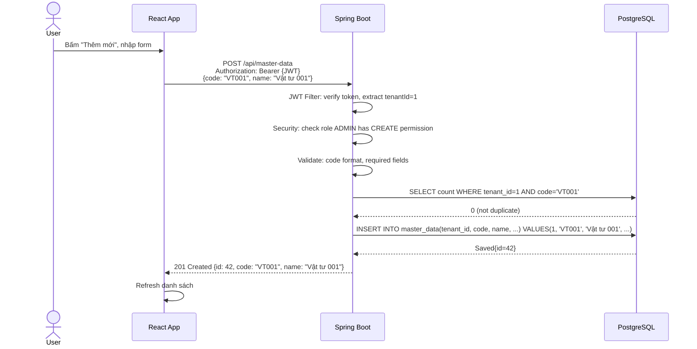
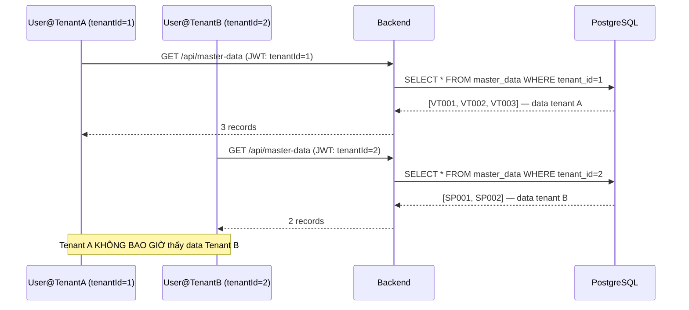
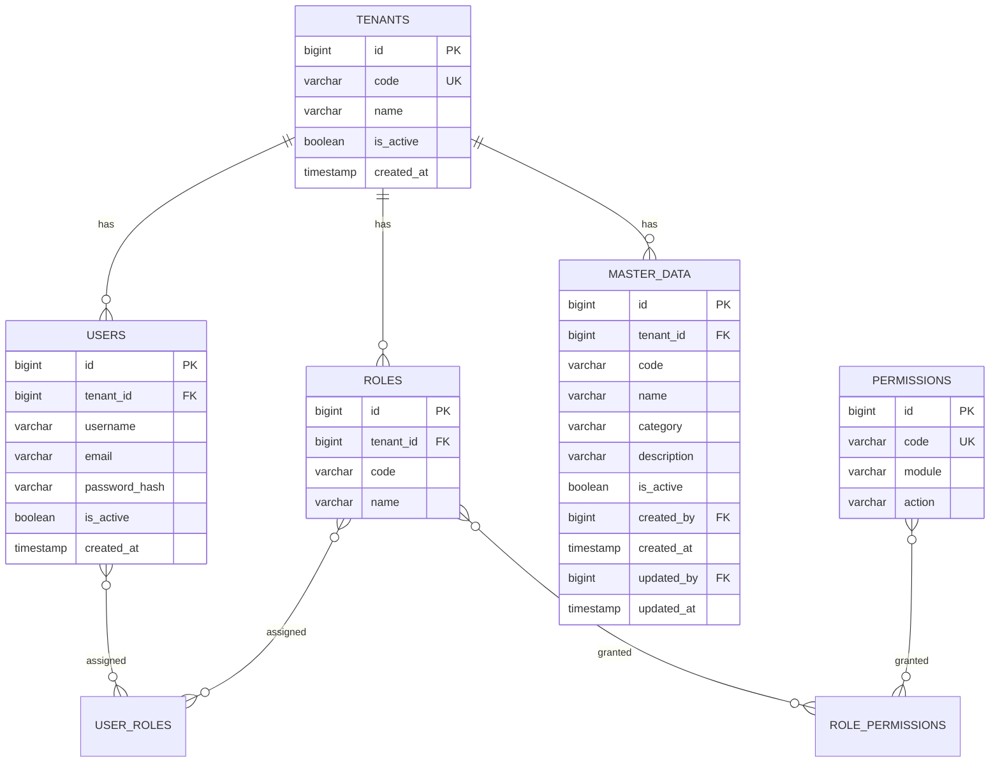
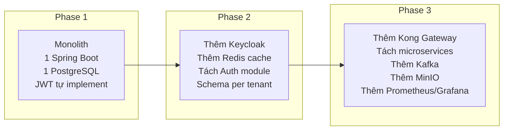

# 🏗️ Kiến trúc Demo Phase 1

## Nguyên tắc thiết kế Demo

1. **Đơn giản nhưng có cấu trúc** — không overengineer, nhưng không bừa bãi
2. **Thể hiện multi-tenant** — đây là mục tiêu chính
3. **Có auth hoàn chỉnh** — login + JWT + RBAC
4. **1 module CRUD** — đủ để minh họa full flow
5. **Có thể tiến hóa** — thiết kế để mở rộng, không phải rewrite

---

## Kiến trúc tổng thể Demo Phase 1



---

## Request Flow chi tiết

### Login Flow



### CRUD Flow



### Tenant Data Isolation Flow



---

## Database Schema cho Demo



---

## Tech Stack Demo

| Layer | Technology | Lý do chọn |
|-------|-----------|-----------|
| Frontend | React + Vite | Nhẹ, nhanh, dự án target dùng React |
| Backend | Spring Boot 3 | Dự án target dùng Java/Spring |
| Database | PostgreSQL 15 | Dự án target dùng PostgreSQL |
| Auth | Spring Security + JWT | Tự implement để học, migrate Keycloak sau |
| Build | Maven/Gradle | Standard Java |
| Container | Docker Compose | Dev environment nhất quán |

---

## Docker Compose cho Demo

```yaml
version: '3.8'
services:
  postgres:
    image: postgres:15-alpine
    environment:
      POSTGRES_DB: phase1_demo
      POSTGRES_USER: demo
      POSTGRES_PASSWORD: demo123
    ports:
      - "5432:5432"
    volumes:
      - postgres_data:/var/lib/postgresql/data

  backend:
    build: ./backend
    ports:
      - "8080:8080"
    environment:
      SPRING_DATASOURCE_URL: jdbc:postgresql://postgres:5432/phase1_demo
    depends_on:
      - postgres

  frontend:
    build: ./frontend
    ports:
      - "3000:3000"
    depends_on:
      - backend

volumes:
  postgres_data:
```

---

## Tiến hóa sau Phase 1



---

*Tiếp theo: [16-lo-trinh-thuc-hien/](../16-lo-trinh-thuc-hien/)*
