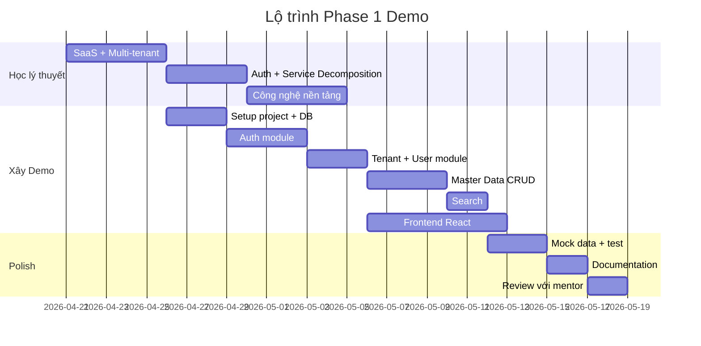
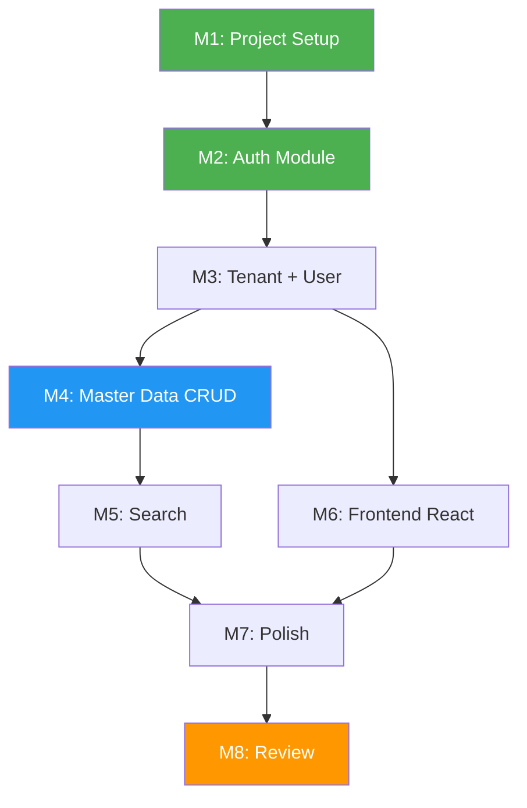

# 🗺️ Lộ trình thực hiện Demo Phase 1

## Tổng quan Milestones

---

## Milestone 1: Project Setup (3 ngày)

### Công việc
- [ ] Khởi tạo Spring Boot project (Spring Initializr)
- [ ] Setup PostgreSQL với Docker Compose
- [ ] Cấu hình Flyway/Liquibase cho DB migration
- [ ] Tạo bảng `tenants` + insert 10 tenants mock
- [ ] Tạo base classes: `TenantAwareEntity`, `TenantContext`, `ApiResponse`
- [ ] Verify: chạy app, connect DB thành công

### Definition of Done
✅ App khởi động không lỗi  
✅ PostgreSQL chạy trong Docker  
✅ Bảng `tenants` có 10 records  
✅ Code structure theo convention đã học  

---

## Milestone 2: Auth Module (4 ngày)

### Công việc
- [ ] Tạo bảng `users`, `roles`, `permissions`, `user_roles`, `role_permissions`
- [ ] Implement đăng ký user (có thể tạm skip, insert bằng SQL)
- [ ] Implement login endpoint: `POST /api/auth/login`
- [ ] JWT generation với `tenantId`, `userId`, `roles`
- [ ] JWT validation filter
- [ ] Tenant context filter (extract tenantId từ JWT → ThreadLocal)
- [ ] Spring Security config: permit login, protect others
- [ ] Mock data: mỗi tenant có 1 admin + 1 user thường

### Definition of Done
✅ Login thành công → nhận JWT  
✅ Request không có token → 401  
✅ Request có token → 200  
✅ Token chứa tenantId, roles  

---

## Milestone 3: Tenant + User Module (3 ngày)

### Công việc
- [ ] API list tenants (chỉ system admin)
- [ ] API xem thông tin tenant hiện tại
- [ ] API list users trong tenant hiện tại
- [ ] Verify: user tenant A không thấy user tenant B

### Definition of Done
✅ Tenant API hoạt động  
✅ Data isolation verify: không cross-tenant  

---

## Milestone 4: Master Data CRUD (4 ngày)

### Công việc
- [ ] Tạo bảng `master_data` với `tenant_id`
- [ ] `GET /api/master-data` — list (có pagination)
- [ ] `GET /api/master-data/{id}` — detail
- [ ] `POST /api/master-data` — create
- [ ] `PUT /api/master-data/{id}` — update
- [ ] `DELETE /api/master-data/{id}` — soft delete
- [ ] Permission check: ADMIN full, VIEWER chỉ READ
- [ ] Validation: required fields, duplicate code check

### Definition of Done
✅ CRUD hoạt động đầy đủ  
✅ Tenant isolation: tenant A chỉ thấy data tenant A  
✅ RBAC: VIEWER không thể DELETE  
✅ Validation: trả lỗi rõ ràng  

---

## Milestone 5: Search (2 ngày)

### Công việc
- [ ] `GET /api/master-data?search=keyword` — tìm theo name/code
- [ ] Pagination: `?page=0&size=20`
- [ ] Sort: `?sort=name,asc`
- [ ] Response format: `{ data: [...], totalElements, totalPages, currentPage }`

### Definition of Done
✅ Tìm kiếm trả kết quả chính xác  
✅ Pagination hoạt động  
✅ Search cũng filter theo tenant_id  

---

## Milestone 6: Frontend React (7 ngày — song song với M3-M5)

### Công việc
- [ ] Khởi tạo Vite + React project
- [ ] Setup React Router
- [ ] Login page: form + gọi API login
- [ ] Auth context: lưu token, logout
- [ ] Protected route component
- [ ] Layout + Navbar (show tenant name, user name, logout button)
- [ ] Master Data page: list + search + pagination
- [ ] Create form: modal hoặc page mới
- [ ] Edit form
- [ ] Delete confirmation
- [ ] Error handling: show toast/alert khi lỗi

### Definition of Done
✅ Login → redirect dashboard  
✅ Không login → redirect login  
✅ CRUD master-data hoạt động qua UI  
✅ Search + pagination hoạt động  

---

## Milestone 7: Polish + Mock Data (3 ngày)

### Công việc
- [ ] Insert mock data đầy đủ: 10 tenants, mỗi tenant có users + master-data
- [ ] Test cross-tenant: login tenant A, verify chỉ thấy data A
- [ ] Test RBAC: login VIEWER, verify không thể DELETE
- [ ] Thêm logging với tenant context
- [ ] README cho project demo
- [ ] Docker Compose chạy full stack

### Definition of Done
✅ Demo chạy end-to-end với Docker Compose  
✅ 10 tenants có data riêng  
✅ Không có data leakage  
✅ RBAC hoạt động  

---

## Milestone 8: Review + Documentation (2 ngày)

### Công việc
- [ ] Viết README cho demo project
- [ ] Update tài liệu học tập
- [ ] Chuẩn bị slide/notes cho review với mentor
- [ ] List câu hỏi muốn hỏi mentor
- [ ] Self-review: trả lời các câu hỏi tự học

### Definition of Done
✅ Demo sẵn sàng trình bày  
✅ Có thể giải thích mọi quyết định kiến trúc  
✅ Tài liệu cập nhật  

---

## Thứ tự ưu tiên: Cái gì trước, cái gì sau

### Cái gì hoãn lại?

| Cái gì | Lý do hoãn | Khi nào làm |
|--------|-----------|-------------|
| Kong API Gateway | Chỉ 1 backend, chưa cần | Khi tách service |
| Redis cache | DB query đủ nhanh cho demo | Khi có perf issue |
| Kafka | Không có inter-service comm | Khi tách microservices |
| MinIO | Demo chưa cần file upload | Khi có file requirement |
| Prometheus/Grafana | Monitoring chưa critical | Sau khi CRUD hoàn thành |
| Keycloak | Tự implement JWT để học | Phase 2 |

---

*Tiếp theo: [17-tu-duy-kien-truc/](../17-tu-duy-kien-truc/)*
