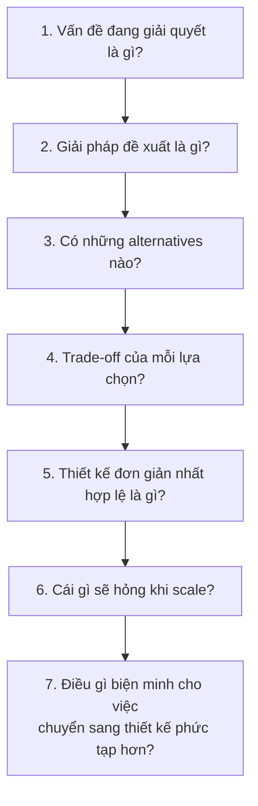
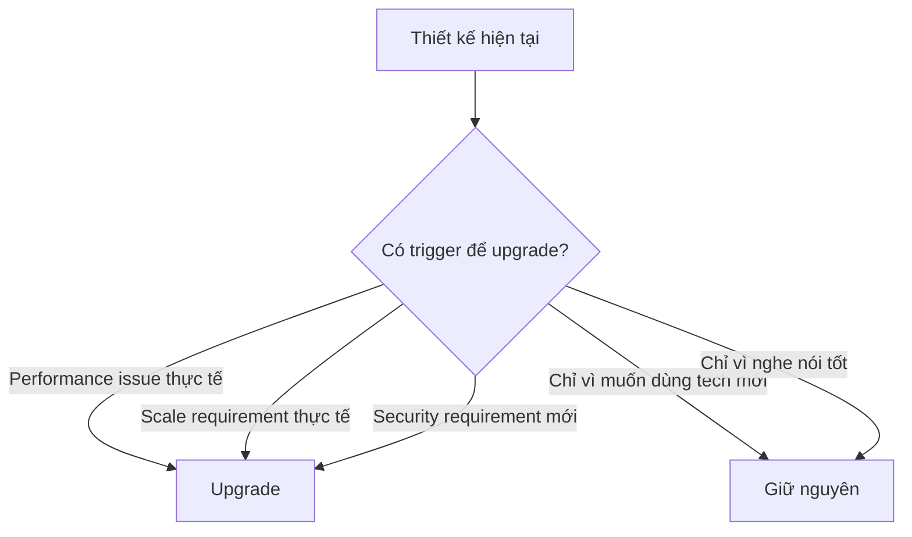

# 🧠 Handbook Tư duy Kiến trúc

> Tài liệu này dạy cách **suy nghĩ**, không phải cách **ghi nhớ**. Đọc lại bất cứ khi nào cần lập luận về một quyết định kiến trúc.

---

## Framework suy luận kiến trúc

Với **mọi quyết định kỹ thuật**, hãy trả lời 7 câu hỏi sau:



---

## 7 câu hỏi chi tiết

### 1. Vấn đề đang giải quyết là gì?

**Trước khi chọn giải pháp, phải hiểu rõ vấn đề.**

| Hỏi | Ví dụ tốt | Ví dụ xấu |
|-----|----------|----------|
| Vấn đề cụ thể là gì? | "Nhiều doanh nghiệp dùng chung hệ thống, data phải tách biệt" | "Cần multi-tenant" |
| Ai gặp vấn đề? | "Khách hàng doanh nghiệp + team vận hành" | "Hệ thống" |
| Nếu không giải quyết thì sao? | "Data leakage giữa các doanh nghiệp → vi phạm bảo mật" | "Sẽ có bug" |

### 2. Giải pháp đề xuất là gì?

Mô tả rõ ràng giải pháp, bao gồm:
- Cách hoạt động
- Thành phần cần thêm
- Thay đổi cần làm

### 3. Có những alternatives nào?

**Luôn liệt kê ít nhất 2 alternatives.** Nếu không nghĩ ra alternatives, có thể bạn chưa hiểu đủ sâu về vấn đề.

| Ví dụ vấn đề | Alternative A | Alternative B | Alternative C |
|-------------|--------------|--------------|--------------|
| Tenant isolation | tenant_id column | Schema per tenant | DB per tenant |
| Auth | Tự implement JWT | Keycloak | Auth0 |
| Inter-service comm | REST sync | Kafka async | gRPC |
| API routing | Backend tự route | Kong Gateway | Nginx reverse proxy |

### 4. Trade-off của mỗi lựa chọn?

**Không có giải pháp hoàn hảo.** Mọi lựa chọn đều đánh đổi.

Template phân tích trade-off:

```
| Tiêu chí         | Option A | Option B | Option C |
|------------------|----------|----------|----------|
| Complexity       |          |          |          |
| Performance      |          |          |          |
| Cost             |          |          |          |
| Maintainability  |          |          |          |
| Scalability      |          |          |          |
| Team skill       |          |          |          |
| Time to implement|          |          |          |
```

### 5. Thiết kế đơn giản nhất hợp lệ là gì?

> "Make things as simple as possible, but no simpler." — Einstein

**Nguyên tắc YAGNI:** You Aren't Gonna Need It.

Hỏi: "Thiết kế đơn giản nhất mà **vẫn đáp ứng yêu cầu hiện tại** là gì?"

| Quá đơn giản | Vừa đủ | Quá phức tạp |
|-------------|--------|-------------|
| Không có tenant isolation | tenant_id column + filter | DB per tenant cho demo 10 tenants |
| Không có auth | JWT + RBAC đơn giản | OAuth2 + OIDC + MFA cho demo |
| Hardcode config | Config file | Distributed config server cho 1 app |

### 6. Cái gì sẽ hỏng khi scale?

Dù chọn thiết kế đơn giản, **phải biết giới hạn của nó**.

| Thiết kế hiện tại | Hỏng khi nào? | Dấu hiệu |
|-------------------|---------------|----------|
| tenant_id column | 1000+ tenants, data quá lớn | Query chậm, index bloat |
| JWT tự implement | Multi-service, SSO cần | Token management phức tạp |
| Single DB | Quá nhiều concurrent writes | Connection pool exhausted |
| Monolith | Team > 10 người, deploy conflict | Merge conflict, slow CI |

### 7. Điều gì biện minh cho việc chuyển sang thiết kế phức tạp hơn?

**Chỉ upgrade complexity khi có lý do cụ thể**, không phải "vì nó cool".



---

## Áp dụng Framework: Ví dụ thực tế

### Ví dụ: "Auth nên tách thành service riêng không?"

| Câu hỏi | Trả lời |
|---------|---------|
| 1. Vấn đề? | Cần xác thực user trước khi truy cập API |
| 2. Giải pháp đề xuất? | Tách Auth thành microservice riêng |
| 3. Alternatives? | A: Auth module trong monolith. B: Dùng Keycloak. C: Auth microservice tự build |
| 4. Trade-off? | Tách riêng: +independent scale, +reuse; -network hop, -complexity, -deploy overhead |
| 5. Đơn giản nhất? | Auth module trong monolith (Phase 1 chỉ có 1 backend) |
| 6. Hỏng khi nào? | Khi có 5+ services đều cần auth → duplicate logic |
| 7. Khi nào upgrade? | Khi tách microservices thực sự |
| **Kết luận Phase 1** | **Auth module trong monolith. Tách sau khi có multiple services.** |

---

## Nguyên tắc vàng

### 1. Start simple, evolve when needed
Bắt đầu đơn giản, phức tạp hóa khi có lý do cụ thể.

### 2. Design for change, not for perfection
Thiết kế để dễ thay đổi, không phải để hoàn hảo ngay từ đầu.

### 3. Understand before optimizing
Hiểu vấn đề trước khi tối ưu. Premature optimization is the root of all evil.

### 4. Every choice is a trade-off
Không có giải pháp tốt nhất, chỉ có giải pháp phù hợp nhất cho context hiện tại.

### 5. Complexity is the enemy
Complexity phải được biện minh bằng giá trị mang lại. Nếu không, nó chỉ là burden.

---

*Đây là tài liệu nên đọc đi đọc lại xuyên suốt Phase 1.*
