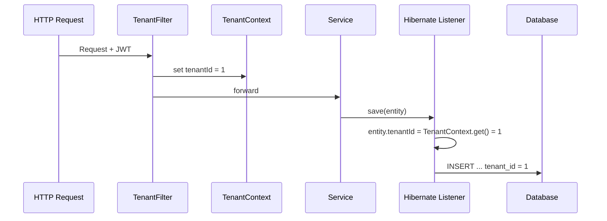

# ✅ Đáp án mẫu — SaaS & Multi-tenant

> ⚠️ **Đọc file này CHỈ SAU KHI đã tự trả lời.** Xem câu hỏi ở [18-ngan-hang-cau-hoi/01-saas-va-multi-tenant.md](../18-ngan-hang-cau-hoi/01-saas-va-multi-tenant.md)

---

## Câu 1: SaaS vs On-Premise từ góc nhìn developer

**Trả lời ngắn:** SaaS phức tạp hơn đáng kể cho developer.

**Lập luận:**
- On-Premise: mỗi client = 1 instance → data isolation tự nhiên, không cần multi-tenant logic, deploy đơn giản
- SaaS: phải giải quyết multi-tenancy, shared infrastructure, zero-downtime deployment, data isolation ở application level
- Thêm các concerns: tenant-aware caching, tenant-aware logging, rate limiting, billing

**Alternatives:**
- Có thể giảm complexity bằng cách dùng platform services (Keycloak cho auth, managed DB)
- Hybrid model: SaaS cho SME, dedicated instance cho enterprise

**Kết luận Phase 1:** Hiểu rõ complexity giúp đánh giá đúng effort. Không được coi nhẹ multi-tenant design.

---

## Câu 7: Chọn chiến lược isolation cho 500 SME + 5 Enterprise

**Trả lời ngắn:** Hybrid — MH1 (tenant_id) cho 500 SME, MH3 (DB riêng) cho 5 Enterprise.

**Lập luận:**
- 500 SME dùng MH1 vì: chi phí thấp, dễ quản lý, data volume mỗi SME nhỏ
- 5 Enterprise dùng MH3 vì: data nhạy cảm, SLA cao, có thể trả phí cao hơn, yêu cầu isolation mạnh
- MH2 (schema) là compromise nhưng migration cho 500 schema quá phức tạp

**Trade-off:**
- Hybrid = codebase phải hỗ trợ 2 mode → phức tạp hơn
- Nhưng giá trị mang lại (phục vụ được cả 2 segment) đáng để đầu tư

**Kết luận Phase 1:** Demo dùng MH1 (tenant_id column). Nhưng thiết kế repository layer với interface để sau có thể switch.

---

## Câu 8: Developer quên tenant_id filter

**Trả lời ngắn:** Data leakage — tenant A thấy data của tất cả tenant khác.

**3 cách phòng tránh:**

1. **Hibernate Filter / JPA Interceptor** — tự động thêm `WHERE tenant_id = ?` vào mọi query
   ```java
   @FilterDef(name = "tenantFilter", parameters = @ParamDef(name = "tenantId", type = Long.class))
   @Filter(name = "tenantFilter", condition = "tenant_id = :tenantId")
   ```

2. **Base Repository class** — mọi repository extend từ TenantAwareRepository, method findAll() đã filter sẵn

3. **Integration test** — viết test case verify: login tenant A, gọi API, assert không có record nào có tenant_id != A

**Cách bổ sung:**
- PostgreSQL Row Level Security (RLS) — DB tự enforce
- Code review checklist: mọi query phải có tenant filter
- Static analysis rule: warning nếu query không có tenant_id condition

**Kết luận Phase 1:** Dùng cách 2 (Base Repository) + cách 3 (test). Cách 1 thêm khi cần.

---

## Câu 9: Cache key thiếu tenant prefix

**Trả lời ngắn:** Data leakage qua cache layer.

**Giải thích:**
- Tenant A request categories → cache miss → query DB → cache key `"categories"` = [data A]
- Tenant B request categories → cache HIT → trả `"categories"` = [data A] → **Tenant B thấy data của A!**

**Giải pháp:** Cache key phải **luôn** chứa tenant identifier:
```
❌ "categories"
✅ "tenant:1:categories"
✅ "tenant:2:categories"
```

**Kết luận Phase 1:** Convention cache key = `tenant:{tenantId}:{module}:{resource}`. Enforce bằng helper method, không để developer tự tạo key.

---

## Câu 10: Noisy neighbor trong shared table

**Trả lời ngắn:** Có ảnh hưởng nhưng có thể giảm thiểu.

**Lập luận:**
- Index trên `(tenant_id, ...)` giúp query của Tenant B vẫn nhanh nếu index đúng
- Nhưng: table size lớn → index lớn → disk I/O tăng, vacuum chậm hơn
- Nếu Tenant A chạy full table scan → lock, buffer pool bị chiếm

**Giải pháp:**
1. Composite index `(tenant_id, column)` — B-tree index skip đến đúng tenant
2. Table partitioning by tenant_id — PostgreSQL partition pruning
3. Connection pool riêng cho tenant lớn
4. Read replica cho heavy queries
5. Cân nhắc migrate tenant lớn sang MH2/MH3

**Kết luận Phase 1:** Với 10 tenants và ít data, không phải vấn đề. Nhưng biết rằng đây là điểm sẽ cần giải quyết khi scale.

---

## Câu 12: Tự động inject tenant_id

**Trả lời ngắn:** Dùng combination Interceptor + Base Entity + Hibernate Event.

**Kiến trúc:**
1. **TenantFilter** (Servlet Filter): extract tenantId từ JWT → set vào ThreadLocal
2. **TenantAwareEntity** (Base class): mọi entity extend, có field `tenantId`
3. **Hibernate PreInsert/PreUpdate Listener**: tự động set `tenantId` trước khi insert/update
4. **Hibernate Filter**: tự động thêm `WHERE tenant_id = ?` vào mọi SELECT



**Kết luận Phase 1:** Implement TenantFilter + TenantAwareEntity + Base Repository. Hibernate Filter thêm sau nếu cần auto-filter SELECT.
