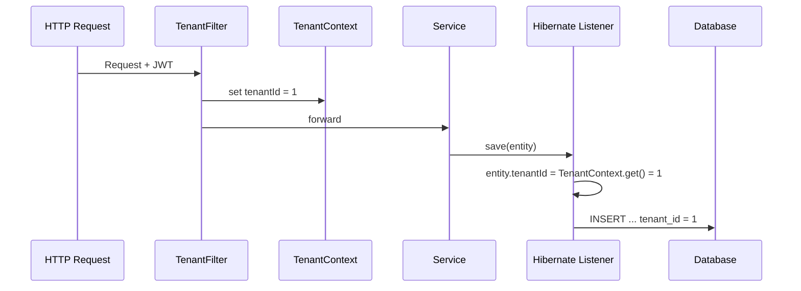

# ✅ Đáp án mẫu — SaaS & Multi-tenant

> ⚠️ **Đọc file này CHỈ SAU KHI đã tự trả lời.** Xem câu hỏi ở [18-ngan-hang-cau-hoi/01-saas-va-multi-tenant.md](../18-ngan-hang-cau-hoi/01-saas-va-multi-tenant.md)

---

## Câu 1: SaaS vs On-Premise từ góc nhìn developer

**Trả lời ngắn:** SaaS phức tạp hơn đáng kể cho developer.

**Lập luận:**
- On-Premise: mỗi client = 1 instance → data isolation tự nhiên, không cần multi-tenant logic, deploy đơn giản
- SaaS: phải giải quyết multi-tenancy, shared infrastructure, zero-downtime deployment, data isolation ở application level
- Thêm các concerns: tenant-aware caching, tenant-aware logging, rate limiting, billing
- On-Premise cũng phức tạp ở chỗ: N clients = N deployments, version fragmentation, customize per-client, debug remote

**Alternatives:**
- Có thể giảm complexity bằng cách dùng platform services (Keycloak cho auth, managed DB)
- Hybrid model: SaaS cho SME, dedicated instance cho enterprise

**Kết luận Phase 1:** Hiểu rõ complexity giúp đánh giá đúng effort. Không được coi nhẹ multi-tenant design.

---

## Câu 2: Data residency requirement

**Trả lời ngắn:** Có mâu thuẫn một phần với centralized hosting, nhưng không mâu thuẫn với bản chất SaaS.

**Lập luận:**
- SaaS = nhà cung cấp quản lý phần mềm. Dù data nằm trên server riêng, nếu nhà cung cấp vẫn quản lý application → vẫn là SaaS variant (managed dedicated).
- Mâu thuẫn: centralized hosting bị phá vỡ một phần. Nhưng bản chất SaaS (nhà cung cấp chịu trách nhiệm vận hành) vẫn giữ nguyên.
- Giải pháp: hybrid deployment — multi-tenant shared DB cho SME, dedicated DB/instance cho enterprise.

**Kiến trúc cần thay đổi:**
- Tenant metadata chứa DB connection info
- Routing layer biết chuyển request đến đúng DB
- Migration tool chạy được trên nhiều DB
- Backup/restore per-tenant

**Kết luận Phase 1:** Demo dùng shared DB. Thiết kế data access layer qua interface để switch DB source sau.

---

## Câu 3: Subscription vs License

**Trả lời ngắn:** Subscription phù hợp vì SaaS là dịch vụ liên tục, cần revenue stream tương ứng.

**Lợi ích kỹ thuật:**
- Nhà cung cấp kiểm soát version duy nhất → giảm support burden
- Subscription fund cho operating cost liên tục (hosting, monitoring, maintenance)
- Khách hàng luôn trên bản mới nhất → dễ debug, dễ maintain

**Lợi ích kinh doanh:**
- MRR/ARR ổn định, predictable
- Barrier to entry thấp cho SME
- Dễ upsell, customer lifetime value cao

**Lưu ý:** Subscription ≠ SaaS. Đây là 2 trục độc lập. On-premise + subscription tồn tại (JetBrains). SaaS + lifetime license cũng có thể.

**Kết luận Phase 1:** Hiểu phân biệt delivery model vs pricing model. Demo không cần billing.

---

## Câu 4: Blast radius (phạm vi ảnh hưởng) khi deploy lỗi

**Trả lời ngắn:** SaaS: tất cả tenant dùng tính năng bị lỗi đều bị ảnh hưởng. On-premise: chỉ client đã update.

**Lập luận:**
- SaaS: blast radius lớn nhưng fix nhanh (1 deploy). Giảm blast radius bằng: canary (triển khai thử cho một nhóm nhỏ người dùng trước, ví dụ 5% traffic trước), rolling deployment (triển khai cuốn chiếu, cập nhật dần từng phần hệ thống thay vì cập nhật toàn bộ cùng lúc), feature flags (cờ bật/tắt tính năng mà không cần sửa code lớn hoặc deploy lại toàn bộ).
- On-premise: blast radius nhỏ per-incident nhưng fix chậm (push fix từng client). Lỗi có thể xảy ra N lần ở N client.

**Kết luận Phase 1:** Demo cần backward-compatible DB migration. Production cần canary/rolling + health check + rollback plan.

---

## Câu 5: Feature flags design

**Trả lời ngắn:** 2 bảng: `feature_flag` (định nghĩa flag) + `tenant_feature_flag` (tenant nào bật flag nào), check ở service layer, cache result.

**Data model:**
- `feature_flag(id, name, description, default_enabled, created_at)`
- `tenant_feature_flag(tenant_id, flag_id, is_enabled, updated_at, updated_by)`

**Logic:** Check `tenant_feature_flag` → nếu không có row → dùng `default_enabled`. Cache per tenant.

**Check ở đâu:** Service layer, helper: `featureFlagService.isEnabled(tenantId, "new_report_v2")`

**Kết luận Phase 1:** Implement đơn giản 2 bảng + helper method. Không cần rollout percentage.

---

## Câu 6: Zero-downtime deployment

**Trả lời ngắn:** Rolling deployment + backward-compatible migration + health check.

**Các yếu tố:**
1. DB migration backward compatible (migration DB theo kiểu an toàn, ví dụ thêm cột nullable/default để code cũ chưa biết cột mới vẫn chạy được)
2. Rolling deployment (thay từng pod) hoặc blue-green (dựng sẵn môi trường mới song song, rồi chuyển traffic sang khi ổn)
3. Health check endpoint + auto rollback (ự động quay lại phiên bản cũ nếu bản mới lỗi)
4. Stateless design (JWT) → không cần sticky session
5. Feature flags — deploy code nhưng chưa bật tính năng
6. Rollback plan rõ ràng

**Kết luận Phase 1:** Demo cần backward-compatible migration. Production cần rolling + health check.

---

## Câu 7: Chọn chiến lược isolation cho 500 SME + 5 Enterprise

**Trả lời ngắn:** Hybrid — MH1 (tenant_id) cho 500 SME, MH3 (DB riêng) cho 5 Enterprise.

**Lập luận:**
- 500 SME dùng MH1 vì: chi phí thấp, dễ quản lý, data volume mỗi SME nhỏ
- 5 Enterprise dùng MH3 vì: data nhạy cảm, SLA cao, có thể trả phí cao hơn, yêu cầu isolation mạnh
- MH2 (schema) là compromise nhưng migration cho 500 schema quá phức tạp

**Trade-off:**
- Hybrid = codebase phải hỗ trợ 2 mode → phức tạp hơn
- Nhưng giá trị mang lại (phục vụ được cả 2 segment) đáng để đầu tư

**Kết luận Phase 1:** Demo dùng MH1 (tenant_id column). Nhưng thiết kế repository layer với interface để sau có thể switch.

---

## Câu 8: Developer quên tenant_id filter

**Trả lời ngắn:** Data leakage — tenant A thấy data của tất cả tenant khác.

**3 cách phòng tránh:**

1. **Hibernate Filter / JPA Interceptor** — tự động thêm `WHERE tenant_id = ?` vào mọi query
   ```java
   @FilterDef(name = "tenantFilter", parameters = @ParamDef(name = "tenantId", type = Long.class))
   @Filter(name = "tenantFilter", condition = "tenant_id = :tenantId")
   ```

2. **Base Repository class** — mọi repository extend từ TenantAwareRepository, method findAll() đã filter sẵn

3. **Integration test** — viết test case verify: login tenant A, gọi API, assert không có record nào có tenant_id != A

**Cách bổ sung:**
- PostgreSQL Row Level Security (RLS) — DB tự enforce
- Code review checklist: mọi query phải có tenant filter
- Static analysis rule: warning nếu query không có tenant_id condition

**Kết luận Phase 1:** Dùng cách 2 (Base Repository) + cách 3 (test). Cách 1 thêm khi cần.

---

## Câu 9: Cache key thiếu tenant prefix

**Trả lời ngắn:** Data leakage qua cache layer.

**Giải thích:**
- Tenant A request categories → cache miss → query DB → cache key `"categories"` = [data A]
- Tenant B request categories → cache HIT → trả `"categories"` = [data A] → **Tenant B thấy data của A!**

**Giải pháp:** Cache key phải **luôn** chứa tenant identifier:
```
❌ "categories"
✅ "tenant:1:categories"
✅ "tenant:2:categories"
```

**Kết luận Phase 1:** Convention cache key = `tenant:{tenantId}:{module}:{resource}`. Enforce bằng helper method, không để developer tự tạo key.

---

## Câu 10: Noisy neighbor trong shared table

**Trả lời ngắn:** Có ảnh hưởng nhưng có thể giảm thiểu.

**Lập luận:**
- Index trên `(tenant_id, ...)` (chỉ mục bắt đầu bằng tenant_id, giúp database tìm nhanh dữ liệu của đúng tenant) giúp query của Tenant B vẫn nhanh nếu index đúng
- Nhưng: table size lớn → index lớn → disk I/O tăng, vacuum chậm hơn (PostgreSQL dọn dẹp row cũ/chết chậm hơn)
- Nếu Tenant A chạy full table scan → lock, buffer pool bị chiếm (vùng cache dữ liệu trong RAM bị chiếm nhiều, làm query khác chậm theo)

**Giải pháp:**
1. Composite index `(tenant_id, column)` (index nhiều cột, bắt đầu bằng tenant_id rồi đến cột thường query cùng) — B-tree index skip đến đúng tenant
2. Table partitioning by tenant_id (chia bảng lớn thành nhiều phần nhỏ theo tenant hoặc nhóm tenant)  — PostgreSQL partition pruning (PostgreSQL tự bỏ qua các partition không liên quan khi query)
3. Connection pool riêng cho tenant lớn (nhóm kết nối DB tách riêng để tenant lớn không chiếm hết tài nguyên của tenant khác)
4. Read replica (bản sao chỉ để đọc, dùng sang tải query nặng riêng) cho heavy queries (các câu query tốn tài nguyên)
5. Cân nhắc migrate tenant lớn sang MH2/MH3

**Kết luận Phase 1:** Với 10 tenants và ít data, không phải vấn đề. Nhưng biết rằng đây là điểm sẽ cần giải quyết khi scale.

Đọc thêm: [vi-du-ve-noisy-neighbor.md](../23-kien-thuc-mo-rong/vi-du-ve-noisy-neighbor.md)

---

## Câu 11: Schema per tenant — migration complexity

**Trả lời ngắn:** Phải migrate **TẤT CẢ N schema** (N = số tenant).

**Lập luận:**
- Schema per tenant = mỗi tenant có 1 schema riêng. 500 tenant = 500 schema.
- Thêm 1 cột mới → phải chạy ALTER TABLE cho TẤT CẢ 500 schema.
- Đây là trade-off lớn nhất của schema per tenant.

**Quy trình:**
- Viết migration script → chạy loop qua tất cả schema → handle failure per-schema → verify consistency

**Rủi ro:**
1. 1 schema fail → tenant đó bị inconsistent với các tenant khác
2. Thời gian migration dài (N × thời gian per-schema)
3. Khó rollback nếu chỉ một số schema đã migrate
4. Lock table per-schema → ảnh hưởng tenant đang dùng

**So sánh:**
- tenant_id column: migrate 1 lần cho 1 bảng → đơn giản nhất
- DB per tenant: migrate N lần nhưng independent — fail 1 DB không ảnh hưởng DB khác

**Kết luận Phase 1:** Đây là lý do Phase 1 chọn tenant_id column — migration đơn giản nhất.

---

## Câu 12: Tự động inject tenant_id

**Trả lời ngắn:** Dùng combination Interceptor + Base Entity + Hibernate Event.

**Kiến trúc:**
1. **TenantFilter** (Servlet Filter): extract tenantId từ JWT → set vào ThreadLocal
2. **TenantAwareEntity** (Base class): mọi entity extend, có field `tenantId`
3. **Hibernate PreInsert/PreUpdate Listener**: tự động set `tenantId` trước khi insert/update
4. **Hibernate Filter**: tự động thêm `WHERE tenant_id = ?` vào mọi SELECT



**Kết luận Phase 1:** Implement TenantFilter + TenantAwareEntity + Base Repository. Hibernate Filter thêm sau nếu cần auto-filter SELECT.

---

## Câu 13: Data portability — export toàn bộ dữ liệu tenant

**Trả lời ngắn:** DB per tenant dễ nhất (pg_dump), tenant_id column khó nhất (query từng bảng).

**So sánh:**

| Mô hình | Cách export | Độ khó | Ưu điểm | Nhược điểm |
|---------|-------------|--------|---------|------------|
| tenant_id column | Query mỗi bảng với WHERE tenant_id = ? | Trung bình-Khó | Không cần tool đặc biệt | Phải biết tất cả bảng, handle FK, maintain export script |
| Schema per tenant | `pg_dump --schema=tenant_X` | Thấp | Clean, complete, 1 lệnh | Cần quyền DB-level |
| DB per tenant | `pg_dump database_tenant_X` | Thấp nhất | Đơn giản nhất, isolated | Cần quyền DB-level |

**Format:** SQL dump cho restore, JSON/CSV cho data portability (GDPR).

**Kết luận Phase 1:** Với tenant_id column, cần thiết kế export service sớm.

---

## Câu 14: User thuộc nhiều tenant

**Trả lời ngắn:** Bảng mapping `user_tenant_role` (many-to-many) + tenant picker sau login.

**Data model:**
- `user_tenant_role(user_id, tenant_id, role_id, is_default, joined_at)`
- User X có thể có nhiều row (1 row per tenant)

**Auth flow:**
1. Login → verify credentials
2. Query `user_tenant_role` WHERE user_id = X
3. Nếu 1 tenant → auto-select
4. Nếu nhiều → hiện tenant picker
5. User chọn → set `tenant_id` vào JWT claim
6. Tiếp tục bình thường

**Switch tenant:** Cho phép switch trong session mà không cần re-login (issue JWT mới).

**Kết luận Phase 1:** Implement bảng mapping + default tenant. Tenant picker UI nếu có thời gian.
