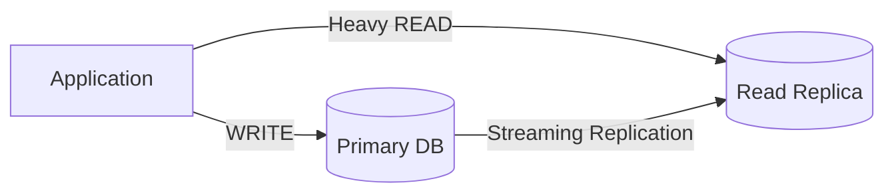

# 🔬 PostgreSQL Internals cho Multi-tenant — Phần 1: Index, Query và Noisy Neighbor

> Tài liệu bổ sung cho các câu hỏi multi-tenant Part 1 (câu 8, 9, 10, 12).
> Nguồn chính: [PostgreSQL Official Documentation](https://www.postgresql.org/docs/current/).

---

## 1. B-Tree Index — Cơ chế bên trong

### 1.1. B-Tree hoạt động thế nào?

B-Tree (Balanced Tree) là loại index mặc định trong PostgreSQL. Khi viết `CREATE INDEX`, nếu không chỉ định loại, PostgreSQL dùng B-Tree.

**Cấu trúc:**

```
              [Root Page]
             /     |      \
       [Branch]  [Branch]  [Branch]
       /    \      |   \      \
   [Leaf] [Leaf] [Leaf] [Leaf] [Leaf]
     ↓      ↓     ↓      ↓      ↓
   rows   rows  rows   rows   rows
```

- **Root page**: điểm vào, chứa các giá trị phân chia (separator keys)
- **Branch pages**: các nút trung gian, dẫn xuống đúng nhánh
- **Leaf pages**: chứa giá trị thực + pointer đến row trong bảng (tuple identifier — TID)

**Cơ chế tìm kiếm:** Đi từ root → so sánh giá trị → chọn nhánh phù hợp → xuống branch → xuống leaf → theo pointer ra row thực.

**Ví dụ cụ thể:**

```sql
CREATE INDEX idx_invoice_tenant ON invoice(tenant_id);

SELECT * FROM invoice WHERE tenant_id = 5;
```

PostgreSQL sẽ:
1. Đọc root page → tìm nhánh chứa giá trị `5`
2. Đi xuống branch → leaf page chứa các entry `tenant_id = 5`
3. Từ leaf → lấy TID → đọc row thực từ heap (bảng)

**Quan trọng:** Số lần đọc page = **O(log N)** trong đó N = số row. Nếu bảng có 10 triệu row, chỉ cần ~3-4 lần đọc page thay vì quét 10 triệu row.

### 1.2. Tại sao B-Tree quan trọng trong multi-tenant?

Trong shared table (MH1: tenant_id column), tất cả tenant nằm chung 1 bảng. Không có index:

```
Tenant A: 1,000,000 rows  ─┐
Tenant B:       100 rows   ├── Tất cả chung 1 heap
Tenant C:    50,000 rows  ─┘
```

Query `WHERE tenant_id = B` không có index → **Sequential Scan** (đọc toàn bộ 1,050,100 rows để lọc ra 100 rows). Đây là full table scan.

Có index `(tenant_id)` → **Index Scan** → đi thẳng đến 100 rows của B mà không đọc data A hoặc C.

> 📌 **Liên hệ câu 10:** Câu trả lời trước nói "query của B phải scan qua 1 triệu bản ghi của A" — điều này **chỉ đúng khi KHÔNG có index.** Có composite index thì B-Tree skip thẳng đến data B.

---

## 2. Composite Index — Tại sao thứ tự cột quan trọng

### 2.1. Composite index là gì?

```sql
CREATE INDEX idx_invoice_tenant_status ON invoice(tenant_id, status);
```

Đây là B-Tree index trên **nhiều cột**. Dữ liệu trong index được sắp xếp theo thứ tự: **tenant_id trước, rồi status trong mỗi nhóm tenant_id**.

**Hình dung dữ liệu trong index:**

```
tenant_id=1, status='DRAFT'    → TID (1,1)
tenant_id=1, status='PAID'     → TID (1,2)
tenant_id=1, status='PAID'     → TID (1,3)
tenant_id=2, status='DRAFT'    → TID (2,1)
tenant_id=2, status='OVERDUE'  → TID (2,2)
tenant_id=2, status='PAID'     → TID (2,3)
tenant_id=3, status='PAID'     → TID (3,1)
```

### 2.2. Query nào được hưởng lợi?

| Query | Dùng được index `(tenant_id, status)` không? | Lý do |
|-------|:---:|-------|
| `WHERE tenant_id = 2 AND status = 'PAID'` | ✅ Tối ưu | Match cả 2 cột theo đúng thứ tự |
| `WHERE tenant_id = 2` | ✅ Dùng được | Match cột đầu tiên (leftmost prefix) |
| `WHERE status = 'PAID'` | ❌ Kém hiệu quả | Không match cột đầu tiên → phải scan toàn bộ index hoặc dùng cách khác |
| `WHERE status = 'PAID' AND tenant_id = 2` | ✅ Tối ưu | PostgreSQL optimizer tự sắp xếp lại điều kiện |

**Quy tắc leftmost prefix:** Composite index `(A, B, C)` hỗ trợ tốt cho:
- `WHERE A = ?`
- `WHERE A = ? AND B = ?`
- `WHERE A = ? AND B = ? AND C = ?`

Nhưng **KHÔNG** hỗ trợ tốt cho `WHERE B = ?` hoặc `WHERE C = ?` đơn lẻ.

### 2.3. Tại sao tenant_id phải là cột đầu tiên?

Trong multi-tenant, **hầu hết mọi query đều filter theo tenant_id trước.** Nếu `tenant_id` là cột đầu tiên:

```sql
-- Mọi query tenant-aware đều được hưởng lợi
WHERE tenant_id = ? AND status = ?    -- ✅
WHERE tenant_id = ? AND created_at > ? -- ✅ (nếu có index (tenant_id, created_at))
WHERE tenant_id = ?                    -- ✅
```

Nếu đặt `status` trước `tenant_id`:
```sql
-- Index (status, tenant_id) → query theo tenant phải scan nhiều hơn
WHERE tenant_id = ? AND status = ?    -- Vẫn OK (optimizer reorder)
WHERE tenant_id = ?                   -- ❌ Không dùng index tốt
```

> 🔑 **Nguyên tắc multi-tenant:** Composite index trong shared table LUÔN bắt đầu bằng `tenant_id`.

---

## 3. Full Table Scan — Khi nào xảy ra và tại sao nguy hiểm

### 3.1. Sequential Scan vs Index Scan

PostgreSQL query planner chọn giữa 2 chiến lược chính:

| Chiến lược | Khi nào dùng | Cách hoạt động |
|-----------|-------------|---------------|
| **Sequential Scan** | Không có index phù hợp, hoặc query trả về >5-10% rows | Đọc toàn bộ bảng từ đầu đến cuối |
| **Index Scan** | Có index phù hợp, query trả về ít rows | Đi qua B-Tree → lấy TID → đọc row từ heap |
| **Index Only Scan** | Index chứa đủ cột cần thiết (covering index) | Chỉ đọc index, không cần đọc heap |
| **Bitmap Index Scan** | Index có nhưng trả về nhiều rows rải rác | Dùng bitmap để gom các page cần đọc → đọc heap theo page order |

### 3.2. Kiểm tra query plan với EXPLAIN

```sql
EXPLAIN ANALYZE
SELECT * FROM invoice WHERE tenant_id = 2 AND status = 'PAID';
```

Output ví dụ (có index):
```
Index Scan using idx_invoice_tenant_status on invoice
  Index Cond: (tenant_id = 2 AND status = 'PAID')
  Rows Removed by Filter: 0
  Actual Rows: 45
  Planning Time: 0.1 ms
  Execution Time: 0.3 ms        ← Nhanh
```

Output ví dụ (KHÔNG có index):
```
Seq Scan on invoice
  Filter: (tenant_id = 2 AND status = 'PAID')
  Rows Removed by Filter: 1049955
  Actual Rows: 45
  Planning Time: 0.1 ms
  Execution Time: 850 ms        ← Chậm 2800x!
```

> 📌 **Liên hệ câu 10:** Khi EXPLAIN cho thấy Seq Scan trên shared table lớn — đó là dấu hiệu noisy neighbor sắp xảy ra.

### 3.3. Tại sao full table scan nguy hiểm trong multi-tenant?

1. **Shared buffer bị chiếm:** PostgreSQL cache data pages trong shared_buffers (RAM). Seq scan trên bảng lớn → đẩy data của tenant khác ra khỏi cache → query tenant khác bị chậm vì phải đọc lại từ disk.

2. **Disk I/O bùng nổ:** Đọc toàn bộ bảng = đọc tất cả pages từ disk. Nếu bảng 10GB, phải đọc 10GB dữ liệu.

3. **Lock contention:** Trong PostgreSQL, Seq Scan không lock exclusive, nhưng chiếm I/O bandwidth → các query khác phải chờ I/O.

4. **Đây chính là noisy neighbor:** Tenant A chạy 1 query tệ → ảnh hưởng TẤT CẢ tenant khác đang dùng cùng DB.

---

## 4. Noisy Neighbor — Cơ chế chi tiết ở tầng DB Engine

### 4.1. Shared Buffers (Buffer Pool)

PostgreSQL dùng **shared_buffers** — một vùng RAM chung để cache data pages. Mặc định thường 25% tổng RAM (ví dụ: server 16GB RAM → shared_buffers = 4GB).

```
┌─────────────────────────────────┐
│         shared_buffers          │
│                                 │
│  [Page A1][Page A2][Page B1]    │  ← Data của tenant A và B
│  [Page A3][Page C1][Page A4]    │     được cache chung
│  [Page B2][Page A5][Page C2]    │
└─────────────────────────────────┘
```

Khi tenant A chạy full table scan trên bảng lớn:
```
shared_buffers BỊ ĐẨY TOÀN BỘ data cũ ra:

Before: [B1][B2][C1][C2][A1][A2]
After:  [A3][A4][A5][A6][A7][A8]  ← Data B và C bị đẩy ra!
```

Tenant B query tiếp → **cache miss** → phải đọc từ disk → chậm hơn nhiều.

> ⚠️ PostgreSQL có cơ chế **buffer ring** cho Seq Scan lớn (chỉ dùng ~256KB buffer thay vì chiếm toàn bộ shared_buffers). Nhưng cơ chế này không hoàn hảo nếu query patterns phức tạp.

### 4.2. Connection Pool Contention

PostgreSQL mỗi connection = 1 OS process. Số connection có giới hạn (mặc định `max_connections = 100`).

```
Connection Pool (size = 20):
├── Tenant A: chiếm 15 connections (report nặng)
├── Tenant B: 3 connections
├── Tenant C: 2 connections
└── Tenant D: hết connection → PHẢI CHỜ → timeout!
```

Đây là noisy neighbor ở tầng connection.

**Giải pháp ở tầng application:**
- Dùng connection pooler (PgBouncer) giữa app và PostgreSQL
- Giới hạn max connections per tenant
- Tách connection pool cho tenant lớn (như đã đề cập ở file `vi-du-ve-noisy-neighbor.md`)

### 4.3. VACUUM và Bloat

PostgreSQL dùng **MVCC** (Multi-Version Concurrency Control): khi UPDATE hoặc DELETE row, row cũ KHÔNG bị xóa ngay mà được đánh dấu "dead". **VACUUM** là process dọn dẹp dead rows.

```
Tenant A: 1 triệu rows, UPDATE thường xuyên → tạo 500K dead rows
→ Bảng phình lên (bloat) → tất cả query (kể cả tenant B) phải đọc qua vùng bloat
→ VACUUM phải chạy nặng để dọn → tốn CPU, I/O
→ AutoVACUUM chạy trên bảng lớn → ảnh hưởng performance toàn bộ DB
```

> 📌 **Liên hệ câu 10:** Đáp án đề cập "vacuum chậm hơn" — đây là lý do. AutoVACUUM trên shared table chứa data nhiều tenant → tốn thời gian, và trong lúc chạy, I/O bị chia sẻ.

---

## 5. Row Level Security (RLS) — Bảo vệ ở tầng DB

### 5.1. RLS là gì?

PostgreSQL hỗ trợ **Row Level Security** — DB tự enforce rule "tenant nào chỉ thấy data của mình" mà KHÔNG cần application code.

```sql
-- Bật RLS
ALTER TABLE invoice ENABLE ROW LEVEL SECURITY;

-- Tạo policy: mỗi user chỉ thấy rows có tenant_id khớp
CREATE POLICY tenant_isolation ON invoice
    USING (tenant_id = current_setting('app.current_tenant')::bigint);

-- Set tenant context trước khi query
SET app.current_tenant = '2';
SELECT * FROM invoice; -- Chỉ trả về rows có tenant_id = 2
```

### 5.2. Ưu và nhược

| Ưu điểm | Nhược điểm |
|---------|------------|
| ✅ Bảo vệ ở tầng DB — dù code quên filter, DB vẫn block | ⚠️ Phải set session variable mỗi request |
| ✅ Defense-in-depth — thêm 1 lớp bảo vệ | ⚠️ Debug khó hơn (query "không ra data" mà không biết vì sao) |
| ✅ Không phụ thuộc ORM/framework | ⚠️ Overhead nhỏ cho mỗi query |

> 📌 **Liên hệ câu 8:** RLS là 1 trong các cách phòng tránh developer quên `WHERE tenant_id`. Đây là "cách 4" ngoài 3 cách chính (Hibernate Filter, Base Repository, Integration Test).

---

## 6. Connection Pool và Read Replica

### 6.1. Connection Pool

PostgreSQL không có built-in connection pooling mạnh. Mỗi connection = 1 backend process → tạo/hủy connection tốn tài nguyên.

**Giải pháp production:** Dùng **PgBouncer** hoặc **Pgpool-II** đặt giữa application và PostgreSQL.

```
Application (100 threads) → PgBouncer (pool size 20) → PostgreSQL (20 connections)
```

**Trong multi-tenant:**
- Có thể config PgBouncer với pool per database (nếu dùng MH3)
- Hoặc giới hạn connection per user/role

### 6.2. Read Replica



- **Primary**: xử lý tất cả WRITE + READ quan trọng
- **Read Replica**: xử lý heavy READ (báo cáo, export, analytics)
- Data được đồng bộ gần realtime qua **streaming replication**

**Trong multi-tenant:** Báo cáo kế toán (tổng hợp cả triệu bản ghi) → chạy trên replica, không ảnh hưởng primary → giảm noisy neighbor.

> 📌 **Liên hệ câu 10:** Read replica là giải pháp cho heavy queries mà không ảnh hưởng performance bình thường.

---

## Tóm tắt nhanh — Liên hệ với các câu Part 1

| Khái niệm | Câu liên quan | Takeaway |
|-----------|:---:|----------|
| B-Tree Index | 10, 12 | Index giúp skip đến đúng tenant, tránh scan toàn bảng |
| Composite Index `(tenant_id, ...)` | 10 | Phải đặt tenant_id ĐẦU TIÊN trong composite index |
| Full Table Scan | 10 | Xảy ra khi thiếu index → noisy neighbor |
| Shared Buffers | 10 | Cache RAM chung, bị chiếm khi 1 tenant chạy query nặng |
| VACUUM / Bloat | 10 | Bảng lớn chung → VACUUM lâu → ảnh hưởng tất cả tenant |
| RLS | 8 | Bảo vệ data leakage ở tầng DB, defense-in-depth |
| Connection Pool | 10 | PgBouncer cho production, giới hạn per-tenant |
| Read Replica | 10 | Tách heavy read sang replica, giảm noisy neighbor |
| EXPLAIN ANALYZE | 10 | Tool chính để phát hiện query tệ |
